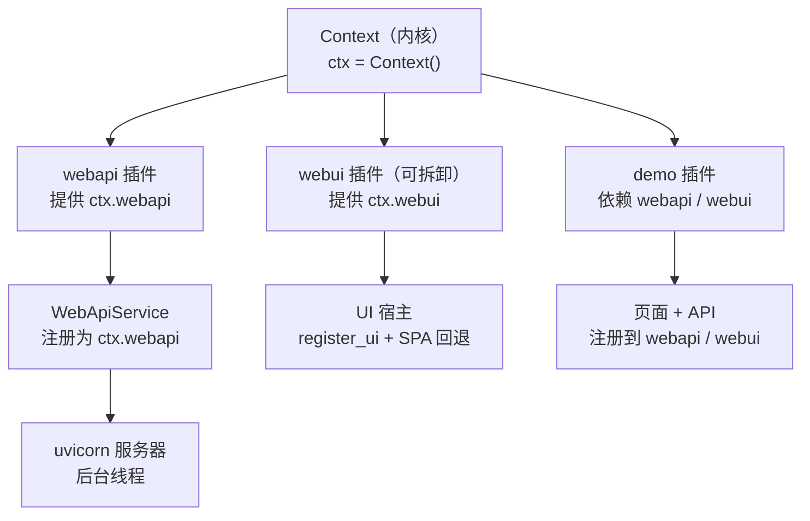
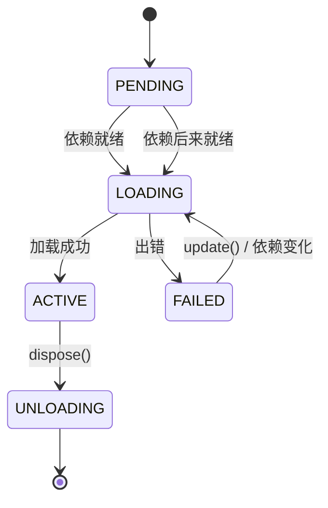
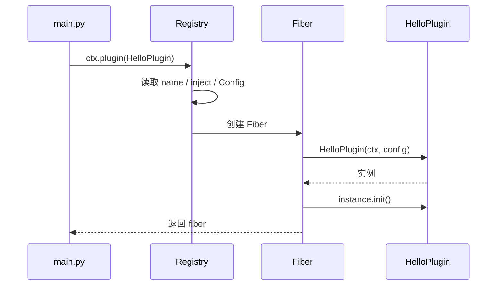
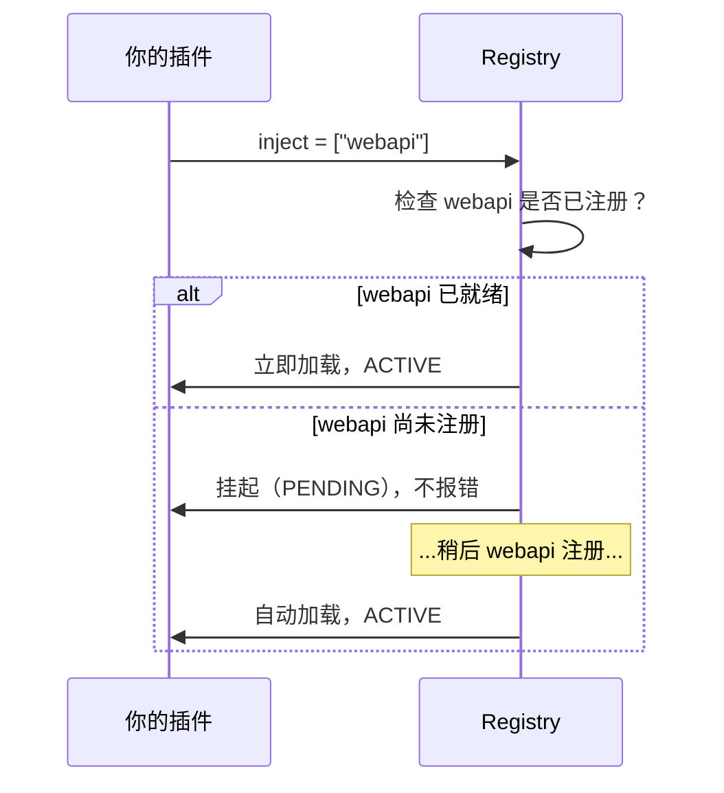
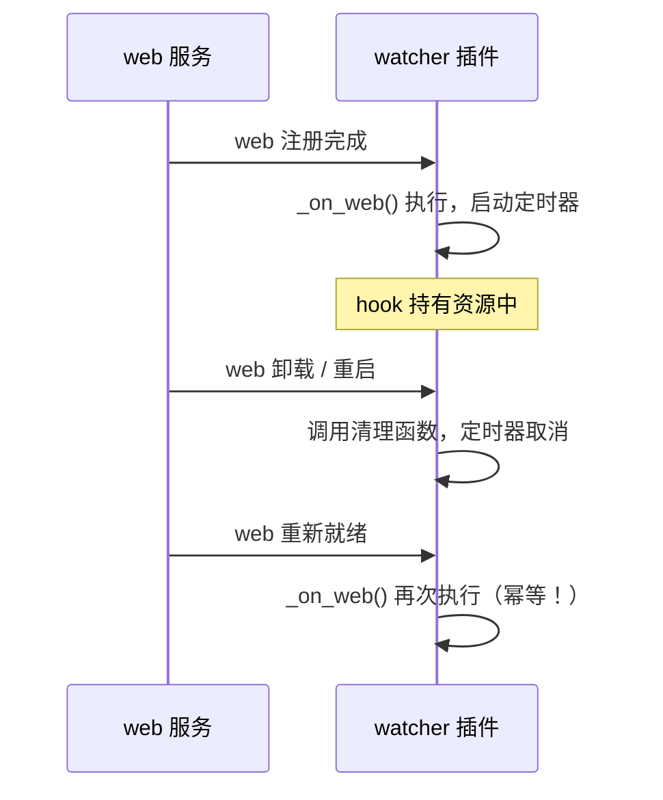

# AETP 开发文档

> 本文是 AETP 唯一的开发文档，分上下两篇：
>
> - **上篇：cordis 插件开发指南** —— 从零学会用 `cordis_port` 写插件（服务、依赖注入、事件、自动清理）。
> - **下篇：Web 与插件 UI** —— `common/plugins/webapi`（API）与 `master/webui`（UI 宿主）两个插件的构建启动、插件包管理、`register_ui` 契约、命名插槽与 JS 扩展的用法与约定。
>
> 上篇所有代码都经过实机验证。凡是「实测发现」的坑点，都用 **⚠️** 标出。

---

## 目录

**上篇：cordis 插件开发指南**

1. [cordis 是什么](#1-cordis-是什么)
2. [三个核心概念](#2-三个核心概念)
3. [第一个插件（5 分钟）](#3-第一个插件5-分钟)
4. [插件的三种写法](#4-插件的三种写法)
5. [插件的四件"声明式"配置](#5-插件的四件声明式配置)
6. [副作用与自动清理](#6-副作用与自动清理)
7. [服务：让插件互相调用](#7-服务让插件互相调用)
8. [依赖注入](#8-依赖注入)
9. [事件总线](#9-事件总线)
10. [配置与校验](#10-配置与校验)
11. [上下文继承与隔离](#11-上下文继承与隔离)
12. [实战：写一个完整插件](#12-实战写一个完整插件)
13. [cordis 惯用法：能用原生就用原生](#13-cordis-惯用法能用原生就用原生)
14. [常见坑点清单](#14-常见坑点清单)
15. [API 速查表](#15-api-速查表)

**下篇：Web 与插件 UI**

16. [启动与构建](#16-启动与构建)
17. [插件包与插件管理](#17-插件包与插件管理)
18. [业务 API 注册](#18-业务-api-注册)
19. [插件 UI 资源与 register_ui](#19-插件-ui-资源与-register_ui)
20. [独立 Vue 页面](#20-独立-vue-页面)
21. [Vue / HTML 命名插槽](#21-vue--html-命名插槽)
22. [JS Extension](#22-js-extension)
23. [清单与生命周期](#23-清单与生命周期)
24. [样式、依赖与安全约定](#24-样式依赖与安全约定)
25. [Web 配置](#25-web-配置)
26. [节点入口与从节点](#26-节点入口与从节点)
27. [应用配置（config.ini）](#27-应用配置configini)
28. [心跳插件（主从通信）](#28-心跳插件主从通信)
29. [数据库服务（db）](#29-数据库服务db)
30. [待办（路线图）](#30-待办路线图)

---

# 上篇：cordis 插件开发指南

面向 Python 初学者。读完后你能独立写出一个带服务、带网页、能自动清理的插件。

---

## 1. cordis 是什么

一句话：**cordis 是一个「插件拼装」框架** —— 你把功能拆成一个个小插件，它负责按依赖关系组装、启动、并在不需要时干净地拆掉。

它解决的问题：

| 没有框架时 | 用 cordis |
|---|---|
| 各处 `import` 直接调用，模块耦合死 | 插件通过 `ctx` 拿到服务，不直接 import |
| 关服务要手动记住每个资源怎么释放 | 资源登记为 effect，插件卸载自动全部释放 |
| A 依赖 B，B 没就绪就崩 | 声明 `inject`，框架自动等 B 就绪再加载 A |
| 想加个功能要改核心代码 | 写个插件 `ctx.plugin(MyPlugin)` 即可 |

本项目的 cordis 实现是 `cordis_port` 包（已安装）。

### 一个最小全景图



插件之间**不互相 import**，只通过 `ctx` 交换服务。

---

## 2. 三个核心概念

### 2.1 Context（`ctx`）—— 万能门面

`ctx` 是你唯一需要持有的对象。通过它你能：

```python
ctx.logger.info("日志")        # 打日志
ctx.on("事件名", 处理函数)      # 监听事件
ctx.emit("事件名", 数据)        # 触发事件
ctx.plugin(OtherPlugin)        # 加载子插件
ctx.foo                        # 访问名为 foo 的服务
ctx.fiber                      # 当前插件的生命周期句柄
```

一句话：**`ctx` 是插件的"遥控器"**，所有能力都从它取。

### 2.2 Fiber —— 插件的生命周期句柄

每次 `ctx.plugin(P)` 都会创建一个 Fiber（可以理解为"这次加载的实例记录"）。

```python
fiber = await ctx.plugin(MyPlugin)

fiber.name        # 'my-plugin'
fiber.state       # FiberState.ACTIVE
fiber.config      # 校验后的配置
await fiber.dispose()      # 卸载：自动清理该插件的所有 effect
await fiber.restart()      # 重启：先卸载再加载
await fiber.update({...})  # 改配置并重载
```

Fiber 的状态机：



**⚠️ 关键点**：`PENDING` 表示"在等依赖"，不是错误。插件依赖的服务还没注册时，它会安静地等待，等到了自动加载（实测通过）。

### 2.3 Effect —— 会自动清理的副作用

只要你通过 `ctx.effect(...)` 或 `ctx.fiber.effect(...)` 创建资源，卸载时框架会自动替你清理：

```python
def apply(self, ctx, config):
    ctx.effect(lambda: (start_timer(), stop_timer)[1], "我的定时器")
    #                 ↑ 现在做什么          ↑ 卸载时做什么
```

这是 cordis 最实用的功能 —— **你不需要记住清理什么**。

---

## 3. 第一个插件（5 分钟）

### 3.1 创建文件

新建 `master_plugins/hello/plugin.py`：

```python
"""我的第一个插件。"""

from typing import Any


class HelloPlugin:
    # 插件名：会出现在日志、fiber.name、路由归属里
    name = "hello"

    def __init__(self, ctx: Any, config: Any = None) -> None:
        """构造：cordis 会传入 ctx 和校验后的 config。

        这里适合放「注册类」动作：注册服务、注册路由、注册事件监听。
        """
        self.ctx = ctx
        self.ctx.logger.info("Hello 插件加载了！")

    def init(self) -> None:
        """可选。cordis 在 __init__ 之后自动调用。"""
        self.ctx.logger.info("Hello 插件初始化完成")
```

再建 `master_plugins/hello/__init__.py`：

```python
from .plugin import HelloPlugin

__all__ = ["HelloPlugin"]
```

### 3.2 挂载它

在 `master/main.py` 里：

```python
from master_plugins.hello import HelloPlugin

await ctx.plugin(HelloPlugin)
```

运行 `python master/main.py`，你会看到日志输出。

### 3.3 拆解发生了什么



1. Registry 读取插件类的 `name`、`inject`、`Config`（这就是为什么它们写在类上）
2. 创建 Fiber，并 `extend()` 出一个属于本插件的子 `ctx`
3. 实例化插件类，传入 `ctx` 和配置
4. 调用 `init()`（如果定义了）
5. 返回 fiber

---

## 4. 插件的三种写法

三种都支持，按需要选。

### 4.1 类式（推荐）

```python
class MyPlugin:
    name = "my"

    def __init__(self, ctx, config):
        self.ctx = ctx

    def init(self):
        ...
```

**适合**：有状态、要注册多项内容、需要 `name` / `Config` 等元信息。

### 4.2 函数式（最简单）

```python
def my_plugin(ctx, config):
    ctx.logger.info("加载了")
    return lambda: ctx.logger.info("卸载了")   # 返回值即清理函数
```

`fiber.name` 会自动取函数名 `my_plugin`。

**适合**：一次性小功能、临时脚本。

### 4.3 带 `apply` 的对象

```python
class MyPlugin:
    name = "my"

    def apply(self, ctx, config):
        ...
```

**适合**：需要构造参数但不想用类式时。

### 4.4 字典形式

```python
await ctx.plugin({"name": "my", "apply": my_function, "inject": ["webapi"]})
```

**适合**：动态组装、配置驱动加载。

### 4.5 对比

| 写法 | `name` 来源 | 能用 `init()` | 能用 `Config` | 推荐度 |
|---|---|---|---|---|
| 类 | 类属性 `name` | ✅ | ✅ | ⭐⭐⭐ |
| 函数 | 函数名 | ❌ | ❌ | ⭐⭐ |
| 带 apply 的对象 | 对象 `name` | ❌ | ✅ | ⭐⭐ |
| 字典 | `"name"` 键 | ❌ | `"Config"` 键 | ⭐ |

---

## 5. 插件的四件"声明式"配置

这四样都写在**类上**，cordis 会去读它们。**注意：它们不需要你在代码里手动使用**，是给框架看的元数据。

### 5.1 `name` —— 插件名

```python
class MyPlugin:
    name = "my-plugin"
```

它会出现在：

- `fiber.name`
- 日志输出
- **web 路由的 `owner` 字段**（排查"这条路由谁注册的"）

**⚠️ 实测提醒**：`name` 不能和别的插件重复，否则日志里分不清谁是谁。

### 5.2 `inject` —— 依赖声明

```python
class MyPlugin:
    inject = ["webapi"]                       # 只要服务名
    inject = {"webapi": {"port": 9000}}       # 带配置
```

效果：**web 服务没就绪，本插件就不会加载**。

**⚠️ 实测提醒**：`inject` 里的服务没出现时，fiber 停在 `PENDING` 且**不报错**。如果你发现插件"没反应"，先检查 `fiber.state`。

### 5.3 `Config` —— 配置模型

```python
class MyPlugin:
    Config = MyConfig     # 一个带 validate() 的类
```

框架会用 `Config.validate(传入的配置)` 校验并转换，然后才传给 `__init__`。

**⚠️ 实测提醒**：`Config` 必须是**标准 Schema**（有 `validate` 方法），不能是 `dataclass` 或普通类。写成 `None` 表示不校验。详见[第 10 节](#10-配置与校验)。

### 5.4 `provide` —— 声明本插件提供的服务

```python
class MyPlugin(Service):
    provide = "myservice"
```

见[第 7 节](#7-服务让插件互相调用)。

---

## 6. 副作用与自动清理

这是 cordis 最有价值的部分，值得单独一章。

### 6.1 为什么需要它

传统写法：

```python
def start():
    timer = start_timer()
    conn = connect_db()
    # ... 100 行后 ...
    # 忘记关 timer 和 conn → 资源泄漏
```

cordis 写法：

```python
def apply(ctx, config):
    ctx.effect(lambda: (start_timer(), stop_timer)[1], "定时器")
    ctx.effect(lambda: (connect_db(), disconnect_db)[1], "数据库连接")
    # 不用管清理，卸载时自动全部执行
```

### 6.2 三种登记方式

```python
# 方式一：ctx.effect(execute, label)
#        ⚠️ execute 是「立即执行」的，它的**返回值**才是清理函数
ctx.effect(lambda: (setup(), teardown)[1], "标签")
#                    ↑ 立即执行       ↑ 卸载时执行

# 方式二：显式用 fiber（等价，只是强调归属）
ctx.fiber.effect(lambda: (setup(), teardown)[1], "标签")

# 方式三：返回值直接当清理函数（最简，推荐）
def my_plugin(ctx, config):
    setup()
    return teardown          # apply 的返回值

class MyPlugin:
    name = "my"
    def __init__(self, ctx, config):
        self.ctx = ctx
        setup()
    def init(self):
        return teardown      # init 的返回值（实测同样有效）
```

⚠️ **别把清理逻辑直接写进 `execute`**：

```python
ctx.effect(lambda: stop_timer(), "定时器")     # ❌ 加载时就停了
ctx.effect(lambda: (start(), stop)[1], "定时器")   # ✅
```

详见 [13.3 节](#133-副作用的三种写法实测对比)。

### 6.3 返回值的四种形态

| 你返回什么 | 框架怎么做 |
|---|---|
| 一个函数 | 卸载时调用它 |
| `None` | 不清理 |
| `[清理1, 清理2]` | 卸载时**逆序**全部调用（实测确认是逆序） |
| `async def` 清理函数 | 卸载时 `await` 它 |

```python
# 异步清理示例
def apply(ctx, config):
    async def cleanup():
        await asyncio.sleep(0.1)
        print("异步清理完成")
    return cleanup
```

### 6.4 清理顺序

**后注册的先清理**（LIFO）。这符合直觉：后建的资源先拆。

```python
ctx.effect(lambda: (print("建 A"), lambda: print("拆 A"))[1])
ctx.effect(lambda: (print("建 B"), lambda: print("拆 B"))[1])
# 卸载时输出：拆 B → 拆 A
```

### 6.5 监听器也是 effect

```python
dispose = ctx.on("事件", handler)   # 返回注销函数
dispose()                            # 手动注销
# 或者啥也不做 —— 插件卸载时它自动注销
```

`ctx.on()` 内部已经把监听器登记进 fiber 了，**你不需要手动 `off`**。

---

## 7. 服务：让插件互相调用

### 7.1 什么是服务

服务 = **一个可以被其他插件通过 `ctx.名字` 拿到的对象**。

```python
class GreeterService(Service):
    provide = "greeter"      # 其他插件用 ctx.greeter 访问

    def __init__(self, ctx, config=None):
        super().__init__(ctx)      # 必须：这一步完成注册
        self.count = 0

    def hello(self, who="world"):
        self.count += 1
        return f"你好 {who}（第 {self.count} 次）"
```

提供它：

```python
class GreeterPlugin:
    name = "greeter-plugin"

    def __init__(self, ctx, config):
        GreeterService(ctx, config)     # 构造即注册
```

使用它：

```python
class UserPlugin:
    name = "user"
    inject = ["greeter"]

    def __init__(self, ctx, config):
        print(ctx.greeter.hello())      # 直接用
```

### 7.2 两条铁律

**铁律一：`Service.__init__` 必须最先调用 `super().__init__(ctx)`**

```python
def __init__(self, ctx, config):
    super().__init__(ctx)        # ← 先注册
    self.data = load_data()      # ← 再做自己的初始化
```

原因：`super().__init__` 内部会调用 `ctx.reflect.provide()` 完成注册。如果你先访问 `ctx.xxx` 之类可能触发依赖解析，顺序会乱。

**铁律二：服务名全局唯一**

同名重复注册会抛错：

```
RuntimeError: service "web" has been registered at <web>
```

### 7.3 服务方法里拿到的是"调用方 ctx"

这是 cordis 一个精妙设计，**理解它才能写出正确的服务**：

```python
class MyService(Service):
    provide = "myservice"

    def whoami(self):
        return self.ctx.fiber.name      # ← 返回的是「调用方」的名字！
```

实测验证：

```python
# consumer 插件里
ctx.myservice.whoami()      # 返回 'consumer'，不是 'myservice'
```

**为什么这样设计**：服务需要知道"谁在调用我"，才能做权限判断、按调用方区分数据、把资源绑定到调用方生命周期。

**如何拿到服务自己的 ctx**：用 `self.provided_ctx`（本项目的 `UvicornWebApiService` 提供了这个属性）。

🤯 **对本项目的影响**：webapi 的路由注册、webui 的 `register_ui` 就是靠这个机制知道"是谁在注册"，才能让注册项随插件卸载。详见下篇[第 19 节](#19-插件-ui-资源与-register_ui)。

### 7.4 取服务时的三个注意点

⚠️ `ctx.myservice` 拿到的是**代理对象**，不是原始实例：

| 注意点 | 说明 |
|---|---|
| **别用 `is` 比较** | `ctx.myservice is ctx.myservice` 是 `False`（每次访问都新建代理） |
| **别序列化代理** | `json.dumps(svc)` / `pickle.dumps(svc)` 都会失败 |
| **要真引用就自己存** | `svc.original` 可取真实实例；或服务构造时注册自己 |

服务方法内的 `self` 同样是代理。代理的完整行为（可用/不可用操作、取 `original`、判类型写法）
见 [15.4 速查表](#154-服务代理self--ctx服务名) 和 [坑 14](#-坑-14服务方法里的-self-是代理对象)。

### 7.5 服务的可用性检查

有时服务"注册了但还不能用"（比如数据库还没连上）：

```python
class DbService(Service):
    provide = "db"

    def __init__(self, ctx, config):
        super().__init__(ctx)
        self.connected = False

    def __check__(self):
        return self.connected      # False 时，依赖方不会加载
```

把 `connected` 置为 `True` 后，依赖方会自动加载。

### 7.6 服务不能被随意覆盖

```python
ctx.webapi = something_else
# AttributeError: cannot set property "webapi" in multiple fibers
```

只有**提供该服务的 fiber** 能修改它。这是防止插件互相踩踏的保护。

---

## 8. 依赖注入

### 8.1 三种声明方式

```python
# 方式一：类属性列表（最常用，推荐）
class P:
    inject = ["web", "db"]

# 方式二：字典（带配置）
class P:
    inject = {"web": {"port": 9000}}

# 方式三：@Inject 装饰器（类上 / 方法上，见 8.3）
@Inject("web")
class P: ...
```

#### 三者混用 / 继承的实测矩阵

`inject` 的合并规则**不是**「无条件叠加」，用错会**静默丢依赖**。完整矩阵（实测确认，`P`=父类声明的依赖，`C`=子类声明的依赖）：

| 父类声明 | 子类写法 | 最终依赖 | 父依赖 |
|---|---|---|---|
| list / dict / `@Inject` | `@Inject(C)`，本类不写 `inject` | `C, P` | ✅ 保留 |
| list / dict / `@Inject` | 不写装饰器，只继承 | `P` | ✅ 保留 |
| list / dict / `@Inject` | `@Inject(C)` + 本类 `inject = [C]` | `C` | ❌ **丢失** |
| list / dict / `@Inject` | `@Inject(C)` + 本类 `inject = {C: None}` | `C` | ❌ **丢失** |

```python
class Base:
    inject = ["other"]

# ✅ 保留父类：本类不写 inject
@Inject("hello")
class Ok(Base):
    pass
# 结果：hello + other

# ✅ 保留父类：不写装饰器
class Ok2(Base):
    inject = ["other", "hello"]

# ❌ 丢父类：本类 inject + 装饰器 同时写
@Inject("hello")
class Bad(Base):
    inject = ["more"]
# 结果：hello + more —— 父类的 other 没了（不报错！）
```

**避坑铁律**：同一个类里，`inject = ...` 和 `@Inject` **只用一个**。

三层继承（列表 → 字典 → 装饰器）实测正常：`{'a': None, 'b': None, 'c': None}` —— 因为每一层都没有「同时写」的情况。

### 8.2 加载时序



实测确认：先加载消费方、后加载 web，消费方会从 `PENDING` 自动变为 `ACTIVE`。

### 8.3 `@Inject` 装饰器

`@Inject` 把「声明依赖」和「依赖就绪后做事」合成一步。被它装饰的**方法**在本文称为
**hook（钩子）** —— 即「依赖就绪时框架自动调用、依赖失效时自动清理」的回调方法；
它不是 Python 语法特性，而是 cordis 的回调约定。后文 8.3.2–8.3.5、13.2 和坑清单里说的
hook 都指它。两个分支能力不同：

| 分支 | 作用 | 推荐度 |
|---|---|---|
| 装饰**类** | 等价于写 `inject = {...}` | ⭐⭐⭐ |
| 装饰**方法** | 依赖就绪时自动调用该方法；返回值作为清理函数 | ⭐⭐⭐ |

#### 8.3.1 装饰在类上

```python
@Inject("webui")
class MyPlugin:
    def __init__(self, ctx, config):
        ctx.webui.register_ui(
            "mine",
            kind="page",
            format="vue",
            resource_root=config["resource_root"],
            entry="Mine.vue",
            path="/mine",
            title="我的页面",
        )
```

效果等同 `inject = ["webui"]`。可与列表式 `inject` 混用、可被继承，但 ⚠️ **有丢依赖的坑** ——
混用/继承的完整实测矩阵和示例见 [8.1 节](#三者混用--继承的实测矩阵)。避坑铁律：
**同一个类里 `inject = ...` 和 `@Inject` 只用一个**；要叠加依赖，就把全部依赖在一个 `inject = [...]` 里写全。

#### 8.3.2 装饰在方法上（推荐用 Service 子类）

```python
class MyService(Service):
    provide = "mine"
    name = "mine"            # ← 必须是插件类（见下方限制）
    inject = ["webapi"]

    def __init__(self, ctx, config=None):
        super().__init__(ctx)
        self.ctx = ctx        # ← 必须自己保存

    @Inject("webapi")
    def _on_web_ready(self):  # ← 只写 self，不能有 ctx 参数
        print(self.ctx.webapi.address())
```

**三条硬性要求**（违反会报错，实测确认）：

| 要求 | 违反后果 |
|---|---|
| 签名写 `(self)`，不能写 `(self, ctx)` | `TypeError: missing 1 required positional argument: 'ctx'` |
| 必须自己保存 `self.ctx = ctx` | `AttributeError: '<类名>' object has no attribute 'ctx'` |
| **该类必须作为插件加载**（`ctx.plugin(SvcClass)`） | hook 静默不执行（见 8.3.4） |

⚠️ hook 内的 `self` 也是**代理对象** —— `isinstance()` / `self.__class__` / `self.__dict__` 可用，
但 `type(self)`、`self is 原实例`、`json.dumps(self)` 不可用。写法建议见
[坑 14](#-坑-14服务方法里的-self-是代理对象)。

#### 8.3.3 返回值就是清理函数（很实用）

方法里拿到资源后，把清理逻辑返回即可 —— 依赖失效时自动执行（实测确认）：

```python
class ResourceHolder(Service):
    provide = "holder"
    name = "holder"
    inject = ["webapi"]

    def __init__(self, ctx, config=None):
        super().__init__(ctx)
        self.conn = None

    @Inject("webapi")
    def _open(self):
        self.conn = connect()          # 依赖就绪 -> 开资源
        return lambda: self.conn.close()   # 依赖消失 -> 关资源
```

返回值的形态和 [6.3 节](#63-返回值的四种形态) 的四种形态一致：函数（依赖失效/卸载时调用）、`None`（不清理）、`[fn1, fn2]`（**逆序**全部调用）、`async def`（会被 `await`）。

⚠️ **注意时机**：清理发生在**依赖失效或插件卸载**时，不是「方法执行完」时。
实测：依赖重启 → 先 `teardown` 再 `setup`，顺序正确。

#### 8.3.4 关键限制：Service 被手动构造时 hook 不执行

实测 5 种场景的完整边界：

| 场景 | hook 是否执行 |
|---|---|
| `ctx.plugin(SvcClass)` —— Service 类自己作插件 | ✅ |
| 普通插件类（继承 `object`） | ✅ |
| Service 继承链上的父子 `@Inject` | ✅ 都执行 |
| **在别的插件里 `SvcClass(ctx, config)`** | ❌ **静默不执行** |

最后一行是「一个插件类 + 一个服务类」这种分层写法的常见形态。

**两种解法**（推荐第一种）：

```python
# ✅ 解法一：让 Service 自己就是插件（能用 cordis 就用 cordis）
#    完整写法见 [13.1 节]，有 name 就能被 ctx.plugin 加载
await ctx.plugin(MyService)
```

```python
# ✅ 解法二：不用 @Inject 方法，在 __init__ 里直接做事
#    （inject 已保证依赖就绪，没必要再挂 hook）
class MyPlugin:
    name = "mine"
    inject = ["webapi", "webui"]

    def __init__(self, ctx, config):
        self.ctx = ctx
        ctx.webui.register_ui(...)  # 直接注册插件 Vue UI
```

#### 8.3.5 hook 的执行特征（容易踩）

| 特征 | 说明 |
|---|---|
| **是持续监听，不是一次性初始化** | 依赖每次重新就绪都会再调一次；有副作用的逻辑要幂等 |
| **异步加载** | 相对父插件有个延迟；需要等待可 `await asyncio.sleep(0)` |
| **出错落在内部 fiber** | 宿主 fiber 仍是 `ACTIVE`，需单独检查内部 fiber |
| **内部 fiber 名可辨识** | 形如 `ctx.inject(web)@holder._open`，便于定位 |

排查 hook 错误的方法：

```python
for runtime in ctx.registry.values():
    for fiber in runtime.fibers:
        if fiber._error:
            print(runtime.name, "->", fiber._error)
```

### 8.4 依赖变化时自动重载

依赖的服务被卸载时，依赖它的插件会自动卸载；服务重新注册时又会自动加载。这是 cordis 保证一致性的机制。

🤯 **实测现象**：重启 web 插件后，之前注册了路由的 demo 插件会**被自动重新加载**（`__init__` 会再次执行），路由自动恢复 —— 你不需要手写恢复逻辑。

这也是为什么 `@Inject` 方法必须幂等：**它跟插件重载是同一套机制**。

---

## 9. 事件总线

### 9.1 五种派发模式

| 方法 | 行为 | 用在哪 |
|---|---|---|
| `emit(name, *args)` | 依次调用所有监听器，忽略返回值 | 通知类（"X 发生了"） |
| `serial(name, *args)` | 依次调用，**遇到非空返回值就停** | 找第一个能处理的插件 |
| `bail(name, *args)` | 同 serial，但全程同步 | 需要同步结果的场合 |
| `parallel(name, *args)` | 并发调用所有监听器 | 互不依赖的多个响应 |
| `waterfall(name, *args)` | 链式，每个监听器拿到 `next` 回调 | 环绕式拦截（中间件风格） |

### 9.2 基本用法

```python
def apply(ctx, config):
    ctx.on("data/updated", lambda record: print("收到", record))
    ctx.on("data/updated", lambda record: print("我也收到", record))

ctx.emit("data/updated", {"id": 1})
# 输出：收到 {'id': 1}
#       我也收到 {'id': 1}
```

### 9.3 `serial`：找第一个能处理的

```python
ctx.on("get/name", lambda: None)        # 空返回 = "我不处理"
ctx.on("get/name", lambda: "我是名字")   # 非空返回 = "我处理"
ctx.on("get/name", lambda: print("不会执行"))

result = await ctx.serial("get/name")
# result == "我是名字"
```

**⚠️ 判定规则**：`None` 和 `False` 算"未处理"，其余（含 `0`、`""`）都算"命中"。

### 9.4 `prepend`：插队

第三参数是**选项位**（`True` 等价 `{"prepend": True}`，也支持 `{"global": True}` 等，
见 [11.4 节](#114-让监听器无视隔离)）。`prepend=True` 把监听器**插到该事件列表的最前面** ——
后注册但先执行；除此之外与 [9.2 节](#92-基本用法) 的普通注册完全相同（同一事件、同一回调、自动注销）。

```python
ctx.on("e", lambda: print("A：先注册"))
ctx.on("e", lambda: print("B：第二个注册"))
ctx.on("e", lambda: print("C：最后注册，但插队"), True)   # prepend

ctx.emit("e")
# 输出：C：最后注册，但插队 → A：先注册 → B：第二个注册   （实测确认）
```

实现：每个事件名维护一个监听器列表，普通注册 `append` 到尾部，`prepend` 则
`insert(0, ...)` 插到头部；派发时按列表顺序调用。适合「想抢在其他监听器之前执行」
的场合（拦截、优先改写数据）。

⚠️ **两个常见疑问**：

- **能指定位置或按权重排序吗？** 不能 —— 选项里只有 `prepend` / `global` 两个开关，
  没有 priority/weight。需要权重语义时自建分发器（自己维护 `(weight, fn)` 列表、
  排序后调用，不走 `ctx.on`），或者改用 `serial`（见 [9.3 节](#93-serial找第一个能处理的)）
  让「谁能处理」说了算。
- **所有监听器都 `prepend=True` 会互相抵消吗？** 不会抵消，但会退化成**注册顺序的逆序**
  （每来一个都插头部，最终后注册者先执行，实测 `C → B → A`）。想确定顺序，最可靠的
  办法是控制插件加载顺序（`ctx.plugin()` 的先后就是普通注册的执行先后），
  不要靠 prepend 竞争 —— 插件动态启停时执行顺序会变得不可控。

### 9.5 `once`：只执行一次

```python
ctx.once("app/ready", lambda: print("只打印一次"))
```

### 9.6 注销

```python
dispose = ctx.on("e", handler)
dispose()          # 手动注销
# 也可以不管：插件卸载时自动注销
```

### 9.7 命名建议

用 `命名空间/动作` 格式，避免撞名：

```python
"report/done"        # 报告生成完成
"web/nav-groups"     # 导航分组过滤
"data/updated"       # 数据更新
"internal/plugin"    # 框架内部事件（不要用这个前缀）
```

**⚠️ 不要用 `internal/` 前缀**，那是框架保留的。

---

## 10. 配置与校验

### 10.1 为什么需要 Config

没有校验时：

```ini
[web]
port = abc
```

配置错误要到真正用到时才暴露，报错难懂。有校验时（`WebApiPlugin` 启动前就拦下）：

```
ValueError: [web] 节配置无效：监听端口 需要 int
```

一眼看出问题在哪。用 `ctx.plugin(P, {...})` 传配置字典的插件则由 cordis 的
`Config` Schema 校验（见 10.2），失败抛 `ValidationError`。

### 10.2 写一个 Config：继承 `FieldConfig`（推荐）

`Config` 必须是**标准 Schema**：提供 `validate(value)` 方法，返回 `{"value": ...}` 或 `{"issues": [...]}`。
项目里手写的 `__init__` / `validate` / `merge` / `from_ini` 样板已收敛到
`common/config_base.py` 的 `FieldConfig` 基类，配置类只声明**字段表**与专属校验：

```python
from common.config_base import FieldConfig, Issue


class MyConfig(FieldConfig):
    """插件配置。类属性即默认值，实例上会被 __init__ 覆盖。"""

    # 字段表：字段名 -> (类型元组, 说明)。驱动默认值、类型校验与 ini 序列化
    _FIELDS: ClassVar[dict[str, tuple[tuple[type[object], ...], str]]] = {
        "port": ((int,), "监听端口"),
        "host": ((str,), "监听地址"),
    }
    # 对应 config.ini 的节名；声明后接入注入 / 写回钩子（见 10.5）
    ini_section: ClassVar[str | None] = "my"

    # 用普通标注写默认值（**不要**写 ClassVar）
    port: int = 8080
    host: str = "127.0.0.1"

    def _validate_extra(self) -> list[Issue]:
        """专属校验（取值范围、必填项、归一化）；无约束可不写。"""
        issues: list[Issue] = []
        if not (0 < self.port < 65536):
            issues.append({"message": f"端口需在 1~65535，收到 {self.port}", "path": ["port"]})
        return issues
```

基类直接提供：

| 能力 | 入口 | 说明 |
|---|---|---|
| 默认值填充 | `MyConfig(**values)` | 未给的键取类属性默认值 |
| Schema 校验 | `MyConfig.validate(value)` | 未知键报「未知配置项」，类型问题报「说明 需要 类型」；`bool` 不会当 `int` 放行 |
| ini → 实例 | `MyConfig.from_ini(节值)` | 字符串按字段类型收敛，失败抛 `ValueError` |
| 实例 / 字典 → ini | `MyConfig.to_ini(value)` | 只序列化**实际给出**的键（部分更新 = 部分写回）；非法输入（非实例 / 非 Mapping）抛 `TypeError` |
| 层合并 | `MyConfig.merge(*layers)` | 前者为底、后者覆盖（供拦截层配置使用） |

不继承基类也可以：自己写标准 Schema（下例），但字段多时样板很啰味：

```python
class MyConfig:
    """手写标准 Schema（最小形态）。"""

    def __init__(self, **values):
        for name in ("port", "host"):
            setattr(self, name, values.get(name, getattr(type(self), name)))

    @classmethod
    def validate(cls, value):
        """标准 Schema 的入口。"""
        if value is None:
            return {"value": cls()}
        if not isinstance(value, dict):
            return {"issues": [{"message": "配置必须是字典", "path": []}]}
        issues = []
        if "port" in value and not isinstance(value["port"], int):
            issues.append({"message": "端口需要 int", "path": ["port"]})
        if issues:
            return {"issues": issues}       # ← 返回 issues 表示失败
        return {"value": cls(**value)}      # ← 返回 value 表示成功
```

完整示例见 `common/plugins/webapi/config.py`。

### 10.3 `merge`：多层配置合并

如果 Config 定义了 `merge` 类方法，cordis 在解析配置层时会用它；
`FieldConfig` 已内置，手写 Schema 时按「前者为底、后者覆盖」实现即可：

```python
@classmethod
def merge(cls, *configs):
    """按「前者为底、后者覆盖」合并。"""
    merged = {}
    for config in configs:
        if isinstance(config, cls):
            merged.update(config.to_dict())
        elif isinstance(config, dict):
            merged.update(config)
    return cls(**merged)
```

### 10.4 在插件里读配置

```python
class MyPlugin:
    Config = MyConfig

    def __init__(self, ctx, config):
        # config 已经被校验并转换成了 MyConfig 实例
        self.ctx = ctx
        self.config = config if isinstance(config, MyConfig) else MyConfig()
```

**⚠️ 实测提醒**：`config` 只在 `__init__` 里是参数，`init()` 里访问不到。要存成 `self.config`。

而且**必须存** —— 不存的话，方法内的 `self.config` 会回退到 cordis 的协议符号
`Symbol.for('cordis.config')`，读配置项时报 `AttributeError`。详见
[坑 15](#-坑-15不保存-selfconfig-时方法里读到的是一个-symbol)。

### 10.5 配置注入与写回（`ini_section` 接入 config.ini）

声明 `ini_section` 后，`appconfig` 会在两个配置生命周期钩子里自动接线，
插件类不需要再手写 `from_ini(ctx.appconfig.section(...))`：

* **`internal/config`（解析前注入默认值）**：每次加载 / `fiber.update()` 解析
  插件配置时，把 `config.ini` 对应节的值注入为**默认值层**。
  优先级：**显式传入 > ini 节值 > 类属性默认值**；改写发生在 Schema 校验之前，
  注入的值同样受类型校验保护。
* **`internal/commit`（提交时写回）**：`fiber.update(config)` 提交时把新配置经
  `to_ini` 序列化写回该节（`update(..., no_save=True)` 跳过）。
  只写**实际提交**的键：部分更新 = 部分写回。

```python
# 运行时改配置并持久化到 config.ini（UI 改配置的后端入口就是它）
await fiber.ctx.update({"port": 9090})        # → [web] port = 9090 写回
await fiber.ctx.update({"port": 9090}, no_save=True)  # 只改运行时，不落盘

# 不经 fiber 也能直接改配置节（外科手术式写回，注释与排版保留）
ctx.appconfig.update_section("web", {"port": "9090"})
# 或对 AppConfig 对象：
from common.plugins.appconfig import AppConfig, write_ini_values
config.update_section("web", {"port": "9090"})       # 内存 + 文件
write_ini_values(path, {"web": {"port": "9090"}})    # 只写文件
```

写回是**外科手术式行编辑**：已有键就地替换、新键插到节尾、节不存在则在
文件尾追加；其余行（注释、排版、其它节）一字不动 —— 手工维护的注释不会丢。
写入走「临时文件 + 原子替换」（写一半崩溃不会损坏 `config.ini`）；带 BOM 的
文件读入时剥 BOM，避免 BOM 挡住首行节头匹配导致重复追加节。
未声明 `ini_section` 的插件（如 `plugin.json` 的 `config` 驱动的插件）不会被
注入或写回，配置原样透传。

管理入口：`PATCH /api/plugins/{id}/config`（请求体 = 要改的键值对象）即前端
改配置的 HTTP 通道，`ctx.plugins.update_config(id, config)` 为其服务形态
（见 17 节）；内置插件拒绝（403）。

---

## 11. 上下文继承与隔离

这两块属于进阶内容，初学可以先跳过。

### 11.1 子上下文（extend）

```python
child = ctx.extend({"my_data": 123})
child.my_data        # 123
child.logger         # 父级服务照样能用（沿链上溯）
```

子上下文能看到父级的一切，反过来不行。

### 11.2 isolate：让服务"多实例"

```python
a = ctx.isolate("db")
b = ctx.isolate("db")

# a.db 和 b.db 是不同实例，互不干扰
```

**用途**：同一插件为不同租户/模块提供独立实例。

### 11.3 事件也会被隔离

```python
ctx.on("msg", handler)                    # 根上下文监听
isolated_ctx.on("msg", handler2)          # 隔离分支监听

ctx.emit("msg", 1)          # 只有 handler 被调用
isolated_ctx.emit("msg", 1) # 只有 handler2 被调用
```

**⚠️ 实测确认**：隔离分支的监听器不会被根上下文的 `emit` 触发，这是刻意的隔离设计。

### 11.4 让监听器无视隔离

```python
ctx.on("msg", handler, {"global": True})   # global 监听器任何上下文 emit 都会触发
```

---

## 12. 实战：写一个完整插件

目标：一个带服务、带页面、带 API、带清理的插件。

### 12.1 目录结构

```
master_plugins/todo/
├── __init__.py
└── plugin.py
```

### 12.2 完整代码

> 本例采用 [13.1 节](#131-service-直接当插件--最省事的分层方式)推荐的惯用法：
> **Service 类自己就是插件**（`provide` + `name` + `inject` + `Config` 全写在类上）。

```python
"""待办事项插件：演示完整插件写法。"""

from __future__ import annotations

from pathlib import Path
from typing import Any

from cordis_port import Context, Service


class TodoConfig:
    """插件配置（标准 Schema）。"""

    max_items = 100
    brand = "待办"

    def __init__(self, **values: Any) -> None:
        self.max_items = values.get("max_items", type(self).max_items)
        self.brand = values.get("brand", type(self).brand)

    @classmethod
    def validate(cls, value: Any) -> dict[str, Any]:
        if value is None:
            return {"value": cls()}
        if not isinstance(value, dict):
            return {"issues": [{"message": "配置必须是字典", "path": []}]}

        issues = []
        if "max_items" in value:
            raw = value["max_items"]
            if isinstance(raw, bool) or not isinstance(raw, int):
                issues.append({"message": "max_items 需要 int", "path": ["max_items"]})
        if issues:
            return {"issues": issues}
        return {"value": cls(**value)}

    @classmethod
    def merge(cls, *configs: Any) -> "TodoConfig":
        merged: dict[str, Any] = {}
        for config in configs:
            if isinstance(config, cls):
                merged.update({n: getattr(config, n) for n in ("max_items", "brand")})
            elif isinstance(config, dict):
                merged.update(
                    {k: v for k, v in config.items() if k in ("max_items", "brand")}
                )
        return cls(**merged)


class TodoPlugin(Service):
    """待办插件本体。

    四个类属性把元信息全部声明好：

    * ``provide`` —— 对外提供服务名 ``ctx.todo``
    * ``name``    —— 插件名，**有它才能被 ``ctx.plugin()`` 加载**
    * ``inject``  —— 依赖 webapi / webui，保证 ``ctx.webapi``、``ctx.webui`` 可用
    * ``Config``  —— 配置模型，自动校验与合并
    """

    provide = "todo"
    name = "todo"
    inject = ["webapi", "webui"]
    Config = TodoConfig

    def __init__(self, ctx: Context, config: Any = None) -> None:
        # ⚠️ 必须最先调用，这一步完成服务注册
        super().__init__(ctx)
        self.ctx = ctx
        self.config = config if isinstance(config, TodoConfig) else TodoConfig()
        self._items: list[dict[str, Any]] = []
        self._next_id = 1

    def init(self) -> None:
        """依赖就绪后由 cordis 调用 —— 这里可以安全使用 ``ctx.webapi`` / ``ctx.webui``。"""
        self._register_routes()
        self.ctx.logger.info("待办插件已加载（最多 %s 条）", self.config.max_items)
        return self._cleanup          # ← 返回值即清理函数

    # -- 业务 API（其他插件通过 ctx.todo 调用）--------------------------------
    def add(self, text: str) -> dict[str, Any]:
        """添加一条待办。"""
        item = {"id": self._next_id, "text": text, "done": False}
        self._items.append(item)
        self._next_id += 1
        return item

    def list_all(self) -> list[dict[str, Any]]:
        """列出全部待办。"""
        return list(self._items)

    def toggle(self, item_id: int) -> bool:
        """切换完成状态；返回是否找到。"""
        for item in self._items:
            if item["id"] == item_id:
                item["done"] = not item["done"]
                return True
        return False

    def remove(self, item_id: int) -> bool:
        """删除一条待办。"""
        before = len(self._items)
        self._items = [i for i in self._items if i["id"] != item_id]
        return len(self._items) < before

    def _cleanup(self) -> None:
        """插件卸载时调用（此处仅为示例）。"""
        self.ctx.logger.debug("待办插件已清理")

    # -- 注册插件 Vue 页面 / API ----------------------------------------------
    def _register_routes(self) -> None:
        ctx = self.ctx

        # UI 页面由 Vue 编写；Python 插件只声明组件入口和菜单元数据。
        ctx.webui.register_ui(
            "todo-page",
            kind="page",
            format="vue",
            resource_root=Path(__file__).resolve().parent / "ui",
            entry="TodoPage.vue",
            path="/todo",
            title="待办事项",
            menu_group="工具",
            menu_icon="pi pi-fw pi-check-square",
            menu_order=50,
        )

        # API
        @ctx.webapi.get("/api/todo")
        def list_items(request: Any) -> list[dict[str, Any]]:
            """列出全部待办。"""
            return self.list_all()

        @ctx.webapi.post("/api/todo")
        async def add_item(request: Any) -> Any:
            """新增待办：请求体 {"text": "..."}"""
            try:
                payload = await request.json()
            except Exception:
                payload = {}
            text = str(payload.get("text", "")).strip()
            if not text:
                return ctx.webapi.json({"error": "text 不能为空"}, status_code=400)
            if len(self.list_all()) >= self.config.max_items:
                return ctx.webapi.json({"error": "已达上限"}, status_code=400)
            return self.add(text)

        @ctx.webapi.post("/api/todo/{item_id}/toggle")
        def toggle_item(request: Any, item_id: int) -> dict[str, Any]:
            """切换完成状态。"""
            return {"ok": self.toggle(item_id)}

        @ctx.webapi.delete("/api/todo/{item_id}")
        def delete_item(request: Any, item_id: int) -> dict[str, Any]:
            """删除待办。"""
            return {"ok": self.remove(item_id)}


__all__ = ["TodoConfig", "TodoPlugin"]
```

### 12.3 关键点回顾

| 位置 | 做了什么 | 为什么 |
|---|---|---|
| `provide = "todo"` | 声明服务 | 其他插件用 `ctx.todo` 调用 |
| `name = "todo"` | 声明插件名 | **`ctx.plugin()` 需要它**；日志 / 路由 owner 也用它 |
| `inject = ["webapi", "webui"]` | 声明依赖 | 保证 `ctx.webapi` / `ctx.webui` 可用；未就绪时本插件 PENDING |
| `Config = TodoConfig` | 声明配置模型 | 自动校验用户传的配置 |
| `super().__init__(ctx)` | 注册服务 | Service 的注册入口，必须最先调用 |
| `self.ctx = ctx` | 存上下文 | `init()` 里要用 |
| `self.config = ...` | 存配置 | `init()` 里访问不到构造参数 |
| `init()` 里注册路由 | 依赖已就绪 | 比 `__init__` 更安全；且便于读配置 |
| 返回 `self._cleanup` | 提供清理函数 | 卸载时自动调用 |
| `ctx.webui.register_ui(...)` | 注册 Vue 页面与导航元数据 | 卸载时自动移除 UI 清单和静态目录 |

**实测结果**（验证脚本）：8 项 HTTP 检查全通过、配置上限生效（第 4 条返回 400）、
卸载后清理函数执行、服务移除、端口释放。

### 12.4 挂载

```python
# master/main.py
from master_plugins.todo import TodoPlugin

await ctx.plugin(TodoPlugin, {"max_items": 50})
```

插件显式把自己的 `ui/` 目录传给 `register_ui`，其中包含 `TodoPage.vue`。访问
`http://127.0.0.1:8080/todo` 就能看到页面；Vue 组件通过 `/api/todo` 访问数据，
其他 Python 插件仍可用 `ctx.todo` 读写数据：

```python
class OtherPlugin:
    name = "other"
    inject = ["web", "todo"]        # ← 声明依赖 todo

    def __init__(self, ctx, config):
        self.ctx = ctx
        items = ctx.todo.list_all()  # 直接调用
```

### 12.5 验证清单

写完插件后，逐项检查：

- [ ] `python master/main.py` 能启动
- [ ] `fiber.state == FiberState.ACTIVE`（不是 `PENDING` —— 说明依赖满足）
- [ ] 访问 `/api/web/routes`，能看到自己的路由且 `owner` 正确
- [ ] 访问 `/api/web/ui`，能看到插件页面 contribution
- [ ] Vue 页面、菜单项和插槽能在 Sakai UI 中显示
- [ ] 传非法配置能被拦截并给出清晰报错
- [ ] 若提供服务：`ctx.reflect.has("服务名")` 为 `True`
- [ ] 卸载插件后 UI 清单和插件资源挂载消失，手动刷新后菜单和页面入口消失
- [ ] 卸载后清理函数确实被执行（加一行日志验证）

---

## 13. cordis 惯用法：能用原生就用原生

这一章把前面散落的写法收成「推荐姿势」。**凡是有原生做法，就不要自己造轮子。**

### 13.1 Service 直接当插件 —— 最省事的分层方式

很多项目的习惯是「一个插件类 + 一个服务类」，然后在插件里 `MyService(ctx, cfg)` 手动 new。
这个写法在 cordis 下**有一半能力是失效的**（见 [8.3.4](#834-关键限制service-被手动构造时-hook-不执行)）。

**cordis 惯用法：Service 类自己就是插件**，全套元信息都写在类上：

```python
class TodoService(Service):
    provide = "todo"          # 提供服务
    name = "todo"             # ← 关键：有 name 就能被 ctx.plugin 加载
    inject = ["webapi", "webui"]   # 声明依赖
    Config = TodoConfig       # 配置模型

    def __init__(self, ctx, config=None):
        super().__init__(ctx)         # ← 先注册服务
        self.ctx = ctx                # ← 再存 ctx（@Inject 方法需要）
        self.config = config or TodoConfig()
        self._items = []

    def init(self):                   # 依赖已就绪，这里可以直接用 ctx.webapi / ctx.webui
        self._register_routes()

# 加载：一行搞定
await ctx.plugin(TodoService, {"max_items": 50})
```

> 第 12 章的完整示例就是这个结构（类名叫 `TodoPlugin`，因为它同时承担插件与服务两个角色）。

对比手动 new 的写法：

| 能力 | Service 作插件 | 插件里手动 `new` |
|---|---|---|
| `provide` 注册服务 | ✅ | ✅ |
| `inject` 等待依赖 | ✅ | ❌ 需自己保证顺序 |
| `Config` 校验 | ✅ | ❌ |
| `@Inject` 方法 hook | ✅ | ❌ **静默不执行** |
| 依赖失效自动重载 | ✅ | ❌ |
| `init()` 生命周期 | ✅ | ❌ |

代价只有一个：**「服务必须提供」和「服务可被卸载」绑定在了一起**。
对本项目来说这恰恰是想要的语义。

### 13.2 `@Inject` 方法：管理「依赖存续期」的资源

`@Inject` 方法最常见的误解是「当初始化用」。它的真正用途是
**在依赖存续期间持有资源** —— 写法同 [8.3.3 节](#833-返回值就是清理函数很实用)：
方法在依赖就绪时开资源、返回清理函数，依赖失效时自动执行。以 `web` 依赖为例的时序（实测）：



⚠️ 所以 hook 里**不要做不可重复的事**（追加到模块级列表、写文件头、注册全局单例）。

### 13.3 副作用的三种写法（实测对比）

前提同 [6.2 节](#62-三种登记方式)：**`effect(execute)` 里的 `execute` 是「立即执行」的，它的返回值才是清理函数。**

三种登记方式实测结果：

| 写法 | 加载时 | 登记为 effect | 卸载时 |
|---|---|---|---|
| `ctx.effect(...)`（插件体里） | execute 立即执行 | ✅ `get_effects()` 有 | ✅ 清理执行 |
| `ctx.fiber.effect(...)` | execute 立即执行 | ✅ 有 | ✅ 清理执行 |
| `init()` **返回**函数 | — | ❌ 无 | ✅ 清理执行 |
| `apply()` 返回函数 | — | ❌ 无 | ✅ 清理执行 |

⭐ **推荐姿势**：把清理逻辑直接 `return` 出去（`apply` / `init` 的返回值即清理函数，
两种写法见 [6.2 节](#62-三种登记方式) 方式三）—— 最短，且不需要碰 `ctx`。

```python
# ✅ 备选：显式 ctx.effect —— 需要 label（调试面板可见）或在流程中途登记时用
def init(self):
    self.ctx.effect(self._open, "my.autosave")

def _open(self):
    启动定时器()
    return lambda: 停止定时器()      # ← 返回清理函数
```

```python
# ⚠️ 不推荐：手写 try/finally
def apply(ctx, config):
    handle = open_thing()
    try:
        ...
    finally:
        handle.close()
```

`finally` 只在函数返回时执行 —— 插件卸载、依赖失效重载时**都不会跑**，资源会泄漏。
cordis 的清理走的是 effect 机制，必须把清理函数交出去。

### 13.4 等待插件加载：用 `fiber.wait()`

本项目早期用 `common/cordis_utils.py` 的 `wait_until()` 轮询。
cordis 原生提供了更好的方式：

```python
# ⭐ 原生：等到加载完成；失败会抛错（含真实异常信息）
fiber = await ctx.plugin(MyPlugin)
await fiber.wait()

# 简写（Fiber 实现了 __await__）
fiber = await ctx.plugin(MyPlugin)      # plugin() 本身返回 Fiber
await fiber                            # 等价于 fiber.wait()
```

```python
# ⚠️ 绕路：手写轮询
from common.cordis_utils import wait_until
await wait_until(lambda: ctx.reflect.has("todo"), timeout=5)
```

**什么时候还需要 `wait_until()`**：等待的是「某个副作用发生了」而不是「某个插件加载完了」。
例如等一份异步生成的报告：

```python
done = asyncio.Event()
ctx.on("report/done", lambda: done.set())
await ctx.plugin(ReportPlugin)
await done.wait()
```

> 但 web 就绪**不需要**这样等：`WebApiPlugin.init()` 里 `service.start()` 会阻塞到端口真正
> 开始监听，`await ctx.plugin(WebApiPlugin)` 返回时就已经可用；业务插件声明
> `inject = ["webapi"]` 即可保证加载顺序。

### 13.5 卸载：cordis 没有批量卸载

实测确认：`ctx.registry` 只提供 `get` / `has` / `keys` / `values` / `forEach` / `delete`，
`ctx.fiber` 也没有「卸载所有子插件」的方法。想按「停服」顺序清理只能自己遍历：

```python
# common/cordis_utils.py 已封装
async def unload_all(ctx) -> None:
    for runtime in list(ctx.registry.values()):
        for fiber in list(runtime.fibers):
            await fiber.dispose()
```

注意**不能**用 `await ctx.fiber.dispose()`（那是 restart，见 [坑 8](#-坑-8根-fiber-的-dispose-不是卸载)）。

### 13.6 惯用法速查

| 场景 | ⭐ cordis 原生写法 | ⚠️ 不要这样做 |
|---|---|---|
| 插件 + 服务分层 | `Service` 类上加 `name` 直接作插件 | 插件里 `MyService(ctx, cfg)` |
| 依赖就绪后干活 | `Service.init()` | 自造 `on_ready` 事件 |
| 持有依赖期资源 | `@Inject` 方法返回清理函数 | 手动 try/finally |
| 登记副作用 | `apply`/`init` 返回值 | 手写 `try/finally` |
| 等待加载 | `await fiber.wait()` | 轮询 `ctx.reflect.has()` |
| 等端口就绪 | `inject = ["webapi"]`，加载即就绪 | 轮询 / 造 `ready` 事件 |
| 卸载全部 | 遍历 `ctx.registry`（已封装 `unload_all`） | `ctx.fiber.dispose()` |
| 声明依赖 | 类属性 `inject` **或** `@Inject`（二选一） | 两者同时写（会丢依赖） |
| 判断服务类型 | `isinstance(self, X)` | `type(self) is X`（代理，恒 False） |
| 取类名 | `self.__class__.__name__` | `type(self).__name__`（返回代理名） |
| 读配置 | `self.config = config` 存在实例上 | 什么都不存（读到 Symbol） |
| 拿真实例 | `ctx.svc.original` 或构造时存 `self` | 用 `is` 比较两个服务访问结果 |
| 序列化服务 | 传 `original` 或普通数据 | `json.dumps(代理)` |

---

## 14. 常见坑点清单

都是本项目开发中实测踩到的，按重要性排序。

### ⚠️ 坑 1：`init()` 里访问构造期的局部变量

```python
# ❌ 错误
def __init__(self, ctx, config):
    resolved = config or MyConfig()
    self.service = MyService(ctx, resolved)

def init(self):
    print(resolved.port)      # NameError: name 'resolved' is not defined

# ✅ 正确
def __init__(self, ctx, config):
    self.config = config or MyConfig()

def init(self):
    print(self.config.port)
```

**原因**：`init()` 是构造完成后才被调用的，那时局部变量早已失效。

### ⚠️ 坑 2：忘记 `super().__init__(ctx)`

服务类 `__init__` 不先调 `super().__init__(ctx)`，服务就不会注册，`ctx.myservice` 报
`AttributeError`。正确顺序（先注册、再做自己的初始化）见 [7.2 节](#72-两条铁律)。

### ⚠️ 坑 3：`Config` 用了 dataclass

```python
# ❌ 报 TypeError: invalid config schema
@dataclass
class MyConfig:
    port: int = 8080

# ✅ 必须是标准 Schema（有 validate 方法）
class MyConfig:
    # 注意：写普通标注 `port: int = 8080`，**不要**写 ClassVar[int]
    # 因为 __init__ / validate 都会往实例上赋值（config.port = ...），
    # ClassVar 会让那类赋值被判为「无法通过类实例分配属性」错误。
    port: int = 8080

    @classmethod
    def validate(cls, value):
        ...
        return {"value": cls(...)}
```

### ⚠️ 坑 4：`@Inject` 的两类隐患

**隐患一：`inject = ...` 与 `@Inject` 同时写在同一个类上会丢父类依赖**（不报错！）。
规避方法和完整实测矩阵见 [8.1 节](#三者混用--继承的实测矩阵)：同一个类里两者只用一个。

**隐患二：`@Inject` 装饰的方法有硬性签名要求**，见 [坑 12](#-坑-12inject-装饰的方法签名和触发条件)。

### ⚠️ 坑 5：以为插件没加载，其实是 PENDING

```python
fiber = await ctx.plugin(MyPlugin)
print(fiber.state)      # FiberState.PENDING
```

这不是错误，是在等 `inject` 里的依赖。检查：

```python
print(ctx.reflect.has("web"))     # 依赖注册了吗？
print(fiber.inject)               # 声明了哪些依赖？
```

### ⚠️ 坑 6：服务方法里的 `self.ctx` 不是自己

见 [7.3 节](#73-服务方法里拿到的是调用方-ctx)。需要自己的 ctx 时用 `self.provided_ctx`（若服务提供了该属性）或构造时另存一份。

### ⚠️ 坑 7：`from __future__ import annotations` 影响类型注解

```python
from __future__ import annotations

@ctx.webapi.get("/items/{item_id}")
def handler(request, item_id: int):    # 注解实际是字符串 "int"
    ...
```

框架需要用 `typing.get_type_hints()` 才能还原成真实类型。本项目的 web 插件已经处理了这点，但你写**其他**依赖注解的框架代码时要注意。

### ⚠️ 坑 8：根 fiber 的 `dispose()` 不是卸载

```python
await ctx.fiber.dispose()      # ❌ 这是「重启」，不是卸载！
```

实测确认：根 fiber 的 dispose 实现是 `restart()`，插件不会被卸载，资源不会释放。

**正确做法**：用 `common.cordis_utils.unload_all(ctx)`。

### ⚠️ 坑 9：`None` 和 `False` 在 serial 里算"未处理"

`0`、`""` 都算「命中」返回，只有 `None` 和 `False` 算「未处理」继续找下一个监听器。
判定规则见 [9.3 节](#93-serial找第一个能处理的)。

### ⚠️ 坑 10：服务名 / 事件名撞车

- 服务名：同名重复注册会抛 `RuntimeError`
- 事件名：撞车不会报错，但监听器会互相干扰

**建议**：服务名和事件名都带上插件前缀，如 `todo`、`todo/updated`。

### ⚠️ 坑 11：同路径不同 HTTP 方法（本项目 web 插件已修复）

```python
# 修复前：POST 会把 GET 覆盖掉，GET /api/items 变成 405
@ctx.webapi.get("/api/items")
def list_items(request): ...

@ctx.webapi.post("/api/items")
def create_item(request): ...
```

**根因**：路由表原先以「路径」为唯一键，同路径的第二个注册会顶掉第一个。

**现状**：已修复 —— 路由表改为按「路径 + 方法」管理：

| 情况 | 行为 |
|---|---|
| 路径不同 | 各自独立 |
| 路径相同、方法不同 | **共存**（`GET /x` 和 `POST /x` 各用各的 handler） |
| 路径相同、方法重叠 | 后注册者覆盖 |
| 请求未注册的方法 | 405 |

`ctx.webapi.remove(path)` 会移除该路径下的**全部**方法，不是只删一个。

**给插件作者的启示**：把「一个资源的多组操作」注册到同一路径是自然写法：

```python
@ctx.webapi.get("/api/todo")            # 列表
def list_items(request): ...

@ctx.webapi.post("/api/todo")           # 新增
async def add_item(request): ...

@ctx.webapi.delete("/api/todo/{item_id}")   # 删除
def delete_item(request, item_id: int): ...
```

### ⚠️ 坑 12：`@Inject` 装饰的方法：签名和触发条件

- **签名**：只写 `(self)`，不能写 `(self, ctx)` —— ctx 通过 `with_props` 注入到实例属性，
  不是参数（违反报 `TypeError: missing 1 required positional argument: 'ctx'`）。
- **触发条件**：类必须被 `ctx.plugin()` 加载，hook 才会执行；手动 `SvcClass(ctx, config)`
  **静默不触发**。类级 `inject` 不需要包含该依赖（实测确认）。

签名要求见 [8.3.2 节](#832-装饰在方法上推荐用-service-子类)，
完整触发边界见 [8.3.4 节](#834-关键限制service-被手动构造时-hook-不执行)。

### ⚠️ 坑 13：`effect` 的 execute 是「立即执行」的，返回值才是清理函数

`ctx.effect(lambda: stop_timer(), "定时器")` 这类误读会**在加载时就把"清理逻辑"跑掉**，
卸载时什么都不会发生。正确写法（返回拆除函数）和三种登记方式的实测对比见
[6.2 节](#62-三种登记方式)、[13.3 节](#133-副作用的三种写法实测对比)。

另：`init()` 返回清理函数**不会**出现在 `get_effects()` 里，但卸载/依赖失效时确实会被调用。

### ⚠️ 坑 14：服务方法里的 `self` 是代理对象

在**服务方法**内部和 **`@Inject` hook** 内部，`self` 不是原始实例，而是 cordis 的代理：

```python
type(self)                  # ❌ _TraceableProxy / _PropsProxy，不是你的类
type(self) is X             # ❌ False
self is original            # ❌ False
self == original            # ❌ False（代理没实现 __eq__ 到服务对象）
id(self)                    # ❌ 代理对象的 id
```

**但下面这些可用**（v0.1.5 起 `isinstance` / `__class__` / `__dict__` 均已修复）：

```python
isinstance(self, X)              # ✅ True
self.__class__ is X              # ✅ True
self.__class__.__name__          # ✅ 真实类名 —— 用它替代 type(self).__name__
list(self.__dict__)              # ✅ 真实实例字典（读写都生效）
self.attr = 1                    # ✅ 属性写入落到真实实例
```

**推荐写法**：判类型用 `isinstance()`，取类名用 `self.__class__.__name__`。

```python
# ❌ 不要这样
if type(self).__name__ == "MyService":
    ...

# ✅ 这样
if isinstance(self, MyService):
    ...

# ✅ 需要真实类对象时
cls = self.__class__
```

#### 拿真实实例与序列化

`ctx.myservice.original` 可取真实实例；`ctx.myservice is ctx.myservice` 恒为 `False`
（每次访问都是新代理）—— 不要用 `is` 比较或缓存代理，要长期持有就在服务构造时把
`self` 存进注册表。代理在序列化等方面的行为见 [15.4 速查表](#154-服务代理self--ctx服务名)。

### ⚠️ 坑 15：不保存 `self.config` 时，方法里读到的是一个 Symbol

`Config` 是 cordis 的**协议符号**（`Service.config = symbols.config`），
所以「不写 `self.config = config`」时，方法内的 `self.config` 会回退到类属性上的那个符号：

```python
class MyService(Service):
    provide = "mine"
    Config = MyConfig

    def __init__(self, ctx, config=None):
        super().__init__(ctx)
        # ❌ 忘了保存

    def do_something(self):
        print(self.config)          # Symbol.for('cordis.config')  ← 不是你想要的配置！
        print(self.config.max_items)  # AttributeError: '_Symbol' object has no attribute
```

实测对比：

| 写法 | `type(self.config)` | 能否读配置项 |
|---|---|---|
| 不保存 | `_Symbol` | ❌ `AttributeError` |
| `self.config = config` | `MyConfig` | ✅ 正常 |

**正确写法**（务必在 `__init__` 里存下来）：

```python
def __init__(self, ctx, config=None):
    super().__init__(ctx)
    self.config = config if isinstance(config, MyConfig) else MyConfig()
```

⚠️ **注意**：如果只是「配置项名」和 `config` 撞车（比如服务自己有个业务属性的 `config`），
同样会被协议符号干扰。这种时候换个名字（`self.settings` / `self.cfg`）更安全。

---

## 15. API 速查表

### 15.1 插件类上可声明的

| 名称 | 类型 | 作用 |
|---|---|---|
| `name` | `str` | 插件名 |
| `inject` | `list[str]` 或 `dict[str, Any]` | 依赖声明 |
| `Config` | 标准 Schema 类 | 配置校验模型 |
| `provide` | `str` 或 `list[str]` | 本插件提供的服务名 |
| `intercept` | `dict[str, bool]` | 拦截声明（进阶） |

### 15.2 `ctx` 常用方法

| 方法 | 说明 |
|---|---|
| `ctx.plugin(P, config)` | 加载插件，返回 `Fiber` |
| `ctx.inject(inject, callback)` | 声明依赖后执行回调 |
| `ctx.on(name, fn, options)` | 监听事件，返回注销函数 |
| `ctx.once(name, fn)` | 只监听一次 |
| `ctx.emit(name, *args)` | 触发事件（不收集返回值） |
| `await ctx.serial(name, *args)` | 依次调用，遇非空返回即停 |
| `await ctx.parallel(name, *args)` | 并发调用 |
| `ctx.waterfall(name, *args)` | 链式拦截 |
| `ctx.effect(fn, label)` | 创建自动清理的副作用 |
| `ctx.provide(name, value)` | 直接提供值（不写 Service 类时） |
| `ctx.get(name)` | 取服务（不存在返回 `None`，不报错） |
| `ctx.isolate(name)` | 创建隔离分支 |
| `ctx.extend(meta)` | 创建子上下文 |

### 15.3 `ctx` 常用属性

| 属性 | 说明 |
|---|---|
| `ctx.fiber` | 当前插件的 fiber |
| `ctx.logger` | 日志服务（`info` / `warn`（别名 `warning`） / `error` / `debug`） |
| `ctx.registry` | 插件注册表 |
| `ctx.events` | 事件服务 |
| `ctx.reflect` | 服务仓库 |
| `ctx.parent` | 父上下文 |

### 15.4 服务代理（`self` / `ctx.服务名`）

服务方法内与服务访问拿到的都是**代理对象**。下表是你需要记的全部行为：

| 表达式 | 结果 |
|---|---|
| `isinstance(self, MyService)` | ✅ `True` |
| `self.__class__` | ✅ 真实类 |
| `self.__class__.__name__` | ✅ 真实类名（替代 `type(self).__name__`） |
| `self.__dict__` | ✅ 真实实例字典（**读写均生效**） |
| `self.attr = x` | ✅ 写入真实实例 |
| `self.__resolve_config__()` | ✅ 可用（官方配置解析协议） |
| `type(self)` | ❌ `_PropsProxy` / `_TraceableProxy` |
| `type(self) is X` | ❌ `False` |
| `self is 原实例` | ❌ `False` |
| `self == 原实例` | ❌ `False` |
| `id(self)` | ❌ 代理的 id |
| `json.dumps(self)` | ❌ `TypeError` |
| `pickle.dumps(self)` | ❌ `PicklingError` |
| `copy.copy(self)` / `deepcopy` | ✅ 可用 |
| `hash(self)` / `repr(self)` | ✅ 可用 |

取真实实例：

```python
raw = ctx.myservice.original      # 跨插件访问时
```

⚠️ `ctx.myservice is not 真实实例`，且**每次访问都是新代理** ——
所以不要用 `is` 比较服务实例，也不要缓存代理。需要长期持有就在构造时存 `self`。

### 15.5 `Fiber` 常用成员

| 成员 | 说明 |
|---|---|
| `fiber.name` | 插件名 |
| `fiber.uid` | 唯一编号（`None` 表示已销毁） |
| `fiber.state` | 状态（`FiberState` 枚举） |
| `fiber.config` | 校验后的配置 |
| `fiber.inject` | 依赖声明字典 |
| `fiber.effect(fn, label)` | 在该 fiber 上创建副作用 |
| `await fiber.dispose()` | 卸载 |
| `await fiber.restart()` | 重启 |
| `await fiber.update(config)` | 改配置并重载 |
| `await fiber.wait()` | 等待加载完成；失败则抛错 |
| `await fiber` | 同上（`__await__`） |

### 15.6 `FiberState` 枚举

| 值 | 含义 |
|---|---|
| `PENDING` | 已创建，等依赖 |
| `LOADING` | 正在加载 |
| `ACTIVE` | 正常运行 |
| `FAILED` | 出错（等 `update()` 恢复） |
| `UNLOADING` | 正在卸载 |
| `DISPOSED` | 已销毁 |

### 15.7 本项目提供的工具

| 工具 | 位置 | 说明 |
|---|---|---|
| `unload_all(ctx)` | `common/cordis_utils.py` | 卸载全部插件（退出时用；单个失败不中断整体卸载） |
| `safe_dispose(fiber)` | `common/cordis_utils.py` | 统一 fiber 销毁：吞清理期异常并返回，外层取消照常传播 |
| `wait_until(pred, timeout)` | `common/cordis_utils.py` | 轮询等待条件成立 |
| `ctx.webapi` / `ctx.webui` 全套 API | `common/plugins/webapi/`、`master/webui/` | 路由 / UI 注册（见下篇） |
| `ctx.plugins` 服务 | `common/plugins/webapi/plugin_manager_plugin.py` | 插件安装 / 启停 / 包读取（下篇 17 节） |
| `ctx.appconfig` 服务 | `common/plugins/appconfig/` | 读取 `config.ini` 的应用配置（下篇 27 节） |

---

# 下篇：Web 与插件 UI

AETP 的 Web 能力拆成**两个独立插件、两个包、两个服务**：

| 插件 | 包 | 服务 | 职责 |
|---|---|---|---|
| `WebApiPlugin` | `common/plugins/webapi/`（源码直接加载） | `ctx.webapi` | uvicorn 服务器、业务 API 路由、静态挂载 |
| `PluginManagerPlugin` | `common/plugins/webapi/`（同包，入口加载） | `ctx.plugins` | 插件安装 / 启停（17 节） |
| `WebUiPlugin` | `master/webui/`（内嵌必备插件源，安装后落 `master/plugins/webui/`） | `ctx.webui` | `/ui-static`、SPA 页面回退、`register_ui`、`/api/web/ui` 清单 |

**目录语义**：`common/plugins/`（主从共用）、**`master_plugins/` /
`slave_plugins/`**（节点专属插件源，如 `master_plugins/heartbeat`、
`slave_plugins/heartbeat`，可打包分发 / 上传安装）与**各节点目录**（如
`master/webui/`）存放的都是**未安装的插件源文件**；安装后落到各节点的安装目录
（主节点 `master/plugins/`，从节点 `slave/plugins/`）——包目录和
`.archives` 归档都在那里，属运行时数据（安装记录住 plugin-manager 自己的表
`aetp_plugin_manager_records`，安装目录只放插件包）。`webapi` 是运行时底座（安装器与服务宿主），
由入口源码直接加载；其余插件（含 webui）经 `ctx.plugins.install_source` 安装后启用。

webui 是主节点**内嵌必备**的 UI 宿主：从节点不安装 webui 即为纯 API（无头）部署。
所有 UI 页面由 `master/webui/frontend/` 下的 Sakai Vue SPA 渲染；Python 不生成
UI HTML 页面。

---

## 16. 启动与构建

```powershell
Push-Location master/webui/frontend
npm ci
npm run build
Pop-Location
python master/main.py
```

Vite 将产物生成到 `master/webui/static/ui/dist/`，webui 插件从 `/ui-static/` 提供静态文件。Vue History 深层 URL 未匹配时回退到 SPA `index.html`；`/api/*`、`/ui-static/*` 和 `/plugin-ui/*` 不参与回退。Python 保留 API 和静态文件服务，不提供旧的 `page()`/HTML layout。SPA 页面样式**优先复用 Sakai 模板的 PrimeVue 组件与 Tailwind 工具类**（写法参考模板 `src/views/uikit` 示例，如 `card`、`flex gap-*`、`text-muted-color`），确实没有对应能力时才写 scoped CSS。

主入口加载两个插件：

```python
from common.plugins.appconfig import AppConfigPlugin
from common.plugins.webapi import WebApiPlugin
from common.plugins.webapi.plugin_manager_plugin import PluginManagerPlugin

await ctx.plugin(AppConfigPlugin, {"path": "master/config.ini"})
await ctx.plugin(WebApiPlugin)
await ctx.plugin(PluginManagerPlugin)

# UI 宿主：从插件源安装并启用（跳过这段即为纯 API 无头模式）
if "webui" not in {p["id"] for p in await ctx.plugins.list_plugins()}:
    await ctx.plugins.install_source(Path("master/webui"))
await ctx.plugins.enable("webui")
```

`PluginManagerPlugin` 提供插件管理 API，并在启动时恢复已启用插件。插件管理**不带 UI**：左侧“插件管理”页面是 webui 宿主 SPA 自带页面，提供 ZIP 上传、启用、停用和卸载，列表用 TreeTable 按「用户安装 → 预装 → 内置」三段分组展示（分组行可折叠（默认收起）、支持展开 / 收起全部；表头带搜索框，各列可点表头排序、筛选行逐列过滤，操作列固定右侧；组内按 id 排序）。安装目录由插件从 `[node].install_root` 读取（主节点默认 `master/plugins/`），是运行时数据，不应提交到 Git。上传同 id 包会弹**替换确认**（不区分升级/降级，一律确认）；替换保留旧版归档一版，失败自动回滚。启动做**一致性自检**：孤儿安装目录（registry 无记录，中断残留）不再 409 卡死、安装同名时自动覆盖；registry 有记录但目录缺失的插件标记「需要重新安装」并在启用时给出明确诊断。

---

## 17. 插件包与插件管理

管理 API：

| 方法与路径 | 操作 |
|---|---|
| `GET /api/plugins` | 获取已安装插件及 enabled 状态 |
| `POST /api/plugins/upload` | 原始 `application/zip` 请求体上传插件包（`?replace=1` 显式确认覆盖同 id） |
| `POST /api/plugins/{id}/enable` | 导入并启用插件入口类 |
| `POST /api/plugins/{id}/disable` | dispose 插件 Fiber 并停用 |
| `DELETE /api/plugins/{id}` | 停用并删除插件包；`?keep_data=1` 保留数据表与专属数据目录（重装复用），`?drop=1` 被依赖时强制删数据（默认拒绝卸载） |
| `PATCH /api/plugins/{id}/config` | 部分更新插件配置（请求体 JSON 对象 = 要改的键值，其余键保留） |
| `GET /api/plugins/{id}/readme` | 插件描述文件原文（Markdown）；无描述文件报 404 |

**配置更新**（`PATCH .../config` 与 `ctx.plugins.update_config(id, config)` 同一实现）：
运行中的插件经 `fiber.update` 校验并热更新，`internal/commit` 钩子把新值写回
`config.ini` 对应节（声明 `ini_section` 的插件）；未启用的插件只保存进安装
记录，下次启用生效（启用链路负责校验）。校验失败报 422 且**不保存**；重载
失败报 422 但**配置已保存**（错误记入 `last_error`）。内置插件拒绝（403）。

插件包 ZIP 根目录必须包含 `plugin.json` 和 Python 入口文件。最小清单：

```json
{
    "id": "example",
    "name": "示例插件",
    "version": "1.0.0",
    "entrypoint": "plugin:ExamplePlugin",
    "kind": "master",
    "resource_root": "ui",
    "config": {}
}
```

清单字段：

| 字段 | 必填 | 说明 |
|---|---|---|
| `id` | ✅ | 插件 ID（小写字母、数字、`_`、`-`，≤64） |
| `name` / `version` | ✅ | 显示名（≤120）与版本（≤64） |
| `entrypoint` | ✅ | `module:ClassName`，入口类必须在包内 |
| `resource_root` | — | UI 资源目录（ZIP 内相对目录） |
| `config` | — | 传给插件的配置对象 |
| `kind` | ✅ | 目标节点类型（归属）：`master` / `slave` / `any`（不限），**单值或列表**（如 `["master", "slave"]` = 主从通用）；安装前校验覆盖当前节点 |
| `requires` | — | 节点能力标签列表（如 `["can-bus"]`），≤32 项（每项 ≤64 字符），供未来按能力匹配节点 |
| `dependencies` | — | 跨插件数据依赖声明（`[{"plugin", "data", "requires": {列: 类型符}}]`）：读别的插件的表必须声明，未声明的跨 owner 访问一律拒绝（见 [db 章节](#27-database-服务)） |

`plugin.json` 整体最大 64 KiB。

`kind` 是插件的**归属与准入**（必填）：`master` / `slave` / `any`（不限），支持列表
（`["master", "slave"]` = 主从通用）；webapi / `ctx.plugins` 安装前校验必须覆盖当前节点，
不支持或无法校验即拒绝。`kind = slave` 的插件即未来分发到从节点的候选；`requires` 是
节点能力标签（如 `["can-bus"]`），留作按能力匹配节点。插件以 **zip 包交付**：`ctx.plugins.package_source(源目录)`
打出交付包，`plugins` 配置 / `ensure_installed` 与上传接口同样接受 zip（源目录仅便于
开发期直接引用）。安装时**原始 ZIP 保留**在 `master/plugins/.archives/{id}.zip`，
便于分发与回溯；卸载、安装失败或校验失败时自动清理（暂存目录、插件目录、归档、
注册表记录一并回滚）。`node_modules`、`__pycache__` 等构建缓存不进安装包。

**三类存储的生命周期**（卸载语义对齐，`keep_data` 同时作用于三者）：

| 存储 | 位置 | 卸载时 |
|---|---|---|
| 代码与 UI 资源 | 插件包目录 `plugins/{id}/` | 即删 |
| 插件自管数据文件（自管 sqlite、缓存、导出物） | 专属数据目录 `data/plugins/{id}/` | 即删 |
| 入库数据 | `ctx.db` 的表 `aetp_{owner}_*` | `drop_owner` 即删 |

数据文件**不要放包目录**（覆盖安装替换目录会连带丢数据）——用
`common.plugin_data.plugin_data_dir(base_dir, plugin_id)` 取专属数据目录
（`base_dir` = config.ini 所在目录）；自管文件放这里，卸载时整目录回收。

**每节点单库设计**：`data/plugins/db/aetp.db` 是唯一数据库——业务表与治理表
同住此库，治理表**各归其主**（`aetp_{owner}_{logical}` 命名约定）：
归属登记 `aetp_db_claims`（db 的账本：owner → 表清单含逐表结构指纹 + keep
+ 迁移版本）、插件安装记录 `aetp_plugin_manager_records`（plugin-manager 的
账本，安装字段分列存放，config/depends 等复合字段存 JSON 文本列）、变更
日志 `aetp_schema_log`、日志查询表 `aetp_log_entries`（log）。日志文本
文件 `data/plugins/log/aetp.log`（轮转）是唯一文件日志。安装记录定位是
「丢了重装即可」的台账，归属登记与日志查询数据一并接受「丢了可接受」的
代价换取单库简单性；旧布局文件**不自动搬迁**，需要保留数据时手动移动。

`entrypoint` 是 `module:ClassName`；`resource_root` 是 ZIP 内相对目录。若插件提供 UI，其 `ui/` 目录中放置 `.vue`、HTML 和 JS 入口，Python 插件通过 `ctx.webui.register_ui(...)` 声明页面/插槽（需 `inject = ["webapi", "webui"]`）。上传后状态为停用，用户点击启用；安装、启停或卸载后刷新浏览器以更新菜单。ZIP 最大 32 MiB，解压后最大 128 MiB，禁止绝对路径、`..` 路径和符号链接。

**描述文件（README.md）**：插件可在包根目录放一份 `README.md`（Markdown，
≤10 MiB，UTF-8），讲述插件功能、能力接口与使用方法——这是约定文件名，
不写进 `plugin.json`。插件管理页的插件名称与「文档」按钮据此打开弹窗
展示（前端转义渲染，不执行 HTML）；列表接口的 `has_readme` 字段标识
是否带描述文件。示例见 `slave_plugins/heartbeat/README.md`、
`master/webui/README.md`。

**内置 / 预装插件的保护**：插件列表展示所有插件，管理页按「用户安装 → 预装 → 内置」三段分组展示；权限上分两级——

| 类别 | 例子 | 安装 / 升级 | 启停 | 卸载 | 改配置 |
|---|---|---|---|---|---|
| 普通插件 | 上传的 zip | ✅ | ✅ | ✅ | ✅ |
| 预装（`protected`） | `webui` | ✅ 覆盖升级 | ✅ | ✅（重启自动重装） | ✅ |
| 内置（`builtin`） | `appconfig` / `db` / `webapi` / `plugin-manager` | ❌ | ❌ | ❌ | ❌ |

- **内置插件**在 `common/plugins/` 下随平台**直装**（`node_runtime` 装配，
  不走安装器、不落 registry），因此**禁止安装 / 升级 / 启停 / 卸载 / 配置修改**：
  上传同 id 插件包会被拒绝（否则装出与直装服务同名冲突的「影子插件」），
  遗留注册表里的同 id 记录读取时即丢弃。内置身份**自动识别**，不维护手写
  清单：凡从 `common.plugins` 包树加载的插件类即内置（`ctx.plugins` 从
  cordis 注册表现查），展示名与版本取插件类的 `display_name` / `version`
  类属性，`entrypoint` 取规范导入路径；
- **预装插件**（`[node] plugins` 列出的插件源）**不锁定**：停用 / 卸载均
  可操作——反正节点重启时 `ensure_installed` 会按预装源自动重装并启用，
  状态自然重置（临时排障 / 换版本很方便）。`protected` 标记**由
  config.ini 推导**（启动时解析 `[node] plugins` 各源的 `plugin.json`
  得到 id 集合），跟随配置自动变化，无第二处硬编码清单；
- 列表记录带 `builtin` / `protected` 标记，管理页据此按「用户安装 → 预装 → 内置」分组展示（内置行锁定操作，预装行仅提示重启重置）。

### 覆盖安装（同 id 替换）

同 id 重复安装一律视为**替换**，不区分升级 / 降级，且**必须显式确认**：

- 未确认（`install_*` 不传 `replace=True` / 上传不带 `?replace=1`）→ 报 **409**，
  `details` 携带 `{code: "already-installed", id, installed_version, incoming_version}`
  （版本字段恒为字符串：无记录或旧记录缺版本时是 `"未知"`，不出 `null`）；
  Web UI 据此弹确认框，确认后带 `?replace=1` 重传。
- 显式确认后走覆盖安装：**停旧 fiber → 原子换目录 → 启新版**；原启用状态保留
  （旧版启用中则新版落地后重新启用），**用户持久化配置也保留**（旧值优先、
  新清单里的新键补默认值；新版删掉的旧键会在启用时显式报「未知配置项」，
  不会静默重置为默认值）。
- `enable` 幂等短路**只对健康运行（`ACTIVE`）的 fiber 生效**：重载失败残留的
  死 fiber 会被就地清理后全新装载；配置重载失败时记录置为未启用并留
  `last_error`，修复配置后 `enable` 直接恢复（无需「先停再启」）。
- 旧版 zip 归档保留一版（`.archives/{id}.prev-{旧版本}.zip`）供回滚 / 回溯；
  再次替换时最旧一版被覆盖，卸载时一并清理。
- **任一步失败（含新版启用失败）都整体回滚到旧版**：目录、归档、注册表与运行状态
  全部还原，`last_error` 记录失败原因，旧版继续可用。

```python
# 服务层同理：replace=True 就是调用方的显式确认
await ctx.plugins.install_archive(package, replace=True)
```

### 安装能力服务：`ctx.plugins`

安装/启停/包读取的**唯一入口**是 `ctx.plugins` 服务（HTTP 层与它共用同一个
`PluginManager` 实例——多份注册表会互相覆盖，不要自建）。后续的主从通信插件声明
`inject = ["plugins"]`，收到插件包后即可完成本地安装：

| 方法 | 说明 |
|---|---|
| `list_plugins()` | 列出已安装插件（含 `kind` / `requires` / `enabled` / `digest`） |
| `install_archive(bytes, replace=False)` | 安装插件包（与 `POST /api/plugins/upload` 同一实现）；同 id 需 `replace=True` 显式确认 |
| `install_source(dir, replace=False)` | 从本地插件源目录安装（如 `master/webui`），同上 |
| `enable(id)` / `disable(id)` | 启用（加载进本节点运行时）/ 停用 |
| `uninstall(id)` | 停用并删除插件包 |
| `package_bytes(id)` | 读取插件包原始 ZIP（安装时归档保留） |
| `plugin_readme(id)` | 读取插件描述文件（`README.md`，Markdown 文本） |

`ensure_installed`（`common/node_runtime.py`，启动预装用）以**内容摘要**（`digest`）
判定是否换装：已安装且内容一致 → 只启用；内容变了（如重新构建的 webui）→ 覆盖
安装（`replace=True`），重启即生效，不需要手动卸载重装。

---

## 18. 业务 API 注册

业务插件通过 `ctx.webapi` 注册 JSON、通用路由和静态资源。声明 `inject = ["webapi"]` 后，API 服务在插件构造前已就绪。

⚠️ **接口鉴权（两层并存）**：`[web] auth_token` 是**节点通信令牌**（必填，
缺失拒启动）——主从通信（心跳上报、未来的插件分发 / 数据回传）与脚本化
调用携带 `X-AETP-Token` 头；**浏览器同源请求自动受信**（`Sec-Fetch-Site:
same-origin/none`，免令牌）。非 `/api` 路径（SPA 页面、静态资源）与
`OPTIONS` 预检免鉴权。验证通过后身份挂在 `request.state.auth`
（`{"subject", "role"}`）。未来的**用户管理插件是叠加层**（登录态、可见
内容裁剪、页面展示效果、接口访问权限），包装 / 替换
`ctx.webapi.auth.verifier`（`AuthVerifier.verify(token, headers) -> AuthIdentity | None`）
即可，**与令牌机制并存、不是二选一**（token 管机器通道、插件管人的权限）；
`/api/web/ui` 等清单类接口可按身份裁剪输出。

```python
class ExamplePlugin:
    name = "example"
    inject = ["webapi"]

    def __init__(self, ctx, config):
        self.ctx = ctx

        @ctx.webapi.get("/api/example/status", kind="api")
        def status(request):
            return {"ready": True}
```

插件卸载会自动注销其路由。同路径不同 HTTP 方法共存、`ctx.webapi.remove(path)` 的语义见上篇[坑 11](#-坑-11同路径不同-http-方法本项目-web-插件已修复)。

---

## 19. 插件 UI 资源与 register_ui

带 UI 的插件同时依赖两个服务（`inject = ["webapi", "webui"]`），通过 `ctx.webui.register_ui(...)` 注册。每个插件显式配置 `resource_root`，指向插件自己的 UI 资源目录，入口路径相对该目录。注册时后端验证目录和入口文件，并挂载到 `/plugin-ui/{owner}/{contribution-id}/`。

```text
master_plugins/example/
  plugin.py
  ui/
    Dashboard.vue
    StatusCard.vue
    header.html
    extension.js
```

Contribution 的 ID 在单个插件内唯一；资源目录必须存在，入口必须处于该目录内。支持格式：`page/vue`、`slot/vue`、`slot/html`、`script/js`。

注意：`/plugin-ui/{owner}/{contribution-id}/` 是资源目录前缀，不是页面地址；目录本身没有 `index.html`，直接打开会返回 404。`page` 请打开 contribution 的 `path`（例如 `/plugins/overview`）；`slot` 组件只会在 `target` 对应的 Sakai 页面内显示，不能当独立页面访问。

---

## 20. 独立 Vue 页面

页面注册会加入 Vue Router 与导航菜单。插件页面组件运行在宿主 Vue App 中，共享 Aura 主题、PrimeVue 配置和布局。导航有两处：顶栏 MegaMenu 菜单栏与抽屉侧边栏 TieredMenu 分层菜单（同一份菜单数据）；**未配置 `menu_group` 的页面直接显示为一级菜单**，配置了 `menu_group` 的页面收进分组作为二级菜单。点击菜单会在主区打开**标签页**（PrimeVue Tabs）：标签页带悬浮显示的关闭按钮，右键提供「关闭当前 / 关闭右侧所有 / 关闭左侧所有 / 关闭非当前选项」。`menu_order` 是**菜单权重**（越小越靠前，「插件管理」默认 100 = 最低），组内与分组间均按权重排序，`menu_icon` 为菜单图标；**整个菜单权重最靠前的条目即默认首页**（`/` 重定向目标）。

```python
ctx.webui.register_ui(
    "dashboard",
    kind="page",
    format="vue",
    resource_root=config["resource_root"],
    entry="Dashboard.vue",
    path="/plugins/example",
    title="示例插件",
    menu_group="业务插件",
    menu_icon="pi pi-fw pi-box",
    menu_order=20,
)
```

---

## 21. Vue / HTML 命名插槽

宿主目前提供这些 outlet：

| Outlet | 位置 |
|---|---|
| `app:header-actions` | 全局顶栏操作区 |

> ⚠️ 历史文档曾列 `dashboard:top` / `dashboard:widgets`——Dashboard 页已移除，
> 这两个 outlet **实现中不存在**：slot 注册会成功但永不渲染（也无报错），
> 请勿使用（DOC-H1 订正）。

```python
ctx.webui.register_ui(
    "notice",
    kind="slot",
    format="html",
    resource_root=config["resource_root"],
    entry="header.html",
    target="app:header-actions",
    order=20,
)
```

Vue SFC 使用 `vue3-sfc-loader` 按需编译，loader 复用宿主 Vue runtime。HTML 文件作为局部片段插入 outlet，不应带完整 `html/head/body` 文档壳。插件样式优先使用宿主提供的共享组件（见[第 24 节](#24-样式依赖与安全约定)的清单），其余布局样式用 scoped CSS 配合宿主语义变量。

---

## 22. JS Extension

JS 入口是同源 ESM，并导出 `activate(context)`。context 提供 API fetch、Vue Router 以及命名 outlet API。`mountHtml`/`mountVue` 返回单项清理函数；`activate` 返回的函数在插件 runtime 清理时调用。

```js
export function activate(context) {
    const removeNotice = context.slots.mountHtml(
        'app:header-actions',
        '<div class="example-notice">插件已连接</div>'
    );
    const removeStatus = context.slots.mountVue(
        'app:header-actions',
        new URL('./StatusCard.vue', import.meta.url).href
    );

    return () => {
        removeNotice();
        removeStatus();
    };
}
```

```python
ctx.webui.register_ui(
    "extension",
    kind="script",
    format="js",
    resource_root=config["resource_root"],
    entry="extension.js",
)
```

插件脚本按可信代码运行在宿主页面上下文中。JS extension 创建的订阅、定时器和 DOM 外部资源必须在 dispose 回调中自行清理。

---

## 23. 清单与生命周期

- `GET /api/web/ui` 返回所有已注册 contribution（由 webui 插件提供），供 SPA 启动时构建插件路由、菜单和插槽。
- 插件安装、卸载或配置变化后需要用户刷新页面；不做 SSE/WebSocket 热更新。
- 插件 fiber 卸载时后端清除 UI 清单和插件静态挂载；前端清理 JS 扩展、路由和动态样式。
- 卸载 `WebUiPlugin` 会同时撤销 `/ui-static`、SPA 回退和 `/api/web/ui`，系统退化为纯 API；SPA 回退通过 `ctx.webapi.set_fallback(...)` 安装，纯 API 部署下未命中的页面路径返回 JSON 404。
- `GET /api/web/routes` 返回已注册 API/通用路由和静态挂载（由 webapi 插件提供），便于诊断。

### 后端地址切换

顶栏的服务器图标（`src/layout/BackendSwitcher.vue`）可把 SPA 指向**另一个后端**（如另一个节点的 webapi）：地址存 localStorage（键 `aetp.backendUrl`，留空 = 与页面同源），保存后整页刷新生效；插件 API、`/api/web/ui` 清单、`/plugin-ui/...` 与 `/ui-static` 资源一律经 `src/service/backend.js` 的 `resolveUrl()` / `request()` 解析到当前后端，对话框内可先「测试连接」再保存；插件管理页头在非同源时会常显一行「数据来源：xxx」提示。⚠️ 跨源切换（后端不在页面同源）依赖目标后端的 CORS：webapi 的 `cors_origins` 配置默认放行任意来源（可收紧，见 [25 节](#25-web-配置)），也可经反向代理以同源路径暴露。

---

## 24. 样式、依赖与安全约定

- **插件是可信代码**：插件脚本与 SFC 运行在宿主页面上下文中，AETP 不配置 CSP，也不提供插件代码隔离。若部署环境的反向代理自行配置 CSP，需允许 `vue3-sfc-loader` 的运行时编译和动态样式。
- **安全响应头**：Web 层对所有 HTTP 响应（静态资源与 API）统一补 `X-Content-Type-Options: nosniff`。
- **样式**：Vue SFC 默认使用 `<style scoped>`；HTML 片段使用带插件命名空间的根 class；插件 JS 注入的 CSS 也要有命名空间并在 dispose 时清除。宿主提供语义化 CSS variables 和 PrimeVue Aura 主题。
- **共享组件**：宿主在 `master/webui/frontend/src/plugins/shared-components.js` 把常用 PrimeVue 组件（`Button` / `Tag` / `Message` / `Panel` / `DataTable` / `Column` / `Timeline` / `InputText` / `IconField` / `InputIcon` / `Select`）注册为全局组件，插件 SFC 可直接按名使用（运行时解析，无需 import），与宿主共享同一套 Aura 主题；需要更多组件时按需扩充该清单。
- **外部框架导入**：插件页面可以用 `<link>` / `<script>` 标签（HTML 片段直接写，或 JS extension 动态注入并在 dispose 时移除）引入**纯 CSS** 的框架 / 图标来美化页面（Tailwind Play CDN 等运行时方案能补上插件 SFC 没有 Tailwind 的缺口，但与宿主构建期 Tailwind 是两套产物，需自行保证版本一致，且注意命名空间防样式污染）；**JS 组件框架（Element Plus、Ant Design Vue 等）不可行**——组件需注册进宿主 Vue app，插件 SFC 既不能 import npm 包也拿不到 app 实例，且会与 PrimeVue / Aura 主题冲突。例外是 Web Components（自定义元素）类框架：`<script type="module">` 引入后可直接当 HTML 标签使用。表格 / 表单等常用能力优先扩充共享组件清单。
- **依赖**：SFC loader 通过 `moduleCache.vue` 复用宿主同一 Vue runtime；`getFile` 直接 `fetch(resolveUrl(url))`，**无额外同源白名单/路径解析防护**（历史文档提及的 `pathResolve` 不存在）——资源面边界是「只挂载已注册插件的 `resource_root` 目录」+ [§2.6 信任模型](#26-插件-ui-信任模型澄清p1-11-是设计意图不是缺陷)（默认信任已安装插件）。普通 ESM 的相对依赖由浏览器从同一静态目录解析。
- **不承诺的能力**：插件任意 `import` npm 包、Vite 自动组件导入、运行时 Tailwind/Sass、独立 Vue Router、随意注册全局 Vue 插件。Tailwind 是构建期能力，运行时加载的 SFC 不会自动获得新 class 的 CSS；插件首版使用共享组件、tokens 和局部普通 CSS，确有需要时走预构建 ESM 或扩展有版本的 UI SDK。
- **副作用清理**：Vue 组件卸载不会自动清理插件自行创建的定时器、全局事件或外部订阅；JS extension 必须返回清理函数，SFC 用 Vue 生命周期清理。
- **动态 HTML 无 Vue 行为**：注入的 HTML 片段不会自动获得宿主 Vue 行为；需要交互的内容优先以 `slot/vue` 挂载，或由 JS extension 负责事件绑定和清理。
- **Sakai 模板许可**：`master/webui/frontend/` 基于 MIT 许可的 Sakai Vue 模板，改造分发时保留其 `LICENSE.md`。

---

## 25. Web 配置

主 / 从节点的 Web 与插件安装目录配置统一写在各自的 `config.ini`；
`WebApiPlugin` 声明 `inject = ["appconfig"]` 并读取 `[web]`，
`PluginManagerPlugin` 声明 `inject = ["appconfig", "webapi"]` 并读取
`[node].install_root`。装配时先加载 `AppConfigPlugin`，随后无需向这两个插件传配置字典：

```python
await ctx.plugin(AppConfigPlugin, {"path": "master/config.ini"})
await ctx.plugin(WebApiPlugin)
await ctx.plugin(PluginManagerPlugin)
```

`[web]` 支持 `host`、`port`、`access_log`、`log_level`、`start_timeout`、
`auth_token`、`cors_origins`。其中 `auth_token` 是节点通信令牌（**必填**，
缺失拒启动；主从通信 / 脚本调用带 `X-AETP-Token` 头，浏览器同源免令牌，
见 [18 节](#18-业务-api-注册)）；
`cors_origins` 在 ini 中用逗号分隔，**默认关闭**（留空 = 同源专用），`*` 表示
允许任意来源；`WebApiConfig`（继承 `FieldConfig`，`ini_section = "web"`）
负责类型转换（端口 / 布尔 / 超时 / 列表）与校验（`host` 非空、端口 1~65535、
日志级别枚举、CORS 项须为 `*` 或 http(s) 源），写法非法在启动前报错。
`[web]` 节值经 appconfig 的 `internal/config` 钩子注入为**默认值层**，
`ctx.plugin(WebApiPlugin, {...})` / `fiber.update({...})` 显式传入的值覆盖它；
`fiber.update(...)` 提交时把新值写回 `[web]` 节（见 10.5 节）。

webui 的 `ui_directory` 默认指向**安装目录内**的 `static/ui/dist`（随安装复制）；
开发前端时可在 `master/webui/plugin.json` 的 `config` 里把 `ui_directory`
指到源目录的构建产物，免去「build 后重新安装」的步骤。

`cors_origins` 控制 CORS：默认**空**（关闭跨源，同源请求不受影响），`("*",)`
表示不限，列具体来源则仅回显这些 `Origin`。来源项在校验时归一化
（去空白、剥尾部斜杠）——CORS 按字符串精确匹配，`http://host/` 这种写法
不归一化会永不命中。前端[切换后端地址](#后端地址切换)的跨源访问
需要在此显式放行。

---

## 26. 节点入口与从节点

主 / 从入口都是**薄启动器**：只把自己的 `config.ini` 交给
[`common/node_runtime.py`](../common/node_runtime.py) 的 `run_node`，其余全在配置文件里：

```python
# master/main.py
await run_node(config_path=Path(__file__).resolve().parent / "config.ini")
```

每个节点目录一份配置（`master/config.ini`、`slave/config.ini`），分两节：

```ini
[node]
kind = master                     # master / slave（必填）
name = 主节点                     # 缺省取 kind
install_root = plugins            # 缺省 plugins
plugins = webui                   # 预装插件源，逗号分隔

[web]
host = 127.0.0.1                  # 监听地址
port = 8080                       # 监听端口（1~65535）
access_log = false                # 是否打印访问日志
log_level = warning               # uvicorn 日志级别
start_timeout = 10.0              # 启动等待秒数
cors_origins = *                  # CORS 来源，逗号分隔；* 放行全部，留空关闭
```

| 节 | 键 | 说明 |
|---|---|---|
| `[node]` | `kind` | 节点类型 `master` / `slave`（必填），注册为 `node_kind` 服务 |
| `[node]` | `name` / `install_root` / `plugins` | 节点名（缺省取 kind）/ 插件安装目录（缺省 `plugins`，由 `PluginManagerPlugin` 读取）/ 预装插件源（逗号分隔，源目录或 zip 交付包） |
| `[web]` | `host` `port` `access_log` `log_level` `start_timeout` `cors_origins` | `WebApiPlugin` 通过 `appconfig` 读取并转换为 `WebApiConfig`（见 [25 节](#25-web-配置)） |
| `[db]` | `url` `echo` `pool_size` `max_overflow` `pool_recycle` `orphan_policy` `schema_log_limit` | `DbPlugin` 通过 `appconfig` 读取并转换为 `DbConfig`（见 [29 节](#29-数据库服务db)）；`url` 是唯一换库入口（支持 `env:VAR`）；相对库路径按节点目录解析（默认库落 `master/data/plugins/db/aetp.db`，已 gitignore） |

相对路径（`install_root` / `plugins`）按**配置文件所在目录**（节点的执行根目录）解析。

装配由 [`common/node_runtime.py`](../common/node_runtime.py) 的 `run_node` 统一完成：
读 `config.ini` → 加载 `AppConfigPlugin`（应用配置）→ 加载依赖它的 `DbPlugin`（数据库，读 `[db]`）、
`WebApiPlugin` 和 `PluginManagerPlugin`（分别读取 `[web]` 与 `[node].install_root`）→
逐个「确保安装并启用」`plugins` 列表（幂等，重复启动不重复安装；**单个预装源
失败不中断启动**——其余照常装配，失败原因进日志与安装记录 `last_error`，
管理页可重试）→
等待 Ctrl+C / SIGTERM → `unload_all` 有序退出。测试可用 `assemble_node(config_path=...)` 只装配不驻留。
配置里的 `kind` 会注册为 `node_kind` 服务——插件声明 `inject = ["node_kind"]`
后即可经 `ctx.node_kind` 读取节点类型（`NodeKind.MASTER` / `NodeKind.SLAVE`）。
节点名同样注册为 `node_name` 服务（`inject = ["node_name"]` → `ctx.node_name`）：
取 `[node] name`，缺省回退本机设备名（`socket.gethostname()`），避免多个
节点都不配置 `name` 时用同一个默认值互相覆盖注册。

**从节点是无头的**：不安装 `webui`（`plugins` 留空）—— 页面路径返回 JSON 404、`/api/web/ui` 不存在；
测试数据的查看页面统一在主节点。执行插件仍可在本节点注册 `ctx.webapi` 路由
（仪器面板、调试接口）。`plugin.json` 的 `kind` / `requires` 元数据随安装保留，
供未来的分发插件按目标节点 / 能力筛选。

主从通信（节点注册、心跳、插件分发、测试数据回传）由后续的**通信插件**提供——
源文件放节点专属插件源目录（`master_plugins/` / `slave_plugins/`，如从模块侧
`slave_plugins/heartbeat`、主模块侧 `master_plugins/heartbeat`），在配置的
`plugins` 列出即可随启动生效；通信插件经 `ctx.plugins` 完成收到包后的
本地安装（见 17 节）。**心跳**已落地：从模块侧见 `slave_plugins/heartbeat/`、
主模块侧见 `master_plugins/heartbeat/`（均已实现，[28 节](#28-心跳插件主从通信)）。

---

## 27. 应用配置（config.ini）

主 / 从节点装配时**最先加载** `common/plugins/appconfig/`，把节点目录（`master/` /
`slave/`）的 `config.ini` 解析并注册为 `ctx.appconfig` 服务。需要配置的插件声明
`inject = ["appconfig"]`，然后经 Cordis 提供的上下文读取配置；`WebApiPlugin` 从
`[web]` 读取监听与 CORS 设置，`PluginManagerPlugin` 从 `[node].install_root` 读取安装目录：

```ini
[node]
name = 主节点

[web]
port = 8080
```

```python
class MyPlugin:
    inject = ["appconfig"]

    def __init__(self, ctx, config):
        port = ctx.appconfig.get_int("web", "port", 8080)   # 8080（类型化取值）
        name = ctx.appconfig.section("node").name           # 属性式取键
        raw = ctx.appconfig.to_dict()                       # {节: {键: 值}}
```

- 节名**区分大小写**，键统一转小写（configparser 默认）；值都是字符串，数值 / 布尔用
  `get_int` / `get_float` / `get_bool`（写法不合法抛 `ValueError`）。
- 节点入口把 `master/config.ini` / `slave/config.ini` 传给 `run_node(config_path=...)`；
  直接加载 `AppConfigPlugin` 时用 `{"path": ...}` 指定，缺省 `config.ini`（按当前工作目录解析）。
- **文件缺失按空配置启动并告警**（不阻断节点启动）；文件存在但不是合法 ini 时启动失败。
- **写回**：`ctx.appconfig.update_section(节, {键: 值})` 把改动立即写回 ini
  （外科手术式行编辑，注释与排版保留，见 10.5 节）；声明 `ini_section` 的插件
  在 `fiber.update(...)` 提交时自动写回对应节。

---

## 28. 心跳插件（主从通信）

从模块侧心跳上报插件在 [`slave_plugins/heartbeat/`](../slave_plugins/heartbeat/)
（✅ 已实现）；主模块侧接收与从模块管理页在
[`master_plugins/heartbeat/`](../master_plugins/heartbeat/)（✅ 已实现），协议契约与
设计取舍见 [`master_plugins/heartbeat/DESIGN.md`](../master_plugins/heartbeat/DESIGN.md)。

### 28.1 从模块侧（slave_plugins/heartbeat）

`plugin.json` 的 `kind: ["slave"]`，入口 `plugin:HeartbeatPlugin`；声明
`inject = ["appconfig", "webapi", "node_kind", "node_name"]`。⚠️ `inject` 注入的是**服务**
（不是插件名，别和 `plugin.json` 的 `requires` 混淆）：`appconfig` / `webapi`
由同名插件提供，`node_kind` / `node_name` 则是 [`common/node_runtime.py`](../common/node_runtime.py)
装配时 `ctx.provide(...)` 直接注册的值服务（[26 节](#26-节点入口与从节点)），
**没有对应插件**；从模块心跳上报的 `node_id` 即取自 `ctx.node_name`
（缺省本机设备名，避免多个从节点同名冲突）。模块划分：

| 模块 | 职责 |
|---|---|
| `config.py` | `HeartbeatConfig`：读 `[heartbeat]` 节（未知键 / 非数值 / 非有限正数均报错），`ini_section` 接入默认值注入与写回（10.5 节） |
| `capabilities.py` | 能力信封契约：各插件挂载能力信息的统一格式（收集 / 解析 / 摘要 / 筛选） |
| `sender.py` | 传输层：标准库 `urllib` + `asyncio.to_thread`；网络异常统一折算为 `HeartbeatSendError` |
| `monitor.py` | 连接状态机（`unknown` / `online` / `offline`）+ 指数退避重试 |
| `plugin.py` | cordis 入口：启动 / 取消心跳循环，注册 `GET /api/heartbeat/status` |

配置（`slave/config.ini`）：

```ini
[heartbeat]
master_url = http://127.0.0.1:8080   # 主模块地址（必填，http/https）
path = /api/heartbeat                 # 心跳接口路径（缺省 /api/heartbeat）
interval = 5.0                        # 心跳间隔秒数（缺省 5，启动兜底值）
timeout = 3.0                         # 单次请求超时秒数（缺省 3，启动兜底值）
max_backoff = 60.0                    # 失败重试间隔上限秒数（缺省 60，启动兜底值）
```

⚠️ **运行参数由主模块设定**：`interval` / `timeout` / `max_backoff` 的 ini 值
只是「主模块下发前」的启动兜底 —— 心跳响应携带 `config` 字段时从模块立即
应用（`HeartbeatConfig.apply_server`），主模块改配置后最迟一个心跳周期同步
到全部从模块。`master_url` / `path` 仅由本地 config.ini 管理（主模块不可
下发，防止把从模块指向别的地址）；非法值就地跳过并告警（同一坏值重复
下发只告警一次，不逐周期刷屏）、未知键静默忽略（向前兼容主模块后续
新增项）。数值一律要求**有限正数** —— `inf` / `nan` / 超大整数都会被拒
（它们能溜过 `x <= 0` 检查，却会炸 `asyncio.sleep` / `settimeout`）。

异常场景由状态机 + 退避统一覆盖，**不需要**业务侧再写重试：

| 场景 | 行为 |
|---|---|
| 主模块不在线（启动即连不上） | 首次失败进 `offline`，按 `interval × 2^n` 退避重试（封顶 `max_backoff`；指数封顶防溢出，主模块宕机上万次重试也不炸循环） |
| 主模块掉线（`online` → `offline`） | 记一次告警日志，随后同样退避重试；**只在状态转换时打日志，重试本身不刷屏** |
| 主模块上线（`offline` → `online`） | 退避清零，恢复正常心跳间隔 |
| HTTP 4xx/5xx / 超时 / 连接重置 | 全部折算为 `HeartbeatSendError`，按失败处理（不区分是否可达） |
| 意外异常（钩子 / 载荷构造抛错等） | `run()` 每轮带异常围栏，折算成一次失败继续跑，**监控循环不会无声死亡**；任务意外退出也会记 error 日志 |
| 异常响应体 | 读取上限 256 KiB（防大响应撑爆内存）、深层嵌套 JSON 按「无配置」处理；超限按发送失败 |

心跳载荷（主模块协议契约的另一半见设计稿 §2）：

```json
{"node_id": "从节点", "node_kind": "slave", "address": "http://127.0.0.1:8081",
 "seq": 42, "sent_at": 1760000000.0, "status": "alive"}
```

`seq` 每次递增供主模块检测重启 / 丢包，到达 `SEQ_MAX`（`2**53-1`，JS 安全
整数上限）后封顶不再递增（不回绕，避免被误判为重启）。注意 `seq` 在
**构造载荷时**递增，发送失败的尝试也消耗序号（主模块侧看到的缺口含
重试丢弃，不宜当作精确丢包计数）。上报请求携带 `X-AETP-Token`（节点通信
令牌；`[heartbeat] auth_token` 可单独指定，留空则自动取本节点 `[web]`
的令牌——全网共享同一令牌时无需额外配置）。

`address` 支持**主动清除**：上报空串 = 清除旧地址（管理页不再显示失效地址，
并记「清除」历史事件）；键缺失 / 非字符串 = 未上报，保持旧值。主模块的
重启判定不要求 `seq` 恰好落在 1：`seq=1` 是强信号立即判重启；其他回退要求
连续两拍构成「低于旧基线的递增运行」才判重启（首拍丢失也能识别，单个乱序
迟到的旧包不误判）。

自省接口：`GET /api/heartbeat/status` 返回状态快照（`state` / `sent` / `failed` /
`consecutive_failures` / `last_success_at` / `last_error` / `next_retry_in` 等）。

**该接口可被其他插件扩展**：插件卸载重载后快照字段保持稳定（核心字段只读），
其他插件经 `heartbeat/collect-status` 事件（`slave_plugins.heartbeat.STATUS_EVENT`）
把自家数据插入返回值的 `extensions["<插件名>"]` 槽位：

```python
from slave_plugins.heartbeat import STATUS_EVENT

class MyPlugin:
    name = "my"
    inject = ["webapi"]

    def __init__(self, ctx, config):
        self.ctx = ctx

    def init(self):
        def contribute(response):            # 同步 / async 均可
            response["extensions"]["my"] = {"queue": 3}
        self.ctx.on(STATUS_EVENT, contribute)
```

约定：扩展数据一律写 `response["extensions"]["<插件名>"]`（不要动核心字段）；
监听器**并发**派发，某个贡献者抛错不影响接口 —— 错误进返回值的
`extension_errors` 列表（恒在，无错时为空列表），其余贡献照常返回。

**能力信息挂载（capabilities）**：心跳载荷与状态接口还带一个**同构**的
能力列表，供主模块解析 / 展示 / 筛选。各插件经
`heartbeat/collect-capabilities` 事件（`slave_plugins.heartbeat.CAP_EVENT`）
往列表里 `append` 信封条目（推荐用 `capability()` 构造）：

```python
from slave_plugins.heartbeat import CAP_EVENT, capability
class MyPlugin:
    def init(self):
        def contribute(bucket):          # 同步 / async 均可
            bucket.append(capability(
                "executor", "pytest", "pytest-runner",
                version="8.3.4", labels={"lang": "python"},
                summary="Python 单测执行", detail={"cmd": "pytest -q"},
            ))
        self.ctx.on(CAP_EVENT, contribute)
```

信封字段（契约详见 `master_plugins/heartbeat/DESIGN.md` §2.1）：`kind` /
`id` / `provider` 必填（筛选主键），`version` / `labels` / `summary` 可选，
`detail` 任意 JSON **消费方不解析**（通用 JSON 树展示）——被查询的字段
必须同构，其余保持自由。坏条目（缺必填 / 不可序列化）就地丢弃并进
`extension_errors`，不打挂心跳。

同步用「摘要 + 按需全量」：平时心跳只带 `caps_digest`，摘要变了或主模块
应答 `need_caps: true` 才带全量 `capabilities`；筛选复用
`slave_plugins.heartbeat.select_capabilities`（`kind` 多选 / `labels` 子集 /
`q` 模糊）。

使用方式：把插件源列入从节点 `config.ini` 的 `plugins`（相对路径按配置文件
所在目录解析）：

```ini
[node]
kind = slave
plugins = ../slave_plugins/heartbeat
```

### 28.2 主模块侧（master_plugins/heartbeat）

主模块心跳插件（`master_plugins/heartbeat/`，id `heartbeat-server`，✅ 已实现）职责：

1. `POST /api/heartbeat` 接收心跳（幂等 upsert），应答携带 `config`
   （下发 `interval` / `timeout` / `max_backoff`）与 `need_caps`（请求全量能力）；
2. sweeper 定时扫描，按「最后心跳 + 超时阈值」判定 `online` / `offline` / `lost`，
   状态转换记入历史并广播 `heartbeat/node-status` 事件（超时判定用**单调钟**，
   不受 NTP 校时 / 改钟跳变影响；展示时间戳才用墙钟）；
3. 管理 API（`GET /api/heartbeat/nodes` 等，见 `master_plugins/heartbeat/README.md`）与
   `register_ui` 登记「从模块管理」页面（列表、状态历史、移除）。

注册表节点数有上限 `MAX_NODES = 1024`（`POST /api/heartbeat` 未认证，防灌内存）：
满员后新节点以 **429** 拒绝，已登记节点不受影响。

配置在 `master/config.ini` 的 `[heartbeat]`（下发参数 + 判定阈值），随主节点
`plugins = webui, ../master_plugins/heartbeat` 预装；能力信封复用
`slave_plugins/heartbeat` 的 `parse_capability` / `capabilities_digest` /
`select_capabilities`。协议契约、状态模型与实现备注详见
[`master_plugins/heartbeat/DESIGN.md`](../master_plugins/heartbeat/DESIGN.md)，
测试见 `tests/test_heartbeat_server.py`（含与从模块对打的全链路）。

---

## 29. 数据库服务（db）

内置插件 `common/plugins/db/`（✅ 已实现）是平台的**统一数据入口**：注册 `ctx.db`
服务，其他插件声明 `inject = ["db"]` 即可建表与增删改查；换数据库只改 `[db] url`，
不改调用方代码。

```python
from common.plugins.db import Model, Mapped, mapped_column

class TestRun(Model):
    id: Mapped[int] = mapped_column(primary_key=True)
    name: Mapped[str]

class MyPlugin:
    inject = ["db"]

    async def init(self):
        runs = self.ctx.db.repo(TestRun)      # 泛型仓储（add/get/list/update/delete/count）
        await self.ctx.db.sync_schema()       # 建缺表 + 加性对齐 + 补跑迁移（幂等）
        await runs.add(TestRun(name="nightly"))
```

关键语义（详见 [`common/plugins/db/DESIGN.md`](../common/plugins/db/DESIGN.md)）：

- **表归属插件**：物理表名 `aetp_{owner}_{logical}`（owner = 插件 id），卸载即清理
  （`ctx.plugins.uninstall` → `ctx.db.drop_owner`）；停机 / 热更新**不丢数据**；
- **结构演进**：`sync_schema()` 建缺表 → 加性变更自动对齐（加列 / 加索引 / 放宽长度）→
  执行插件声明的 `MIGRATIONS` 版本化步骤（失败回滚不前移）；
- **跨插件数据依赖（锁步更新）**：读别的插件的表必须在 `plugin.json` 的 `dependencies`
  声明 `requires` 最小范围；不符即拒载并提示更新，未声明的跨 owner 访问一律拒绝；
- **事务**：`session()` / `transaction()`（嵌套 = SAVEPOINT，作用域内的仓储操作自动汇入）；
- **单库治理表（每节点唯一数据库 aetp.db，各归其主）**：归属登记
  （`aetp_db_claims`，db 的账本：表清单含逐表结构指纹 + keep + 迁移版本）、
  插件安装记录（`aetp_plugin_manager_records`，plugin-manager 的账本，
  安装字段分列存放）、变更日志（`aetp_schema_log`）与日志查询表
  （`aetp_log_entries`，log）同住业务库；
  安装记录全量替换单事务原子，定位是「丢了重装即可」的台账；
- **界面层独立成服务（一个插件、多个服务，依赖各归各的）**：db 插件提供
  `ctx.db`（核心，只依赖 `appconfig`）与 `ctx.db_ui`（界面层，依赖
  `db` + `webapi`）两个服务——自检接口 `POST /api/db/self-check` 与
  「数据库」页面都归 `db_ui`；`webui` 是可选依赖（从节点没有 webui），
  页面走就绪守护注册，核心因此不依赖 webui / webapi；
- **孤儿数据自检（不随启动回收）**：启动快照受装载顺序影响、会误判内置插件（如 comm
  的 outbox 表晚于 db 装载），故启动**不再**自动回收孤儿归属；改由自检接口手动触发：
  `ctx.db.self_check()` 或 `POST /api/db/self-check`（请求体可选 `{"policy": "drop"}`）。
  `warn` 只报告，`drop` 才清理；有**已注册模型**的 owner 凭"代码仍在"豁免，
  安装记录事实源不可读时整体跳过（宁漏勿误删）；
- **纵深防御**：归属登记里的物理表名过 `[A-Za-z0-9_]{1,96}` 白名单才允许拼
  DDL；连接失败的错误消息不回显 SQLAlchemy 异常原文（可能内嵌带账密的连接串），
  原文只进服务端日志，UI 可见的 `last_error` 只带异常类型；
- **越权与会话隔离**：`drop_owner` / `self_check(policy="drop")` 校验调用方归属——业务插件
  只能清理**自己的**数据（平台管理面除外），越权报 `DbError`；
  `db/schema-changed` 事件的派发窗口隔离环境会话，监听器派生的任务不会跨任务
  共用 `Session`（SQLA 禁止）。

接口速查与配置说明见 [`common/plugins/db/README.md`](../common/plugins/db/README.md)，
测试见 `tests/test_db.py`。

---

## 30. 待办（路线图）

- **系统自检插件（暂名 `system-check`）**：统一巡检系统异常并汇总报告，规划检查项——
  db 孤儿数据（调 `ctx.db.self_check()`）、comm 通道积压 / 节点失联、日志库膨胀、
  磁盘水位等，提供一键修复入口。现阶段已就绪的积木：db 自检接口
  （`ctx.db.self_check()` / `POST /api/db/self-check`），待本插件实现后统一经它调用；
  不再有启动时自动回收。

---

# 附：进一步阅读

- 上篇 [第 12 章](#12-实战写一个完整插件) 的 `TodoPlugin` —— 完整插件示例，可直接照抄
- `common/plugins/webapi/interface.py` / `common/plugins/webapi/router.py` —— `ctx.webapi` 契约与路由实现
- `common/plugins/webapi/uvicorn_web_service.py` / `master/webui/plugin.py` —— 服务如何识别调用方（`_caller_fiber`，进阶技巧）
- `cordis_port` 源码 —— 所有行为的第一手依据
- `vue3-sfc-loader`：https://github.com/FranckFreiburger/vue3-sfc-loader

**排查问题的三板斧**：

```python
ctx.reflect.has("服务名")          # 1. 服务注册了吗？
print(fiber.state, fiber._error)   # 2. 插件在什么状态？有错误吗？
for r in ctx.registry.values():    # 3. 现在有哪些插件？
    print(r.name, [f.state.name for f in r.fibers])
```
