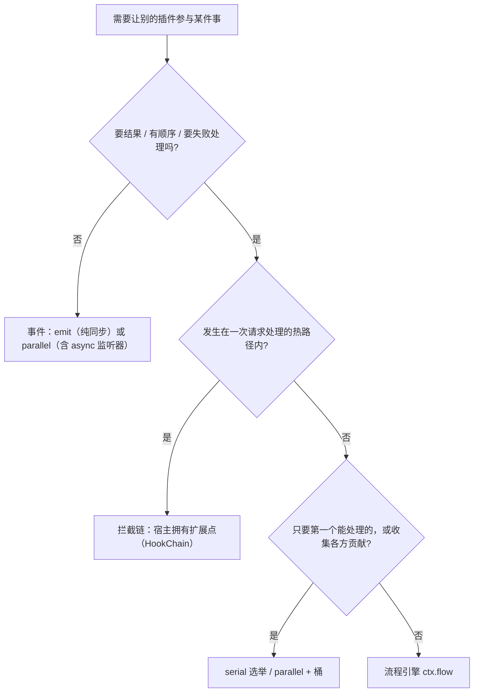
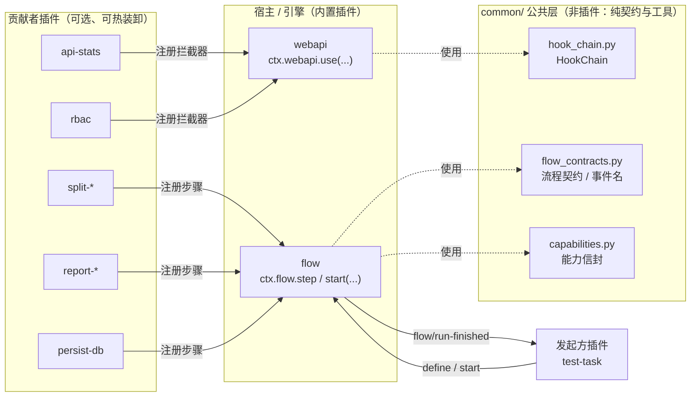
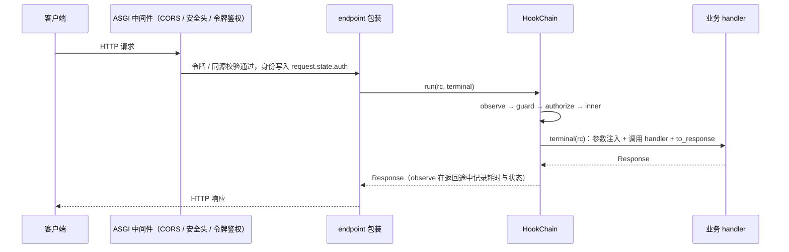
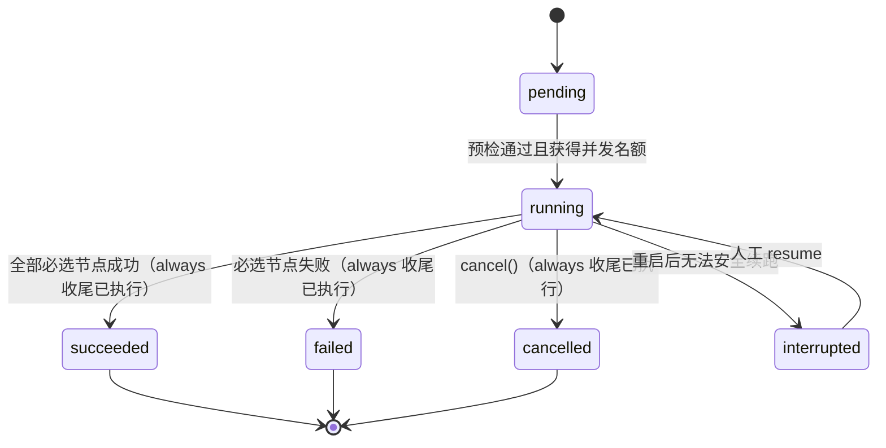
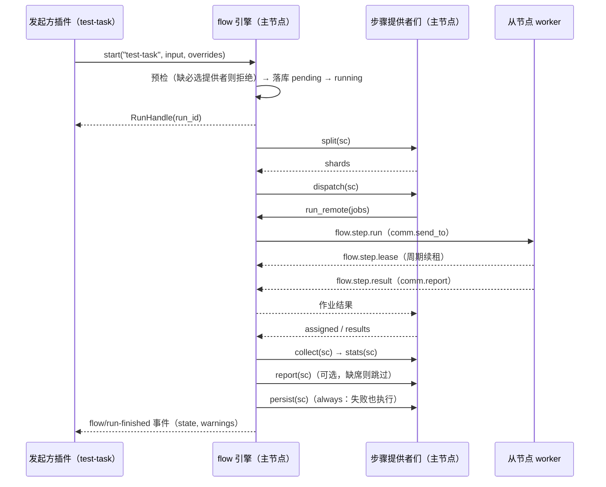

# 链式执行与流程编排设计（拦截链 + 流程引擎）

> 状态：**Phase 0 / 1 / 2 / 3 / 4 / 5 全部已实现**（2026-10-28，全量 313 测试通过）· 日期：2026-10-26
>
> 依据：仓库现状（`cordis-port 0.1.7`、`webapi` / `comm` / `heartbeat` / `db`）与原型 / 实验验证（见 [§8](#8-实测验证记录)）。
> 本文只给设计与落地路线，**不含对现有代码的改动**；[附录 A](#附录-a-hookchain-代码骨架) /
> [附录 B](#附录-b-流程契约代码骨架) 的代码骨架已通过 ruff（仓库规则）与 pyright strict，并有行为检查，可直接作为实现起点。
>
> 标注约定：✅ = 已在本仓库环境实测 · 📝 = 设计决定（未实现） · ⚠️ = 需要特别注意的坑。
>
> 阅读指引：先看结论 → [§3.2 方案对比](#32-方案对比是做个插件接管还是cordis-依赖调用)与 [§6 问题解答](#6-具体问题解答)；评审决策 → [§3.7](#37-关键决策一览)；落地 → [§10](#10-落地路线)与附录 A / B；查实测依据 → [§8](#8-实测验证记录)。

## 目录

1. [背景与目标](#1-背景与目标)
2. [现状盘点：可复用的资产与缺口](#2-现状盘点可复用的资产与缺口)
3. [总体方案](#3-总体方案)
4. [机制一：进程内拦截链（HookChain）](#4-机制一进程内拦截链hookchain)
5. [机制二：流程引擎（flow）](#5-机制二流程引擎flow)
6. [具体问题解答](#6-具体问题解答)
7. [横切关注点](#7-横切关注点)
8. [实测验证记录](#8-实测验证记录)
9. [风险与反模式](#9-风险与反模式)
10. [落地路线](#10-落地路线)
11. [开放问题（待决策）](#11-开放问题待决策)
- [附录 A: HookChain 代码骨架](#附录-a-hookchain-代码骨架)
- [附录 B: 流程契约代码骨架](#附录-b-流程契约代码骨架)
- [附录 C: 参考流程 `test-task`](#附录-c-参考流程-test-task)
- [附录 D: HTTP API 清单](#附录-d-http-api-清单)
- [附录 E: 事件与消息清单](#附录-e-事件与消息清单)
- [附录 F: 术语表与设计类比](#附录-f-术语表与设计类比)
- [附录 G: 移植缺口与实现分工](#附录-g-移植缺口与实现分工)

---

## 1. 背景与目标

### 1.1 要解决的三类问题

| 编号 | 需求 | 典型例子 | 特征 |
|---|---|---|---|
| **A** | 请求拦截链 | 收到 API 请求时先鉴权；记录响应耗时、统计热点接口并打日志；以后再插入限流、审计等 | 同步穿过、毫秒级、在请求热路径上、无状态 |
| **B** | 跨插件业务流程 | 发起一次测试任务：拆分 → 下发 → 收集数据 → 回填统计 → 生成报告 → 保存数据，最后产出「完成」事件 | 多步骤、可能耗时数小时、要重试 / 恢复 / 跨节点 / 可视化 |
| **C** | 可组装 | 有些步骤必选、有些可选；可选步骤由任意插件实现并插入链中；多条流程共用同一批插件；用户自定义流程；下一步不知道谁能做 | 数据化、可发现、可校验 |

A 与 B 的差别决定了它们**不能用同一套机制**（见 [§3.3](#33-三种机制的分工与选型)）；C 是两者共同要满足的「可组装」要求。

### 1.2 设计目标

| 编号 | 目标 | 说明 |
|---|---|---|
| G1 | **遵守插件铁律** | 插件间不 import；运行时交互只经 cordis（服务 / 事件 / `inject`）；共享契约放 `common/` |
| G2 | **宿主 / 引擎不认识贡献者** | 扩展点的拥有者只持有「回调 + 数据」，代码里不出现任何贡献者的名字 |
| G3 | **必选 / 可选显式** | 缺必选能力在**启动前**暴露；可选能力缺席时按规则跳过并留痕 |
| G4 | **热装卸安全** | 插件随时安装 / 卸载 / 热更新：注册随 fiber 清理、在途任务有排空与取消语义 |
| G5 | **可发现** | 「现在有哪些插件能做这一步」可查询、可展示，跨节点同构 |
| G6 | **可组装** | 流程是数据：用户可关闭可选节点、插入步骤、改参数，而不改代码 |
| G7 | **失败可控** | 重试 / 超时 / 取消 / 收尾（always）语义明确；拦截器区分 fail-open 与 fail-closed |
| G8 | **可观测** | `run_id` 贯穿日志；运行时间线、指标、事件齐全 |
| G9 | **渐进落地** | 每个阶段独立可用；先做收益最大、风险最小的部分（[§10](#10-落地路线)） |

### 1.3 非目标

- **不做通用 BPM / 工作流引擎**：无 BPMN、无任意脚本、无复杂分支与循环（v1 只有顺序 + 收尾，见 [§5.5.4](#554-v1-范围与扩展位)）。
- **不做主节点高可用**：单主节点编排；主节点重启靠持久化恢复，不做多主一致性。
- **不沙箱执行用户代码**：「用户自定义流程」= 组装已有步骤；要扩展代码就写插件（走插件管理的信任边界）。
- **不替换 comm**：只在其上补「关联 / 租约 / 幂等」，传输与重试仍由 comm 负责。
- **不引入外部编排依赖**（Celery / Temporal / Airflow 等）：与「插件 + 无外部依赖的节点」定位冲突，真有需求再评估。

### 1.4 约束

| 约束 | 来源 | 对设计的影响 |
|---|---|---|
| 插件间不得 import，运行时交互只经 cordis；共享契约放 `common/` | 项目铁律（`.github/copilot-instructions.md`） | 契约全在 `common/`；引擎持有的是**回调**，不是插件引用 |
| cordis-port 0.1.8：五种派发模式、无优先级；`inject` 已支持 optional、`waterfall` 已支持 `next(x)` 传值（0.1.8 起） | [开发文档 §9](./开发文档.md) + 实测 | 有序链仍自建 HookChain（顺序 / 失败策略 / 自省）；可选依赖用 optional 声明，软依赖注册仍用具名守护（[§3.5](#35-贡献者的接入方式)） |
| 主从拓扑：主节点编排、从节点执行；comm 至少一次投递、无请求应答 | [comm README](../common/plugins/comm/README.md) | 远程步骤自带关联 / 租约 / 幂等（[§5.11](#511-跨节点执行)） |
| 工程门禁：ruff（含 BLE / TRY / S / SLF 等）+ pyright strict + pytest | `pyproject.toml` / CI | 契约强类型；不用裸 `except`；不碰私有成员 |
| 插件可随时安装 / 卸载 / 热更新 | plugin-manager | 注册必须绑 fiber；在途任务需排空（[§5.12](#512-热装卸与排空)） |

---

## 2. 现状盘点：可复用的资产与缺口

### 2.1 可复用的资产

| 资产 | 位置 | 本设计如何使用 | 现状限制 |
|---|---|---|---|
| cordis 事件五模式 | [开发文档 §9](./开发文档.md)；cordis_port `events.py` | `parallel` 做通知与收集，`serial` 做选举 | 无优先级；`emit` 不执行 async 监听器 ✅；`waterfall` 的 `next(x)` 参数被忽略 ✅ |
| 能力信封 + 收集事件 | [capabilities.py](../common/capabilities.py) | 步骤用信封发现（`kind="flow.step"`）；复用 `select_capabilities` / `capability()` | `CAP_EVENT` 目前只由从节点心跳侧收集 |
| 注册绑定调用方 fiber | webapi `route`、webui `register_ui`、comm `on` | `webapi.use` / `flow.step` 沿用同一机制 | `add_health_provider` 只返回注销函数、不自动绑 fiber（契约不一致） |
| 鉴权接缝 | [auth.py](../common/plugins/webapi/auth.py) | 内置令牌鉴权保持为底线 | `AuthContext.verifier` 是**单槽**，多个插件「包装」时顺序不可控 |
| comm 通道 | [comm/](../common/plugins/comm) | 远程步骤的传输（`send_to` / `report` / `on`） | 至少一次、无请求应答、无去重、单批 ≤ 256 KiB |
| 心跳与能力同步 | [master 心跳](../master_plugins/heartbeat/DESIGN.md) / [slave 心跳](../slave_plugins/heartbeat/plugin.py) | 从节点能力同步到主节点；节点在线状态 | 主节点侧**没有对外服务**（只有 HTTP + 事件）；状态在内存，重启即丢 |
| db（Model DSL） | [models.py](../common/models.py) / [db README](../common/plugins/db/README.md) | 流程定义 / 运行记录持久化（`aetp_flow_*`） | — |
| 操作关联 id | [log_op.py](../common/log_op.py) | `run_id` 贯穿日志 | `log_operation()` 只能自动生成 id，不能指定 / 透传 |
| 内置插件自动识别 | `plugin_manager.builtin_specs` | `common/plugins/flow` 自动成为内置插件 | — |
| 健康探针 | `webapi.add_health_provider` | 拦截链 / 引擎指标挂 `/healthz` | 只读内存计数，禁止 IO |

### 2.2 缺口清单

| 编号 | 缺口 | 影响 | 处理 |
|---|---|---|---|
| GAP-1 | 没有有序拦截链 | 无法保证「鉴权先于统计」等顺序 | [§4](#4-机制一进程内拦截链hookchain) |
| GAP-2 | `ctx.emit` 静默丢弃 async 监听器 ✅ | 调度类插件监听 `heartbeat/node-status`（主节点心跳用的正是 `emit`）会无声失效 | [§3.5.3](#353-事件派发约定)、Phase 0 |
| GAP-3 | 主节点心跳没有 `nodes` 服务 | 引擎选节点时不能 import 心跳插件，也没有服务可调 | Phase 0 / Phase 4 |
| GAP-4 | `log_operation` 不支持指定 id | `run_id` 无法贯穿日志、无法跨节点透传 | Phase 0 |
| GAP-5 | comm 无请求应答 | 下发确认 / 租约 / 重试需上层补 | [§5.11](#511-跨节点执行) |
| GAP-6 | 没有流程 / 调度层 | README 已把它列为核心开发任务 | [§5](#5-机制二流程引擎flow) |
| GAP-7 | 鉴权验证器单槽 | 多插件叠加鉴权顺序不可控 | [§4.4.5](#445-与鉴权的关系) |
| GAP-8 | cordis 的异步清理**并发**执行 ✅ | 「后注册先清理」不能保证先排空再释放资源；[开发文档 §6.4](./开发文档.md) 对异步清理不成立 | [§5.12](#512-热装卸与排空)、Phase 0 勘误 |
| GAP-9 | `ctx.inject(spec, cb)` 守护 fiber 的名字是回调函数名 ✅ | 按 `fiber.name` 做归属会变成 `<lambda>` | [§3.5.2](#352-provider-归属命名)：具名守护 |

## 3. 总体方案

### 3.1 核心原则

| 编号 | 原则 | 含义 |
|---|---|---|
| P1 | **依赖方向：贡献者 → 宿主 / 引擎** | 宿主 / 引擎只持有「回调 + 数据」，绝不 import、实例化或点名任何贡献者 |
| P2 | **控制反转：扩展点归「拥有该操作的人」** | 请求链归 webapi，流程归 flow 引擎；谁拥有操作，谁定义阶段 / 顺序 / 失败语义 |
| P3 | **注册绑调用方 fiber** | 一切注册随调用方卸载自动摘除（webapi 路由、webui 页面、comm 订阅已验证这条路） |
| P4 | **晚绑定：按能力选择，不按插件名** | 节点写「阶段 + 标签」，运行时在注册表里解析；换实现 = 换注册，不改流程 |
| P5 | **声明优于命令** | 流程是数据：可校验、可预检、可版本化、可由用户编辑 |
| P6 | **显式失败语义** | 必选 / 可选 / 收尾；拦截器 fail-open / fail-closed；不靠「默默吞异常」 |
| P7 | **契约在 `common/`** | 纯数据 + 协议，无运行时依赖；插件包内只留再导出垫片 |
| P8 | **先发现，再执行** | 启动前预检暴露缺口，而不是跑到第 5 步才发现没人能做 |

### 3.2 方案对比：是「做个插件接管」还是「cordis 依赖调用」？

这不是二选一。cordis 是**唯一的耦合通道**，问题是在它之上用哪种结构。四种候选：

| 维度 | ① 总管插件（认识所有步骤） | ② `inject` 串联（A 依赖 B 依赖 C） | ③ 纯事件接力（编舞） | ④ 引擎 + 自注册 + 数据化定义（**推荐**） |
|---|---|---|---|---|
| 谁知道全貌 | 总管（硬编码） | 每个插件只知道下一个 | 没有人 | 流程定义（数据） |
| 新增一个步骤 | 改总管 | 改上一个插件与依赖链 | 加监听器（顺序隐式） | 注册步骤 + 改定义（或启用附加项） |
| 与铁律 | 总管 import / 点名各插件，违规风险高 | `inject` 是服务依赖，勉强合规但**语义错位** | 合规 | 合规 |
| 必选 / 可选 | 总管里 if / else | 不支持（缺一个，整条链不加载） | 无法检查「缺了谁」 | 预检 + 跳过并留痕 |
| 热装卸 | 总管需感知每个插件 | **级联卸载** ✅ | 监听器自动摘除，但流程悄悄断掉 | 晚绑定 + 排空（[§5.12](#512-热装卸与排空)） |
| 用户改流程 | 改代码 | 不可能 | 不可能 | 覆盖 / 版本化定义 |
| 失败 / 重试 / 恢复 | 总管自己写 | 各自写 | 分散在各监听器 | 引擎统一 |
| 可视化 | 难 | 难 | 难 | 天然（定义 + 运行记录） |
| 适合 | 极小的固定流程 | 服务依赖：「我离不开它」 | 通知 / 广播 | 有状态的多步骤业务流程 |

**结论：选 ④；其余三种各有保留用途**——② 表达「服务依赖」，③ 做通知，① 是反模式。

**为什么引擎不算「接管」**：引擎只提供**机制**（注册表 + 解析 + 执行器 + 状态机 + 持久化），不含任何业务逻辑；拆分策略、下发策略、统计口径、报告格式全是步骤提供者的事。它和 `db` / `comm` / `webapi` 是同一类地基插件。

**为什么引擎持有提供者的回调不违反铁律**：这与 `ctx.webapi.get(path, handler)` 完全同构——webapi 持有各插件注册的 handler 并在请求时调用，没有 import、没有实例化，调用方向由「注册」这一次 cordis 服务调用建立。铁律禁止的是插件包之间的 `import` 与直接调用。

**为什么不用 `inject` 串流程**：`inject` 的语义是「没有它我跑不起来」。实测（[§8](#8-实测验证记录) E6）：被依赖的服务卸载时，硬依赖它的插件会被连带卸载（状态回到 `PENDING`），服务回来再重载。用它表达「A 之后轮到 B」，会把每个步骤都变成上一步的**硬依赖**——缺一个可选步骤，整条链都不加载。

### 3.3 三种机制的分工与选型



| 机制 | cordis 原语 | 谁拥有扩展点 | 适用 | 不适用 |
|---|---|---|---|---|
| 事件通知 | `parallel`（有 async 监听器）/ `emit`（纯同步） | 事件发布者 | 通知、广播、`flow/run-finished` | 要结果、要顺序、要失败处理 |
| 收集 / 选举 | `parallel` + 桶 / `serial` | 收集方 | 能力收集、响应扩展槽、「第一个能处理的」 | 有状态的长流程 |
| **拦截链** | 宿主服务 `use(...)` + [HookChain](#附录-a-hookchain-代码骨架) | 宿主（webapi 等） | 一次调用内的鉴权、限流、统计、审计 | 耗时长、要持久化 |
| **流程引擎** | `ctx.flow` 服务 | flow 引擎 | 多步骤、要重试 / 恢复 / 跨节点 / 用户可改 | 一次函数调用能解决的事（直接 `ctx.<service>`） |

> ⚠️ **别把一切都做成流程节点**：能用一次 `ctx.<service>` 直接调用解决的事，不要过引擎。引擎的价值在「有状态 + 可重试 + 可替换 + 可见」。

### 3.4 总体架构



**箭头方向就是依赖方向**：所有实线都是「贡献者 / 发起方 → 宿主 / 引擎」的 cordis 服务调用（或引擎回发的事件）；虚线是对 `common/` 公共层的使用。没有任何一条线在两个插件之间直接 import。

### 3.5 贡献者的接入方式

#### 3.5.1 五种方式与选择规则

| 方式 | 例子 | 适用 | 注意 |
|---|---|---|---|
| **推（服务注册）** | `ctx.webapi.use(...)`、`ctx.flow.step(...)` | 可执行物（回调） | 绑调用方 fiber 自动清理；返回注销函数 / 句柄 |
| **拉（collect 事件）** | `heartbeat/collect-capabilities`、响应扩展槽 | 纯声明 / 元数据 | `parallel` + 桶；坏条目就地丢弃并上报（沿用 [capabilities.py](../common/capabilities.py) 的约定） |
| **选举** | `serial` | 「第一个能处理的」 | 监听器抛错会**中断整条链** ✅，需自行 try；`None` / `False` = 未处理，`0` / `""` 算命中 ✅ |
| **硬依赖** | `inject = ["flow"]` | **发起方 / 流程所有者**（离了引擎没意义） | 引擎卸载 → 依赖方被连带卸载，引擎回来后重载 ✅ |
| **具名守护（软依赖）** | `ctx.plugin({"name": "x:flow", "inject": ["flow"], "apply": register})` | **步骤提供者**（插件本职独立于引擎） | 引擎卸载只摘注册、提供者保持 `ACTIVE`；引擎回来自动重注册 ✅ |

**规则：发起方硬依赖，提供者软依赖。** 没有声明 `inject` 就访问服务会直接报错（`cannot get property "flow" without inject` ✅），所以发起方必须硬依赖；提供者的核心功能往往独立于引擎（`report-html` 没有引擎也能自己生成报告），用硬依赖会让引擎重载时无谓地拆装它。

> cordis-port 0.1.8 起 `inject` 支持 Koishi 的 `required` / `optional` 语义（optional 缺席访问为 None、不阻塞加载、不触发重载；[附录 G](#附录-g-移植缺口与实现分工) #1 已落地）。仓库里 db / log 的页面服务已改用「**页面独立服务 + `inject = ["<自家核心>", "webui"]`**」（`db_ui` / `log_ui`）：依赖缺席安静 PENDING、就位自动装载、换装 / 重载级联重挂——即下表「具名守护」的服务化写法。步骤提供者的软依赖注册仍用具名守护：optional 语义不触发热重载，覆盖不了「引擎来了注册、走了摘除」。

#### 3.5.2 provider 归属命名

引擎用调用方的 `fiber.name` 识别 provider（与 webapi 的 `RouteRecord.owner`、webui 的贡献归属同一套做法）。⚠️ `ctx.inject(spec, cb)` 创建的守护 fiber **名字是回调函数名**（lambda 就是 `<lambda>` ✅），不是插件名，所以守护必须**显式起名**：

- 约定守护名为 `"<插件名>:<用途>"`，如 `report-html:flow`；
- 引擎取 `fiber.name.split(":")[0]` 作为 `provider`（写入能力信封 `provider` 字段，与 `db_ui:db` 的「`<fiber 名>:<贡献 id>`」约定一致）。

#### 3.5.3 事件派发约定

- **凡是可能有 async 监听器的事件，一律 `await ctx.parallel(...)`**，并捕获 `EventDispatchError` 记日志（comm 的 `_dispatch_payload` 已是这样做的）。`emit` 只留给「确定全是同步监听器」的场景。
- ⚠️ `emit` 对 `async def` 监听器**静默不执行**（协程创建后无人 await，只有一条 `never awaited` 警告 ✅）。现状里 `heartbeat/node-status` 就是 `emit`——将来调度类插件若写 `async def` 监听器会无声失效（GAP-2）。
- 事件载荷一律用**可 JSON 序列化的 dict**，这样 `ctx.comm.relay(event, ...)` 可以直接跨节点转发。
- Phase 0 在 `common/cordis_utils.py` 增加 helper（`parallel` + 吞 `EventDispatchError` 并返回错误列表），降低误用概率。

#### 3.5.4 接入示例（接口为设计稿，机制已由原型验证）

提供者（软依赖，注册随引擎起落）：

```python
class ReportHtmlPlugin:
    name = "report-html"          # 本插件不依赖 flow：没有引擎也能独立工作

    def __init__(self, ctx, config):
        self.ctx = ctx
        self._reg = None
        # …… 先创建自己的资源 ……
        ctx.plugin({
            "name": f"{self.name}:flow",    # 具名守护：provider 归属 = 冒号前的部分
            "inject": ["flow"],             # 引擎就绪才执行；引擎卸载只摘注册
            "apply": self._register,
        })

    def _register(self, ctx, _config=None):
        self._reg = ctx.flow.step(
            "report", "html", self._render,
            labels={"format": "html"}, idempotent=True, summary="HTML 测试报告",
        )

    async def _render(self, sc):            # sc: StepContext
        return {"path": make_report(sc.data["stats"], sc.run_id)}
```

发起方（硬依赖，同时是流程所有者）：

```python
class TestTaskPlugin:
    name = "test-task"
    inject = ["flow"]                       # 离了引擎没意义 → 硬依赖

    def __init__(self, ctx, config):
        self.ctx = ctx
        ctx.flow.define(TEST_TASK)          # 注册模板（绑 fiber，卸载即摘）
        ctx.on("flow/run-finished", self._on_finished)   # async 监听器可用：引擎用 parallel 派发

    async def launch(self, cases):
        run = await self.ctx.flow.start("test-task", {"cases": cases})
        return run.id
```

### 3.6 公共层清单与铁律检查口令

| 文件 | 内容 | 阶段 |
|---|---|---|
| `common/hook_chain.py` | `HookChain` / `OnError` / `HookInfo`（[附录 A](#附录-a-hookchain-代码骨架)） | Phase 1 |
| `common/flow_contracts.py` | 流程定义 / 步骤接口 / 状态 / 事件名（[附录 B](#附录-b-流程契约代码骨架)） | Phase 2 |
| `common/contracts.py`（扩充）或新文件 | `NodesInterface`（主节点节点注册表的服务契约，Protocol） | Phase 0 / 4 |

**审查口令**（沿用项目约定）：在任何插件包里看到 `from common.plugins.<别的插件>` / `from master_plugins.<别的插件>` / `from slave_plugins.<别的插件>` 即违规。步骤提供者只允许 `import common.flow_contracts`；`common/plugins/flow/__init__.py` 只留再导出垫片以维持公开导入路径。

### 3.7 关键决策一览

| 编号 | 决策 | 选择 | 否决的备选 | 主要理由 | 可逆性 |
|---|---|---|---|---|---|
| D1 | 拦截链归属 | 宿主拥有扩展点（webapi 提供 `use`） | 统一进流程引擎；直接用 cordis `waterfall` | 热路径、顺序确定、失败策略、可自省（[§4.8](#48-为什么不直接用-ctxwaterfall)） | 易 |
| D2 | 业务流程编排方式 | 引擎 + 自注册 + 数据化定义 | 总管插件 / `inject` 串联 / 纯事件接力 | 铁律、必选可选、预检、用户可改（[§3.2](#32-方案对比是做个插件接管还是cordis-依赖调用)） | 中 |
| D3 | 贡献者与引擎的依赖 | 发起方硬依赖，提供者具名守护软依赖 | 全部硬依赖 | 避免级联卸载；提供者可独立工作（E4 / E6） | 易 |
| D4 | 步骤发现 | 能力信封 + 选择器（stage + labels） | 按插件名 / 服务名引用 | 晚绑定、跨节点同构、复用现有信封 | 中 |
| D5 | 编排位置 | 主节点编排，从节点执行 | 去中心化编排 | 与现有拓扑一致，实现简单 | 难 |
| D6 | 拦截器挂载点 | endpoint 内（`build_endpoint`） | ASGI 中间件层 | 有路由信息、给的是 `Response`、门槛低（[§4.4.1](#441-挂载点endpoint-内而不是-asgi-中间件)） | 易 |
| D7 | 认证与授权的边界 | 认证留在 ASGI 层 + verifier 接缝；授权走拦截链 | 全部折叠进拦截链 | 安全底线不依赖链的完整性（[§4.4.5](#445-与鉴权的关系)） | 中 |
| D8 | 持久化 | `ctx.db`，flow 拥有三张表 | 文件 / 仅内存 | 治理一致、可恢复（[§5.10](#510-持久化与恢复)） | 中 |
| D9 | 用户自定义范围 | 组装 + 覆盖，不上传代码 | 脚本 / 表达式引擎 | 安全、可校验（[§5.14](#514-用户自定义流程)） | 易（可放宽） |
| D10 | 事件派发 | 一律 `parallel`，载荷为 JSON dict | `emit` | async 监听器可用、可经 `comm.relay` 跨节点转发（[§3.5.3](#353-事件派发约定)） | 易 |
| D11 | 重试策略 | 仅可重试异常 / 超时 / 幂等步骤 | 任何异常都重试 | 非幂等步骤的副作用安全（[§5.8.4](#584-重试超时取消)） | 易 |
| D12 | 卸载安全 | 引擎派发前 `alive` 检查 + 提供者有序 `drain` | 依赖 cordis 的清理顺序 | cordis 清理并发执行（E7 / E8，[§5.12](#512-热装卸与排空)） | 易 |
| D13 | 远程执行 | 引擎原生远程作业（机制）+ 提供者策略 | 每个调度插件各自实现 | 关联 / 租约 / 重试只实现一次（[§5.11.7](#5117-下发--收集的两种建模)） | 中 |
| D14 | HTTP 错误信封 | `{"error": str, "code", "details"}` | `{"error": {...}}` | 与前端 `request()` 兼容（[§7.2](#72-错误模型)） | 易 |

## 4. 机制一：进程内拦截链（HookChain）

### 4.1 场景与要求

场景：API 鉴权 / 授权、响应耗时与热点接口统计（打日志）、限流、审计，以及以后任意想插入的横切功能。

| 编号 | 要求 | 说明 |
|---|---|---|
| R1 | **确定的顺序** | 与插件加载顺序无关（cordis 事件只有「注册序 / prepend」，热装卸下不可控） |
| R2 | **可短路** | 鉴权拒绝时不再往下走 |
| R3 | **逐拦截器声明失败策略** | 鉴权类 fail-closed，统计 / 日志类 fail-open |
| R4 | **热装卸安全** | 卸载即摘除；在途请求不受影响 |
| R5 | **低开销** | 在请求热路径上，框架开销应远小于一次 HTTP 往返 |
| R6 | **可自省** | 随时能看到「现在链上有谁、顺序如何、各自耗时与出错次数」 |
| R7 | **遵守铁律** | 贡献者只经宿主服务 `ctx.webapi.use(...)` 注册 |

### 4.2 契约

#### 4.2.1 阶段词表（webapi）

阶段词表由**宿主**定义（别的宿主有自己的词表）。webapi 为：`observe → guard → authorize → inner`。

| 阶段 | 用途 | 典型拦截器 | 建议失败策略 |
|---|---|---|---|
| `observe` | 最外层：计时、追踪 id、访问统计、审计 | api-stats、audit | `SKIP` |
| `guard` | 廉价的前置拦截：限流、IP 白名单、维护模式 | ratelimit | `SKIP`（限流）；安全类用 `FAIL` |
| `authorize` | 身份已知后的授权：RBAC / 权限点 | rbac | `FAIL` |
| `inner` | 最靠近 handler：参数规范化、幂等键、请求体校验 | — | `SKIP` |

> 令牌 / 同源**认证**在 ASGI 层的 `AuthMiddleware` 已完成，拦截链在它的**内侧**；身份在 `request.state.auth`（见 [§4.4.5](#445-与鉴权的关系)）。

#### 4.2.2 拦截器签名与 `RequestContext`

```python
async def interceptor(rc: RequestContext, next: Next[Response]) -> Response: ...
```

| `RequestContext` 字段 | 含义 |
|---|---|
| `request` | Starlette `Request` |
| `route` | 命中的 `RouteRecord`（路径模板、`name`、`owner`、`kind`、方法集） |
| `identity` | `AuthIdentity \| None`（即 `request.state.auth`） |
| `state` | 拦截器之间传递数据的字典（`next()` 不带参数，数据只经这里流动） |
| `started` | 进入链时的单调钟时刻 |

#### 4.2.3 顺序规则

排序键 `(阶段序号, order, owner, name, 注册序号)`，`order` 缺省 100。建议分段：`0–49` 平台内置，`50–149` 常规，`150+` 宜靠后。最后一级「注册序号」只在 `owner` 与 `name` 完全相同时才起作用，保证排序全序可复现。

#### 4.2.4 失败策略

| 策略 | 语义 | 适用 |
|---|---|---|
| `FAIL`（fail-closed） | 拦截器自己出错 → 异常向上抛，请求失败，**不放行** | 鉴权 / 授权 / 安全类 |
| `SKIP`（fail-open） | 拦截器自己出错 → 记问题并放行（细则见 [§4.3](#43-语义细节)） | 统计 / 日志 / 审计类 |

### 4.3 语义细节

骨架实现见 [附录 A](#附录-a-hookchain-代码骨架)；下表每一行都有对应的行为检查（✅ 12 项全部通过）。

| 情形 | 语义 |
|---|---|
| 不调 `next` 直接返回 | 短路（如鉴权拒绝）；外层拦截器仍能看到这个返回值 |
| `next()` 调两次 | 抛 `RuntimeError("next() called multiple times")`（与 Koa / cordis waterfall 同） |
| `SKIP` 且出错发生在 `next` **之前** | 当它不存在，继续往下走 |
| `SKIP` 且出错发生在 `next` **之后** | 保留下游结果（下游已经完成，不能重来） |
| 下游（handler 或更内层）自己抛异常 | **照常向上传播**，不被 `SKIP` 吞掉，也不计入该拦截器的错误 |
| `FAIL` 且出错 | 向上抛，handler 不会被执行 |
| `asyncio.CancelledError` | 永远向上传播，不当作可跳过的失败 |
| 运行中卸载拦截器 | 每次运行取排序**快照**：在途请求不受影响，新请求看到新链 |
| 耗时统计 | 记录**不含下游**的自身耗时（洋葱结构下无法区分自身与下游，因此**不做强制超时**，改为统计 + 告警） |
| 未知阶段 | 注册时即抛 `ValueError`，不留到运行时 |

### 4.4 webapi 集成

#### 4.4.1 挂载点：endpoint 内，而不是 ASGI 中间件

| | A. ASGI 中间件层（`add_middleware`） | B. endpoint 内（`build_endpoint`）（**推荐**） |
|---|---|---|
| 覆盖范围 | 所有请求（含静态资源、404 回退、SPA 页面） | 仅插件登记的 handler 路由（`api` / `route` 类） |
| 路由信息 | ✗ 路由匹配发生在中间件**之后** | ✔ 已持有 `RouteRecord`（路径模板 / 名字 / owner / kind） |
| 拿到的是什么 | ASGI 的 send / receive 流 | 现成的 `Response` 对象，可直接短路返回 JSON |
| 对插件作者的门槛 | 高：要自己处理流式响应与取消语义 | 低：只处理 `Request → Response` |
| 与内置鉴权的位置 | 可放在 `AuthMiddleware` 内外 | 恒在 `AuthMiddleware` **内侧**（身份已就绪） |
| 能否看到令牌失败的 401 | ✔（放外层时） | ✗ → 用 `webapi/auth-denied` 事件补（[§4.4.5](#445-与鉴权的关系)） |
| 定位 | 留给传输层关切（CORS / 安全头 / 令牌） | **插件拦截器的挂载点** |



#### 4.4.2 改动点

| 文件 | 改动 |
|---|---|
| [interface.py](../common/plugins/webapi/interface.py) | `WebApiService` 增抽象方法 `use(...)`；类文档的「隐含契约」补一条：`use` 注册绑调用方 fiber；增只读属性 `pipeline`（供自省） |
| [uvicorn_web_service.py](../common/plugins/webapi/uvicorn_web_service.py) | 持有 `HookChain`；实现 `use`（`_caller_fiber().effect(...)` 绑定）；把链交给 `RouteRegistry` |
| [router.py](../common/plugins/webapi/router.py) | `RouteRegistry` 持有链引用；`build_endpoint(record, chain)`：把原有「参数注入 → handler → `to_response`」包成 `terminal`，再 `await chain.run(rc, terminal)`。链对象常驻、`run` 每次取快照，所以已缓存的 `record.endpoint` 无需重建 |
| `common/plugins/webapi/pipeline.py`（新） | `RequestContext` / `WEBAPI_PHASES` / 类型别名（依赖 Starlette，故不放 `types.py`——后者约定不依赖 starlette） |
| webapi `plugin.py` | 注册自省路由 `GET /api/web/pipeline`；`add_health_provider("pipeline", ...)` |

#### 4.4.3 `use()` 签名与绑定

```python
def use(
    self,
    fn: Interceptor[RequestContext, Response],
    *,
    phase: str = "inner",
    order: int = 100,
    name: str | None = None,
    on_error: OnError = OnError.SKIP,
    kinds: Collection[RouteKind] = ("api",),
) -> Callable[[], None]: ...
```

- 同时满足两种现有约定：像 `route()` 一样**自动绑调用方 fiber**（卸载即摘除），又像 `add_health_provider` 一样**返回注销函数**（想提前摘也行）；
- `owner` = 调用方 fiber 名（取冒号前的部分，见 [§3.5.2](#352-provider-归属命名)）；
- `kinds`：只对指定种类的路由生效（默认仅 `api`）。由 webapi 在注册时包一层「种类不符就直接 `await next()`」实现，`HookChain` 本身保持与路由无关。

#### 4.4.4 自省与指标

- `GET /api/web/pipeline` → `{"phases": [...], "hooks": [{phase, order, owner, name, on_error, calls, errors, self_ms}]}`（对应 `describe()` / `stats()`）；
- `/healthz` 的 `metrics.pipeline`：拦截器数、累计出错数、自身耗时最大者（只读内存计数，符合 `add_health_provider` 的约束）；
- `SKIP` 出错经 `on_problem` 记一条 warning（带 owner / name / phase），**不静默**；
- 📝 可选（v2）：某拦截器连续出错超阈值时自动熔断并告警。

#### 4.4.5 与鉴权的关系

现状：`AuthMiddleware`（ASGI 层：令牌 / 同源）通过 `AuthContext.verifier`（单槽，可被替换 / 包装）得到身份并写入 `request.state.auth`。

边界划分：

- **认证（你是谁）**：仍在 ASGI 层 + verifier 接缝；
- **授权与其余横切**：走拦截链的 `authorize` 及其它阶段；
- 内置令牌鉴权在链的**外侧**，插件拦截器无法绕过或移除它——**安全底线不依赖链的完整性**。

两个遗留问题：

1. **验证器单槽（GAP-7）**：靠「包装」叠加，两个插件各包一次时内外层取决于加载顺序。建议把它升级成**有序验证器链**：`AuthContext.register(verifier, order)`；依序尝试，第一个返回身份即通过，返回显式 `DENY` 即终止，全部无结论 → 401；保留 `verifier` 属性做兼容。改动局限在 [auth.py](../common/plugins/webapi/auth.py)，建议与 Phase 1 同批评审。
2. **链看不到 401**（令牌失败发生在更外层）：`AuthMiddleware` 拒绝时派发 `webapi/auth-denied`（`parallel`，载荷 `{path, method, reason, remote}`），审计 / 统计插件订阅它。

📝 长期选项（**不在本期**）：把令牌鉴权也折叠成链上 `auth` 阶段的内置、不可移除拦截器，换来「observe 能看见 401」，代价是安全底线与链实现耦合；评审后再定。

### 4.5 示例插件（设计稿）

| 插件 | 阶段 / order | 策略 | 做什么 |
|---|---|---|---|
| `api-stats` | `observe` / 10 | `SKIP` | 计时 + 按路由模板聚合 + 周期输出热点 Top-N |
| `ratelimit` | `guard` / 10 | `SKIP` | 按身份 / 来源令牌桶限流，超限直接返回 429 |
| `rbac` | `authorize` / 10 | `FAIL` | 按路由权限点校验 `rc.identity`，无权返回 403 |
| `audit` | `observe` / 20 | `SKIP` | 记录写操作（谁、何时、哪个路由、状态码） |

```python
# api-stats 的核心（observe 阶段）
async def observe(rc, nxt):
    if rc.route.path.startswith(self.exclude):         # 机器通道不统计（见 §4.6）
        return await nxt()
    started, status = perf_counter(), 500
    try:
        response = await nxt()
        status = response.status_code
        return response
    except HTTPException as exc:                       # 4xx 也要计入
        status = exc.status_code
        raise
    finally:
        self._record(rc.request.method, rc.route.path, status, perf_counter() - started)

ctx.webapi.use(observe, phase="observe", order=10, on_error=OnError.SKIP)
ctx.webapi.add_health_provider("api_stats", self._snapshot)    # Top-N 同时出现在 /healthz
```

```python
# rbac 的核心（authorize 阶段，fail-closed）
async def authorize(rc, nxt):
    needed = PERMISSIONS.get(rc.route.name or rc.route.path)   # 路由 → 权限点
    if needed and not allowed(rc.identity, needed):
        return JSONResponse({"error": "无权限", "code": "forbidden"}, status_code=403)
    return await nxt()

ctx.webapi.use(authorize, phase="authorize", order=10, on_error=OnError.FAIL)
```

### 4.6 热点统计的设计要点

- **键用路由模板**（`GET /api/heartbeat/nodes/{node_id}`），不用原始 path：键数 = 已注册路由数，内存天然有界，也不会被路径参数打散；
- **排除机器通道**：`/api/heartbeat`（每个从节点每 5 秒一次）、`/api/comm/*`（`/api/comm/poll` 是挂起 30 秒的长轮询，耗时没有「延迟」含义）、`/healthz`。用插件配置 `exclude_prefixes` 控制，不改宿主；长期可给路由加 `tags`；
- **聚合后周期输出**：每 `log_interval`（默认 60 秒）一行「热点接口 Top-N（次数 / p95 / 错误率）」，而不是逐请求写日志——逐请求写会放大成大量日志条目，从节点日志还会经 comm 回传主节点；
- **分位数用固定桶直方图**（如 1 / 5 / 10 / 50 / 100 / 500 / 1000 / 5000 ms），不保存样本；
- 同时提供 `add_health_provider("api_stats", ...)`，`/healthz` 里即可看到累计与最近窗口；
- 默认只在内存，重启清零（v1）。

### 4.7 其他宿主复用（不在本期，列出方向）

`HookChain` 与 webapi 无关，别的宿主可以同样开放扩展点，各自定义阶段词表：

- **comm 入站**（`/api/comm/ingest` 之前）：载荷大小 / 速率限制、审计；
- **plugin-manager 安装流水线**：安装前的包扫描 / 策略检查 / 审计；
- **db**：慢查询日志、写操作审计。

### 4.8 为什么不直接用 `ctx.waterfall`

| 维度 | cordis `waterfall` | HookChain |
|---|---|---|
| 顺序 | 注册序 / `prepend`（单个 `prepend` 插队 ✅；多个插件都 `prepend` 会退化成注册序的逆序，见开发文档 §9.4），热装卸下不可控 | 阶段 + `order` + owner，确定 |
| 跨拦截器传值 | `next(x)` 传值（0.1.8 起 ✅；0.1.7 实测被忽略） | 不传参，显式约定（`rc.state`，可审计） |
| 失败策略 | 一个监听器抛错 → 整条链中断 | 逐拦截器声明 fail-open / fail-closed |
| 自省 | 无（只有回调列表） | `describe()` / `stats()` |
| 单次开销（5 个拦截器，本机量级） | ≈ 23 µs ✅ | ≈ 11 µs ✅ |
| 注销 | 随 fiber 自动 | 由宿主绑 fiber（`use` 已做） |

参照：本机 `/healthz` 单次回环 HTTP 请求中位数约 1.8 ms ✅，所以两者的绝对开销都不是问题；选 HookChain 的理由是**顺序、失败策略和可自省**，不是性能。`waterfall` 只适合「≤ 2 个监听者且顺序无关」的简单场景。

## 5. 机制二：流程引擎（flow）

### 5.1 定位与边界

| 引擎做 | 引擎不做 |
|---|---|
| 步骤注册表、能力发现（信封）与解析 | 业务逻辑：拆分策略、下发 / 调度策略、统计口径、报告格式、存储方案 |
| 流程定义的校验与预检 | 脚本 / 表达式执行（`when` 仅限受限的 JSON 条件，v2） |
| 执行：顺序、重试、超时、取消、收尾（always） | 通知渠道（通知本身就是一个步骤） |
| 运行级黑板（节点间数据）与生命周期事件 | 产物的存储与传输（只传引用；大文件通道见 [§11](#11-开放问题待决策)） |
| 持久化与重启恢复 | 多主节点一致性 |
| 跨节点远程作业：选节点、下发、租约、重试、收结果 | 替代 comm 的传输 / 重试 |
| HTTP API 与用户覆盖（组装） | 上传并执行用户代码 |

### 5.2 服务划分与部署形态

一个内置插件 `flow`（`common/plugins/flow/`）提供三个服务——沿用 db / db_api / db_ui 的「一个插件、多个服务，依赖各归各的」：

| 服务 | 依赖 | 职责 | 所在节点 |
|---|---|---|---|
| `flow`（核心） | `appconfig`、`db`、`comm`（以及值服务 `node_kind` / `node_name`） | 注册表、解析、执行、持久化、远程协议、能力发布 | 主从都有：主节点 = 编排 + 本地 worker；从节点 = worker（调用 `start` 抛 `FlowError("本节点不编排")`） |
| `flow_api`（API 层） | `flow`、`webapi` | HTTP API（只读目录接口可下放从节点） | 主节点（从节点可只开只读目录接口） |
| `flow_ui`（页面层） | `flow`、`webui`（webui 软依赖） | 管理页面：`inject = ["flow", "webui"]` 注入式挂载（自家核心 + UI 宿主就位才装载、换装 / 重载自动重挂，无守护轮询；从节点缺 webui 时安静 PENDING，db_ui / log_ui 同款） | 主节点 |

- **装配**：`node_runtime._assemble` 在 `comm` 之后、预装插件之前 `await ctx.plugin(FlowService)`；`builtin_specs` 按 `common.plugins` 包树自动识别为内置插件；`FlowApiService` / `FlowUiService` 的 `service_of = "flow"`（附属服务，不单列）。
- **类形态**沿用 `CommService(Service[CommConfig])`：`provide = "flow"`、`name = "flow"`、`inject = [...]`、`init()` 返回清理函数；配置 `FlowConfig(FieldConfig)`，`ini_section = "flow"`。
- **编排只在主节点**：从节点不需要流程定义，也不落 flow 表。
- **核心不依赖 webapi**：与 db 一致，核心不沾 Web 依赖，无头部署与单测更轻。

### 5.3 贡献者 API（注册）

类型面见 [附录 B](#附录-b-流程契约代码骨架) 的 `FlowInterface`。注册一个步骤：

```python
reg = ctx.flow.step(
    "report", "html", handler,
    labels={"format": "html"}, priority=0, version="1.2.0",
    summary="HTML 测试报告", params_schema={...}, max_concurrency=0, idempotent=True,
)
```

| 参数 | 含义 |
|---|---|
| `stage` / `step_id` | 阶段与步骤标识；`(stage, step_id)` 在同一节点内唯一 |
| `handler` | 同步 / 异步均可；返回 JSON 字典写入黑板（[§5.4](#54-步骤处理函数契约)） |
| `labels` | 选择器的子集匹配轴（`format=html`、`framework=pytest`） |
| `priority` | 同阶段多个提供者时的默认优先级；同优先级且未 `pin` → 预检报歧义 |
| `version` | 信息性（写入运行的 `bindings` 供审计）；📝 v2 支持选择器按版本范围 |
| `summary` | 目录展示用的一句话 |
| `params_schema` | JSON Schema 子集（`type` / `properties` / `required` / `enum` / `minimum` / `maximum` / `pattern` / `maxLength` / `items`），用于保存时校验、预检与 UI 表单 |
| `max_concurrency` | 该步骤同时在途的尝试数上限（共享稀缺资源，如 CANoe 许可）；0 = 不限；**跨流程共享** |
| `idempotent` | 声明「可安全重放」：决定崩溃恢复与普通异常重试是否允许自动重跑 |

**注册语义**：

1. **绑定调用方 fiber**：调用方（或守护 fiber）卸载即自动注销；返回 `StepRegistration` 句柄（`alive` / `drain()` / `close()`）。
2. **信封化**：引擎把注册项转成能力信封 `capability("flow.step", "<stage>/<step_id>", provider, labels={"stage": stage, **labels}, version=..., summary=..., detail={"params_schema": ..., "idempotent": ..., "max_concurrency": ...})`。**步骤目录就是信封列表**，与心跳能力同构，可经 `select_capabilities` 筛选。
3. **唯一性**：`(stage, step_id)` 在同一节点内唯一。同一 provider 重复注册（如重载）→ 替换；**不同 provider 抢同一个 id → `ValueError`**（显式报错，不静默覆盖，与内置插件 id 撞键同一处理风格）。需要并存的实现用不同 `step_id`（`html` / `html-fancy`）+ `labels` / `priority` 区分。
4. **注册即生效**：运行中流程的后续节点立即可见（晚绑定）；同时派发 `flow/steps-changed`（UI 刷新、已保存流程重新校验）。
5. **软依赖提供者随引擎起落**：引擎重载后自动重注册（具名守护，✅ E4）。
6. **位置隐含于节点类型**：主节点注册的步骤在主节点本地执行；从节点注册的步骤经能力同步对主节点可见，由主节点远程调用（[§5.11](#511-跨节点执行)）。

其余服务方法：`define(flow)`（注册模板，绑 fiber；同 id 冲突抛 `ValueError`）、`catalog(stage=None, labels=None)`（返回信封列表；主节点可合并远程能力）、`preflight(flow_id, overrides)`、`start(...)`、`cancel(...)`。

### 5.4 步骤处理函数契约

| 项 | 约定 |
|---|---|
| 签名 | `handler(sc: StepContext) -> dict[str, JsonValue] \| None`，同步 / 异步均可（沿用 webapi handler 的约定） |
| 返回 | JSON 可序列化字典 → 写入黑板 `data[node_id]`；`None` = 空输出；超过 `max_output_bytes` → 该次尝试失败（`output_too_large`），大产物请写文件并返回引用 |
| 抛 `StepSkipped` | 记 `skipped`（原因 `skipped_by_step`），不算失败 |
| 抛 `StepRetryable` | 可重试失败，按节点 `retries` / `backoff` 重试 |
| 抛其他异常 | 失败；是否自动重试见 [§5.8.4](#584-重试超时取消)（只有 `idempotent=True` 的步骤才对普通异常重试） |
| 取消 | 等待 / 轮询 `sc.cancelled`；引擎置位后给 `cancel_grace` 秒收尾，超时 `task.cancel()` |
| 资源 | 每次尝试内获取、`finally` 释放；跨尝试共享的资源属于提供者，卸载时按 [§5.12](#512-热装卸与排空) 有序释放 |
| 状态 | 不得修改 `sc.data`；不得把 `sc` 保存到尝试之外；run 级状态一律以 `sc.run_id` 为键 |
| 幂等 | 同一 `(run_id, node_id)` 可能被再次调用（重试 / 恢复 / 远程重投）；`idempotent=True` 即承诺可安全重放 |
| 日志 | 引擎已把 `run_id` 作为操作 id 绑入上下文（[§5.13](#513-可观测性)） |

### 5.5 流程定义（数据）

#### 5.5.1 字段

**NodeDef**（节点）：

| 字段 | 类型 | 缺省 | 含义 / 校验 |
|---|---|---|---|
| `id` | str | 必填 | 流程内唯一；`[a-z0-9][a-z0-9_-]{0,39}` |
| `stage` | str | 必填 | 阶段（选择器主轴），非空 |
| `labels` | map | `{}` | 对步骤标签做**子集匹配** |
| `pin` | str? | `null` | 精确指定 `step_id`（解决歧义 / 复现） |
| `mode` | `one` / `all` | `one` | 匹配到多个提供者时：`one` 择一（歧义报错）；`all` 依次全部执行，输出为列表 |
| `required` | bool | `true` | 必选：缺提供者 / 失败 → 流程失败；可选：跳过 / 记警告后继续 |
| `locked` | bool | `false` | 用户 / 覆盖不得关闭或修改（模板用） |
| `always` | bool | `false` | 收尾节点：前序失败或取消后仍执行 |
| `params` | map | `{}` | 节点参数，按步骤的 `params_schema` 校验 |
| `retries` | int | `0` | 最大重试次数（[§5.8.4](#584-重试超时取消)） |
| `backoff` | float | `1.0` | 重试退避基数（秒，指数） |
| `timeout` | float? | `null` | 单次尝试超时（秒）；缺省取 `[flow] step_timeout` |

**FlowDef**：`id`、`version`（int）、`title`、`nodes`（有序）、`slots`。**SlotDef**（模板声明的插入位）：`id`、`after`（节点 id）、`stages`（允许插入的阶段）。

#### 5.5.2 `required` × `always` 语义矩阵

| `required` | `always` | 含义 | 典型 |
|---|---|---|---|
| true | false | 必选：失败则中止后续（非 always）节点，流程 `failed` | split / dispatch / collect / stats |
| false | false | 可选：缺提供者 → 跳过；失败 → 记 warning 继续 | report / notify / audit |
| true | true | 必选收尾：总会执行；失败 → 流程 `failed` | persist |
| false | true | 可选收尾：总会尝试；失败仅警告 | cleanup / notify-failure |

`locked` 与 `required` 正交：`locked` 只表示「用户不可改」，`required` 才是执行语义（允许「必须出现但失败可忽略」的 locked 可选节点）。

#### 5.5.3 JSON 形态与校验

- 存储与传输用 JSON（见 [附录 C](#附录-c-参考流程-test-task)），根字段 `"$schema": "aetp.flow/1"`；
- `parse_flow_def(raw) -> (FlowDef | None, list[Problem])`，风格沿用 `parse_capability`：必填项严格；可选项宽松（类型不对降级为默认）；**未知字段忽略**（向前兼容）；坏条目不抛异常而是上报问题；
- 尺寸上限：节点数 ≤ 64；单节点 `params` ≤ 16 KiB；`labels` ≤ 16 项。

#### 5.5.4 v1 范围与扩展位

- **v1**：顺序节点 + `always` 收尾 + `mode one / all`；
- **v2（需求驱动）**：`when`（受限 JSON 条件，如 `{"var": "stats.passed", "op": ">=", "value": 1}` 加 `all` / `any` / `not`，**无 eval**）、`foreach`（对黑板里的列表逐项执行）、`parallel`（`mode=all` 并发）、`needs`（DAG）；
- **理由**：YAGNI。测试平台的核心复杂度在**长时分布式执行与恢复**，不在控制流；
- **兼容**：未知字段被忽略，v2 字段不会让 v1 引擎读取失败（预检会给 warn：「节点含引擎不认识的字段」）。

### 5.6 解析与绑定

```
resolve(node):
    caps  = [e.capability for e in 注册表 if e.alive]            # alive = 提供者 fiber 仍 ACTIVE 且未排空
    picked = select_capabilities(caps, kinds=[STEP_KIND],
                                 labels={"stage": node.stage, **node.labels})   # 复用现成筛选
    if node.pin:  picked = [c for c in picked if step_id(c) == node.pin]
    picked.sort(key=(-priority, provider, id))
    if node.mode == ONE:
        if len(picked) > 1 and picked[0].priority == picked[1].priority and not node.pin:
            → AMBIGUOUS                                         # 不「碰巧」选字母序第一个
        return picked[:1]
    return picked                                                # ALL：按排序键依次执行
```

- **`alive` 判定** ✅：`fiber.uid is not None and fiber.state == ACTIVE and not 已排空`。实测 `dispose()` 一开始 `uid` 就被清空，所以**新活在卸载开始的那一刻就被拒绝**，不必等清理跑完（[§5.12](#512-热装卸与排空)）。
- **晚绑定**：每个节点执行时重新解析，提供者热装卸后无需重新接线。
- **绑定留痕**：每次尝试把 `{provider, step, version, exec_node}` 写进 run 的 `bindings`，审计时能回答「这次报告是谁、哪个版本生成的」。
- **复现开关**（📝 可选）：`pin_at_start`——启动时把解析结果固定下来，之后提供者消失即失败；默认关闭。
- **等待提供者**：必选节点解析为空时，默认立即失败；`[flow] resolve_wait > 0` 时等待提供者出现（应对启动竞态 / 插件热更新的短暂空窗；生产建议 ≥ 10 秒）。

### 5.7 预检（preflight）

`start()` 前与保存用户流程时都会跑；发现 `error` 即拒绝（HTTP 422，`details.problems` 带全部问题）。

| 检查项 | 级别 | `code` | 说明 |
|---|---|---|---|
| 节点 id 重复 | error | `duplicate_node` | 结构错误 |
| 覆盖目标不存在 | error | `unknown_node` | `disable` / `params` / `pin` / `labels` 指向的节点不存在 |
| 关闭 / 修改被锁定或必选的节点 | error | `locked` | `disable` 只允许可选且非 `locked` 的节点 |
| 插入位置非法 | error | `unknown_slot` | `after` 不存在，或该插槽不允许此阶段 |
| 必选节点无候选提供者 | error | `no_provider` | 消息里列出**当前已注册的步骤**，并提示近似项（标签差一点） |
| 可选节点无候选提供者 | warn | `no_provider` | 运行时将被跳过 |
| `mode=one` 候选并列 | error | `ambiguous` | 要求加 `labels` / `pin` / `priority` |
| 参数不符 `params_schema` | error | `bad_params` | 仅当提供者存在时可校验 |
| 数据依赖未满足（v2） | warn | — | `consumes` 未被上游 `produces` |

原型输出示例 ✅（必选节点缺失时）：

```
stage=stats labels={}; registered: audit/log, collect/default, dispatch/all-slaves,
persist/db, report/html, report/junit, split/by-case
```

> 远程执行（[§5.11](#511-跨节点执行)）由提供者在运行时选节点，预检**只校验本地提供者**；「当前没有在线的从节点具备该能力」是运行期问题，由 `place_wait` 超时处理。

### 5.8 执行语义

#### 5.8.1 状态机



节点状态：`pending → running → succeeded / failed / skipped / cancelled / unknown`。

| 节点终态 | 含义 | 附带信息 |
|---|---|---|
| `succeeded` | 成功 | 提供者、版本、执行节点、耗时 |
| `failed` | 失败（重试耗尽 / 不可重试） | 错误摘要、尝试次数 |
| `skipped` | 跳过 | `reason`：`no_provider` / `prior_failure` / `disabled` / `skipped_by_step` |
| `cancelled` | 被取消 | — |
| `unknown` | 崩溃时在途、且步骤非幂等，结果未知 | 需人工处置（[§5.10](#510-持久化与恢复)） |

run 终态规则：任一**必选**节点失败（含缺提供者）→ `failed`；取消且无必选失败 → `cancelled`；否则 `succeeded`，可选节点的失败 / 缺失记入 `warnings`（「测试通过了，但报告没生成」是 `succeeded` + warning，而不是 `failed`）。

#### 5.8.2 单节点执行算法

1. 前序已失败 / 已取消且本节点非 `always` → `skipped(prior_failure)`，结束。
2. 解析候选（[§5.6](#56-解析与绑定)）。为空：必选 → 按 `resolve_wait` 等待，仍空则 `failed(no_provider)`；可选 → `skipped(no_provider)`。
3. 对选中的每个提供者（`mode=all` 依排序键依次执行）：落库 `running`（attempt = n）→ 构造 `StepContext` → 带超时调用 → 落库结果。
4. 失败时按 [§5.8.4](#584-重试超时取消) 判断是否重试；重试耗尽 → `failed`。
5. 必选节点失败：置 run 失败标记，后续非 `always` 节点 `skipped(prior_failure)`；可选节点失败：记 warning，继续。
6. 成功输出写黑板：`data[node_id] = output`（`mode=all` 时为列表，按排序键顺序）。
7. 派发 `flow/node-finished`。

#### 5.8.3 失败传播与收尾

| 情形 | 必选节点 | 可选节点 |
|---|---|---|
| 缺提供者 | `failed(no_provider)` | `skipped(no_provider)` + warning |
| 步骤失败（重试耗尽） | run `failed`；后续非 always 跳过，always 照常执行 | 记 warning，继续 |
| 超时 | 同失败 | 同失败 |
| 取消 | 当前尝试收到取消信号；后续非 always 跳过，always 照常执行 | 同左 |

`always` 节点是「收尾」：失败 / 取消后仍执行，用于保存已收集的数据、释放资源、发失败通知。**「失败了也要保存测试数据」就是它的典型用法。**

#### 5.8.4 重试、超时、取消

- **重试**：对 `StepRetryable`、`TimeoutError`，以及 `idempotent=True` 步骤抛出的普通异常；退避 `backoff × 2^(n-1)`（封顶 `retry_cap`）；每次尝试 attempt + 1，单独落库。**非幂等步骤的普通异常不自动重试**——副作用可能已经发生，重放比失败更危险（原型里「任何异常都重试」是简化，正式设计收紧）。
- **超时**：每次尝试 `asyncio.timeout`；到点先置 `sc.cancelled`，`cancel_grace` 后强制 `task.cancel()`。
- **取消**：`cancel(run_id)` → 在途尝试收到信号（远程作业下发 `flow.step.cancel`）→ 后续非 always 节点跳过 → always 照常 → run `cancelled`。

#### 5.8.5 黑板（节点间数据）

- `data[node_id] = output`，按节点 id 分区；步骤拿到的是**只读快照**；
- 只允许 JSON 可序列化的值（持久化与跨节点都需要）；单节点输出 ≤ `max_output_bytes`（默认 256 KiB），整个黑板 ≤ `max_blackboard_bytes`（默认 4 MiB）；
- 大产物写文件，黑板里只放引用：路径放在 `common.plugin_data.plugin_data_dir(base_dir, "flow")/runs/<run_id>/` 下，随插件数据目录治理；
- 📝 v2：步骤声明 `consumes` / `produces`，预检静态校验数据依赖。

#### 5.8.6 事件

`flow/run-started`、`flow/node-finished`、`flow/run-finished`、`flow/steps-changed`（载荷见 [附录 E](#附录-e-事件与消息清单)）。一律经 `parallel` 派发，监听器抛错被隔离并记日志，**不影响 run 终态**。

#### 5.8.7 并发与限流

- `max_concurrent_runs`（默认 8）：超出的 run 保持 `pending`，FIFO 排队；
- 步骤级 `max_concurrency`：引擎按注册句柄持有信号量，**跨流程共享**——两条流程同时用到同一个 CANoe 许可时不会超用；
- 单个 run 内 v1 串行。

### 5.9 发起方 API 与「完成」事件

```python
run = await ctx.flow.start("test-task", {"cases": [...]}, overrides=None, idempotency_key="ci-1234", actor="ci")
run.id                      # 立即返回（pending / running）
await run.wait(timeout)     # 或订阅 flow/run-finished
await ctx.flow.cancel(run.id, "用户取消", actor="alice")
```

- **预检先行**：`start` 发现 `error` 抛 `FlowRejected(problems)`，不会产生半个 run；
- **`idempotency_key`**：同 key 重复 `start` 返回已有 run（CI 重试 / HTTP 重放不会重复触发）；
- **「完成」事件**：`flow/run-finished`，载荷 `{run_id, flow_id, flow_version, state, duration_ms, warnings, initiator}`。发起方三种用法：① 发起后订阅事件；② `await run.wait()`；③ HTTP 轮询。
- **发起方不需要知道有哪些步骤**，只认 `flow_id` 与输入契约；
- 📝 **身份语义**（2026-10-28，与 [Q11](#11-开放问题待决策) 一体）：run 的取消 / 恢复权归发起方（句柄所有权，dsh AgentHandle 同款，[附录 G](#附录-g-移植缺口与实现分工) #7）；`start` / `cancel` 携带 `actor` 并写入事件日志（**先记录、后校验**），Phase 5 接 RBAC 后启用校验；
- ✅ `status(run_id)` / `list_runs(...)` 已随 Phase 3 落地（2026-10-28，内存优先、落库兜底）。

### 5.10 持久化与恢复

✅ Phase 3 已落地（2026-10-28）：事件日志 + 投影、恢复、幂等键、保留清理、`flow_api` 全量交付（`test_flow_persistence.py` / `test_flow_api.py`）。

**形态（2026-10-28 定）：事件日志为主、行投影为辅**（dsh session log 同款，[附录 G](#附录-g-移植缺口与实现分工) #6）——时间线 / 审计 / 恢复共用一个事实源，`cancel` / `resume` 等带身份的动作天然有处可记：

| 表（Model DSL，`__owner__ = "flow"`） | 主键 | 主要列 | 说明 |
|---|---|---|---|
| `aetp_flow_defs`（逻辑名 `defs`） | `(id, version)` | `kind`（builtin / user）、`title`、`extends`、`body`（JSON 文本）、`enabled`、`needs_attention`、`created_by`、`created_at` | 流程定义 / 用户流程的**不可变版本**（定义是文档，不进事件） |
| `aetp_flow_events`（`events`）📝 新增 | `(run_id, seq)` | `type`、`ts`、`actor`（可空）、`payload`（JSON 文本） | **append-only 唯一事实源**：`run-created` / `run-started` / `node-attempt-started` / `node-attempt-finished` / `node-finished` / `run-cancel-requested` / `run-resume-requested` / `run-interrupted` / `run-finished`……时间线直读；审计 = 带 `actor` 的事件；恢复 = 按事件折叠重建 |
| `aetp_flow_runs`（`runs`） | `id` | `flow_id`、`flow_version`、`state`、`initiator`、`idempotency_key`（唯一，可空）、`input`、`overrides`、`bindings`、`error`、`created_at`、`started_at`、`finished_at` | **查询投影**（按状态过滤、幂等键唯一约束）：与事件**同事务**更新；启动时与 events 对账，不一致以 events 为准重建 |
| `aetp_flow_steps`（`steps`） | `(run_id, node_id, attempt)` | `state`、`provider`、`exec_node`、`job_id`、`output`（JSON 文本，≤ 上限）、`error`、`started_at`、`finished_at` | **尝试投影**：幂等键查询与黑板重建（各节点最新成功尝试的 `output`）走它；由事件维护 |

- 命名遵循 `aetp_{owner}_{logical}`，标识符 ≤ 30 字符（[models.py](../common/models.py) 的 `MAX_IDENT`）；标量分列，形状各异的内容（input / overrides / bindings / output / payload）按 JSON 文本列存放（沿用 plugin-manager 安装记录表的做法）；
- **先写后做**：尝试开始前先 append `node-attempt-started`（崩溃后留有证据）；结束后 append `node-attempt-finished` 并同事务更新投影；run 状态变化即 append 事件；黑板不单独落盘（由 steps 投影的输出重建）；
- 持久化失败 → run 以 `store_error` **快速失败**（db 是数据地基，不静默继续一个无法恢复的运行）；
- 保留：`[flow] retain_days` / `retain_max_runs`，定时清理（与 log 插件的保留配置同风格）；
- 其他插件**不得直接读 flow 的表**（跨 owner 访问需在 `plugin.json` 声明 `dependencies`）：一律经 `ctx.flow` / HTTP API。

**恢复算法**（先用 events 对账重建 runs / steps 投影——对账仅在不一致时发生，日常零开销）：

```
启动后等 resume_delay（给预装插件与从节点重新注册留时间），对 state ∈ {pending, running} 的 run：
  取每个节点的最新尝试，找到第一个未完成（非 succeeded / skipped）的节点 N：
    若 N 的最新尝试为 running（崩溃时在途）：
        远程作业  → 重新挂接：等 flow.step.result；租约重新计时，过期按 lost 处理
        本地步骤  → 步骤 idempotent=True：attempt + 1 重跑
                    否则：N 记 unknown，run 记 interrupted，派发 flow/run-interrupted，等人工处置
    否则：从 N 继续（attempt 序号接续）
```

- 处置 API：`POST /api/flow/runs/{id}/resume`，`mode = retry | skip | abort`；
- 幂等键 `(run_id, node_id, attempt)`：步骤侧与远程 worker 都用它去重；
- 主节点重启后，心跳注册表（内存）为空，从节点要等下一个心跳周期才重新出现——恢复必须容忍这段空窗（`resume_delay` + 逐步重试）。

### 5.11 跨节点执行

✅ Phase 4 已落地（2026-10-28）：`common/plugins/flow/remote.py`（主侧 `RemoteHub` + worker 侧 `WorkerRuntime`）、`run_remote`、四 topic 协议、租约 / 失联 / 换节点重试、`flow.step` 能力发布（CAP_EVENT）、`nodes` 可选接入（`test_flow_remote.py` 9 项：多分片 / 重复投递去重 / 丢 result 换节点 / unknown 打断 / 失败重试 / 无节点 / 载荷超限 / 主节点重启重派 / 能力发布）。

**实现注记**（2026-10-28）：

- **服务发现走 `ctx.get(name)`**：cordis 影子上下文对 `getattr` 只见创建前的 provide / 服务，**迟到的 `nodes` 服务（heartbeat-server 随插件源后装）必须用 `ctx.get("nodes")` 动态查找**，`getattr(ctx, "nodes", None)` 永远是 None——这是 §5.11.2「访问判空」的正确写法；
- **消息键的 `attempt` 是作业级尝试号**（每次投递 +1，从 1 起）；`job_id = f"{node_id}#{12 位随机}"`（进程内全局唯一，重启不撞僵尸作业）；重复投递 = 同键同 nonce（worker 重发上次结果），换节点重派 = 同键新 nonce（旧结果被 nonce 挡掉，worker 本地取消被接替的执行）；
- **重试判据**：lost（租约超时）→ `idempotent or attempts <= retries` 换节点（失联节点硬排除）；failed → 仅 `retryable`（worker 回报，StepRetryable / TimeoutError / 幂等步普通异常）且有预算才重试，失败节点**软避让**（有备选先换人、单节点原地重试）；
- **worker 现场**：`sc.data` 不跨节点（黑板留在主节点，需要的上下文放 `params`）；消息比 E.2 载荷要点多三个字段：`flow_id`（补全 StepContext）、`retryable`（失败可重试性）、cancel 带 `job_id`（按作业取消）；
- **unknown 处置在协调循环内同步 await**（`run_remote` 返回前打断标记就位）：该节点记 unknown（不写黑板）、run 记 interrupted、余下节点保持 pending 等 `resume`。

#### 5.11.1 角色

| 角色 | 节点 | 职责 |
|---|---|---|
| orchestrator | 主节点 | 持有 run 状态；选节点；下发作业；维护租约；收结果；落库 |
| worker | 从节点（主节点本地步骤直接本地调用） | 执行远程作业；续租；回报结果；按 `(run_id, node_id, attempt)` 去重 |

#### 5.11.2 能力发布与节点选择

- **worker 侧**：引擎监听 `CAP_EVENT`（[capabilities.py](../common/capabilities.py)），把本节点已注册的步骤以 `flow.step` 信封 `append` 进桶，`detail` 带 `idempotent` / `max_concurrency`（容量）；从节点心跳按「摘要 + 按需全量」自然同步到主节点——**现有机制，无需新协议**。
- **主节点侧缺一个服务**（GAP-3）：`master_plugins/heartbeat` 已有 `NodeRegistry.capabilities(kinds, labels, q)`，但只暴露 HTTP 与事件，没有 cordis 服务，引擎既不能 import 它也没有服务可调。Phase 0 让 `heartbeat-server` 提供 `nodes` 服务，契约放 `common/`：

```python
class NodesInterface(Protocol):
    def list(self, *, online_only: bool = False) -> list[NodeInfo]: ...
    def select(
        self, *, kinds: Collection[str] | None = None,
        labels: Mapping[str, str] | None = None, online_only: bool = True,
    ) -> list[NodeCapability]: ...        # NodeRegistry.capabilities 的服务化
```

  引擎对它是**可选依赖**（从节点没有 `nodes`；0.1.8 起用 `optional` 声明、访问判空）。
- **选节点**：候选 = `nodes.select(kinds=["flow.step"], labels={"stage": stage, **where})` 中在线的节点；v1 默认策略「在途作业数 / 容量」最小者优先（引擎内存计数）；📝 策略可插拔——由 `dispatch` 阶段的提供者产出分配方案，引擎只负责执行。

#### 5.11.3 远程作业原语

```python
results = await ctx.flow.run_remote(
    sc,                                    # 当前节点的 StepContext：作业归属的 run / node
    stage="execute",                       # 从节点上注册的步骤阶段
    where={"framework": "pytest"},         # 对能力 labels 子集匹配 → 选节点
    jobs=[{"shard": 0, "params": {...}}, ...],
    max_parallel=8, retries=2, timeout=1800,
)                                          # → list[RemoteResult(state, output, node, attempts)]
```

**引擎负责机制**：选节点 / 下发 / 租约 / 失败换节点重试 / 收结果 / 幂等去重 / job 状态持久化；**提供者负责策略**：分片 / 参数构造 / 结果后处理。

#### 5.11.4 消息协议

| topic | 方向 | 载荷要点 | 投递策略 |
|---|---|---|---|
| `flow.step.run` | 主 → 从（`send_to`） | `run_id, node_id, attempt, nonce, stage, step_id, params, input, lease_s, deadline_s, op` | `bounded_policy(min_retries=2, max_attempts=5)` |
| `flow.step.lease` | 从 → 主（`report`） | `run_id, node_id, attempt, nonce, progress?` | `FIRE_AND_FORGET` |
| `flow.step.result` | 从 → 主（`report`） | `run_id, node_id, attempt, nonce, state, output?, error?, duration_ms` | at-least-once（默认） |
| `flow.step.cancel` | 主 → 从（`send_to`） | `run_id, node_id, attempt, reason` | 有界重试，尽力而为 |

字段细节见 [附录 E](#附录-e-事件与消息清单)。topic 命名沿用现有的点分风格（`heartbeat.beat`、`log.batch`）。

#### 5.11.5 租约与失联

- 主节点对每个在途远程作业持有租约定时器（**主节点单调钟**）；worker 每 `lease_interval`（默认 10 秒）发 `flow.step.lease`；超过 `lease_timeout`（默认 45 秒）未续租 → 作业记 `lost`：
  - 步骤 `idempotent` 或可重试 → 新尝试（排除失联节点），并向旧节点补发 `flow.step.cancel`（尽力而为）；
  - 否则 → 节点记 `unknown`，run `interrupted`；
- 消息里一律用**相对时长**（`lease_s`、`deadline_s`），不传绝对时间戳，避免主从时钟漂移；
- 可选加速：订阅 `heartbeat/node-status`，节点 `lost` 时立即判定其作业失联。⚠️ 该事件目前是同步 `emit`（GAP-2），监听器必须是同步入队函数，或先把派发改为 `parallel`；没有这个加速也只是慢一个租约周期，不影响正确性。

#### 5.11.6 幂等、重复、乱序与身份

| 问题 | 来源 | 处理 |
|---|---|---|
| 重复投递 | comm 至少一次，处理器需容忍重复（comm README「边界」） | worker 按 `(run_id, node_id, attempt)` 去重，已执行完的重发上次结果；主节点对 result 按同键幂等落库 |
| 乱序 | 仅单个 topic 内有序，跨 topic 不保证 | 每条消息自带完整键；状态机只接受合法转移（迟到的 lease 在 result 之后直接忽略） |
| 载荷大小 | comm 单批 ≤ 256 KiB | 输入输出内联上限 `max_remote_payload_bytes`（默认 64 KiB），超限失败并提示改用产物引用 |
| 节点身份 | comm 的 `meta.node` 由发送方自报，认证靠共享令牌 | 校验 `meta.node == 已分配节点` 与每次尝试随机 `nonce` 的回显，防串线 / 过期结果。⚠️ 这是**一致性检查**，不是对恶意持令牌者的认证（威胁模型：受信内网） |
| 主节点重启 | 节点注册表在内存 | 恢复时重新挂接（[§5.10](#510-持久化与恢复)） |

#### 5.11.7 「下发 / 收集」的两种建模

| | (a) 提供者自己实现（Phase 2 / 3 可用） | (b) 引擎原生远程作业（Phase 4，**推荐**） |
|---|---|---|
| 下发（dispatch） | 提供者用 `ctx.comm.send_to` + `nodes` 自己下发 | 提供者产出分片与参数，调用 `run_remote(...)` |
| 收集（collect） | 另一个提供者 `comm.on("task.result")` 按关联键等结果 | 引擎收结果，`collect` 只做归一化 / 校验 |
| 关联 / 租约 / 重试 / 换节点 | **每个调度类插件各写一遍** | 引擎统一实现一次 |
| 灵活性 | 完全自由 | 策略（分片 / 参数 / 后处理）仍在插件，机制在引擎 |

README 把「任务派发确认与失败重试需要在 comm 之上增加调度层」列为核心任务——(b) 就是这一层。建议 Phase 2 / 3 的示例流程先按 (a) 做最小实现跑通，再迁到 (b)。

#### 5.11.8 限额与背压

- 每节点在途作业数 ≤ 该节点步骤的 `max_concurrency`（缺省 1），超出的作业在引擎内排队；
- `max_parallel` 限制单次 `run_remote` 的总在途；comm 的 `queue_max`（2000）等参数不改；
- 没有任何具备能力的在线节点时：作业排队等 `place_wait`（默认 60 秒），超时 `failed(no_capable_node)`。

#### 5.11.9 先决条件

1. `nodes` 服务（GAP-3）；
2. `log_operation(op_id)`（GAP-4）：让 worker 把 `run_id` 绑进日志；
3. 事件派发约定（GAP-2）；
4. 产物传输通道（[§11](#11-开放问题待决策)）。

### 5.12 热装卸与排空

提供者随时可能卸载或热更新：在途步骤既不能悬空，也不能用已释放的资源。

**先说实测事实**（✅ [§8](#8-实测验证记录) E7 / E8）：

1. cordis 卸载一个 fiber 时，它所有清理函数经 `asyncio.gather` **并发**执行（cordis_port `fiber.py` 的 `_unload`）。所以异步 `drain` 清理**挡不住**提供者自己的资源清理——没有排空保护时，在途步骤执行到一半资源就被关了（实验里步骤完成时 `resource_open=False`）。「后注册先清理」只对同步清理成立（[开发文档 §6.4](./开发文档.md) 需勘误）。
2. `dispose()` 一开始 `fiber.uid` 就被清空、状态不再是 `ACTIVE`——引擎可以在**清理开始之前**就拒绝新活。
3. 提供者在**自己的同一个清理函数里顺序**执行 `await reg.drain()` → 释放资源，则在途步骤完成时资源仍然可用（实验里 `resource_open=True`）。
4. **0.1.8 起**（cordis #196）：跨 fiber 的清理顺序由 port 保证——提供者等依赖方清理完再销毁（✅ E11）；但 E7 的「同一 fiber 多清理函数并发」结论**不变**，`drain` → 释放资源仍须写在同一个清理函数里。

**设计**（📝）：

| 层 | 规则 |
|---|---|
| 引擎 · 派发 | 每次派发前检查 `alive`（提供者 fiber `ACTIVE` 且未排空）；卸载一开始就不再接新活；已被选中但尚未开始的尝试重新解析 |
| 引擎 · 排空 | `StepRegistration.drain(timeout)`：置「排空中」→ 等在途尝试结束（`timeout` 缺省 `[flow] drain_timeout`）→ 仍未结束则置 `sc.cancelled`，再 `cancel_grace` 后强制取消并记 `cancelled`；**幂等**，可被反复调用 |
| 引擎 · 自动兜底 | `step()` 登记的 effect 清理也调用 `drain()`（幂等）——提供者什么都不做也不会留下悬空引用，但**不保证资源的释放顺序** |
| **提供者 · 有序卸载**（持有跨尝试资源时必做） | 在自己的**一个**清理函数里：`await reg.drain()` → 再关连接 / 释放许可 |
| 提供者 · 首选「每次尝试内获取」 | 资源在 handler 内获取并 `finally` 释放，天然不受卸载时序影响 |
| 被取消的尝试 | 记 `cancelled`；步骤 `idempotent` 或 `StepRetryable` 时按节点重试策略在其他提供者 / 节点上重跑 |

```python
# 提供者的有序卸载（持有跨尝试资源时）
async def init(self):
    async def cleanup():
        if self._reg is not None:
            await self._reg.drain()        # 先让在途步骤做完（或超时被取消）
        self._session.close()              # 再释放资源
    return cleanup
```

其他场景：

- **运行中缺必选提供者**：下个节点解析为空 → 在 `resolve_wait` 内等提供者回来（如插件热更新），超时 `failed(no_provider)`；
- **提供者升级（覆盖安装）**：卸载与加载之间有短暂空窗，生产环境必选节点建议 `resolve_wait ≥ 10` 秒；
- **引擎自身卸载**：在途尝试被取消；Phase 2 内存版的 run 丢失（文档已标注），Phase 3 起靠持久化恢复；
- **发起方插件被卸载**：run 继续跑；`flow/run-finished` 的监听器随发起方消失，结果仍可经 HTTP / `status` 查询。

### 5.13 可观测性

- **`run_id` 贯穿日志**：复用 [log_op.py](../common/log_op.py) 的操作关联 id。`log_operation()` 目前只能自动生成 `op-xxxxxx`，需增 `log_operation(op_id=None)` 支持指定（GAP-4）；引擎在整个 run 的执行作用域里以 `run-<hex>` 作 id，日志查看页 `q=run-xxxx` 即可「一键聚齐」（log 存储的 `op` 列是自由字符串、上限 64 字符，`q` 同时匹配 msg / op / 来源名 / 调用点，所以不必沿用 `op-` 前缀）。跨节点：下发消息带 `op`，worker 在 handler 外层 `log_operation(op)`，其日志经 comm 回传主节点后同样带这个 `op`。
- **指标**：`add_health_provider("flow", ...)`：`runs_active`、`runs_started / succeeded / failed / cancelled`、`steps_inflight`、`preflight_rejects`、`resolve_misses`、`drain_timeouts`、`leases_lost`、`providers`（已注册步骤数）。
- **时间线**：`GET /api/flow/runs/{id}` 返回每个节点的状态 / 提供者 / 执行节点 / 尝试数 / 起止时间 / 错误（直读事件流，含取消 / 恢复等带 `actor` 的动作，[§5.10](#510-持久化与恢复)）。
- **事件**：`flow/*`（[附录 E](#附录-e-事件与消息清单)），可经 `comm.relay` 转发到其他节点。

### 5.14 用户自定义流程

✅ Phase 5 已落地（2026-10-28）：`aetp_flow_defs` 版本化存储、`extends + overrides` / `def` 双形态、保存校验（结构 + 语义 + 参数硬拦、缺提供者仅 warn）、模板升级自动重校验（`needs_attention` 禁启动）、导入导出（`$schema: aetp.flow/1`）、附加项（声明 / 建议 / 启用写入新版本）、`flow:*` 权限点 + 审计、「流程」页面（`flow_ui` 注入式挂载 + `FlowPage.vue` 编辑器）。

**实现注记**（2026-10-28）：

- **单次运行覆盖叠加在持久化覆盖之上**（同构合并：`disable` 并集、`insert` 按节点 id 后者覆盖、`params`/`pin`/`labels` 逐键深合并）；`disable` 也可指向**插入的节点**（「关闭 + 插入」组合，`apply_overrides` 先解析插入再判关闭）；
- **保存校验分级**：`apply_overrides` 的语义错（`locked` / `unknown_slot` / `bad_params` / `duplicate_node`）→ 422 拒绝；`no_provider` / `ambiguous` 只进 `problems` 给 warn（§5.14.5，启动时再硬校验）；
- **needs_attention 判据** = 模板缺失 / 语义错 / 参数错（不含缺提供者）；`define()`（模板热升级）与启动装载都会触发重校验，标记与缓存双写（`_revalidate_user_flows`）；
- **`actor` 取认证身份**（`request.state.auth.subject`，附录 D）：body 自报被忽略；审计 = `aetp_flow_defs.created_by` + `[flow-audit]` 日志 + 事件日志 actor 三处留痕；权限点表 `ROUTE_PERMISSIONS`（api.py）——当前持令牌者即 admin，用户管理插件到位后由 `authorize` 拦截器按表细化；
- **附加项默认关闭**：启用 = 把 `insert` 写进目标用户流程并生成新版本，停用 = 移除同样生成新版本（不可变语义一致）；
- **`resume_delay`**（§5.15）补进 `FlowConfig`：恢复走后台延迟任务（容忍心跳注册表空窗），不阻塞启动。

#### 5.14.1 三层模型

| 层 | 来源 | 可变性 | 说明 |
|---|---|---|---|
| **模板** | 插件代码里 `ctx.flow.define(FlowDef(...))`（`kind=builtin`） | 随插件升级 | 锁定节点由模板作者决定；用户不可编辑，只可「派生」 |
| **用户流程** | 数据库（`aetp_flow_defs`，`kind=user`）：**模板 + 持久化的覆盖** | 不可变版本（每次保存一个新版本） | 也可不 `extends`，直接是完整定义（此时没有 `locked` 语义） |
| **单次运行覆盖** | `start(..., overrides=...)` | 仅本次 | 与用户流程同构的覆盖语义 |

「用户流程 = 模板 + 持久化的覆盖」的好处：一套覆盖语义（原型已验证 ✅）；模板升级时自动获得新增的锁定节点。代价：模板删节点会让引用它的覆盖失效——升级时对所有用户流程的覆盖**重新校验**，失败的标 `needs_attention` 并禁止新启动（已在跑的 run 不受影响）。

#### 5.14.2 覆盖（`Overrides`）

| 操作 | 允许 | 禁止 / 校验 |
|---|---|---|
| `disable: [node_id]` | 关闭**可选且非 locked** 的节点 | locked / required → `locked` |
| `insert: [{after, node}]` | 在模板声明的**插槽**里插入节点 | 插槽不存在或不允许该阶段 → `unknown_slot`；新节点缺省为可选 |
| `params: {node_id: {...}}` | 改节点参数 | 须符合 `params_schema` |
| `pin: {node_id: step_id}` | 指定实现（解决歧义 / 复现） | 步骤不存在 → `no_provider` |
| `labels: {node_id: {...}}` | 切换实现（如 `format: html` → `junit`） | 同上 |
| 重排节点 | **v1 不支持**（会破坏数据依赖）；用「关闭 + 插入」替代 | — |

原型已验证 ✅：关闭可选节点 + 从目录插入新步骤，生效且不改任何代码；试图关闭 `locked` 节点被拒绝（`locked`）。

#### 5.14.3 插槽与附加项

- 模板用 `slots` 显式声明「允许在哪个节点之后插入哪些阶段」；**没声明插槽的模板不接受插入**（默认安全）。
- 插件可声明「我适合插在某流程的某插槽」（**附加项**），它只出现在编辑器的建议列表里，**默认关闭**；管理员显式启用后才写入用户流程。原则：**安装一个插件不应悄悄改变既有流程的行为**。
- 编辑器里从**步骤目录**选择阶段与实现，参数表单由 `params_schema` 渲染。

#### 5.14.4 存储、版本与分发

- 用户流程存 `aetp_flow_defs`，每次保存生成新版本（不可变）；run 记录 `flow_version`，编辑不影响在跑的 run；
- 流程只存在主节点，从节点不需要流程定义；
- 导入 / 导出 JSON（`"$schema": "aetp.flow/1"`），便于 git 管理与 CI 导入。

#### 5.14.5 保存时的校验

结构 + 语义 + 当前能力（只给 warn）+ 参数。**允许保存「当前没有提供者」的流程**（提供者可能稍后才装 / 在别的环境），仅给 warn；**启动时再硬校验**。

#### 5.14.6 权限与审计

- 权限点：`flow:read`（目录 / 列表 / 详情）、`flow:run`（启动 / 取消 / 恢复）、`flow:edit`（保存 / 删除用户流程）、`flow:admin`（启用附加项）；
- 用户管理插件到位之前，持令牌者即 admin（与现有 `SharedSecretVerifier` 一致）；之后由 `authorize` 阶段的拦截器（[§4](#4-机制一进程内拦截链hookchain)）按路由权限点校验；
- 保存 / 启动 / 取消 / 启用附加项都记审计（谁、何时、什么）。

#### 5.14.7 可以做与不可以做

| 可以 | 不可以 |
|---|---|
| 关闭可选节点、从目录插入步骤、切换实现、改参数、导入导出、复制模板 | 上传代码；改锁定节点；用 `eval` 式表达式（`when` 只接受受限 JSON 条件）；重排节点（v1） |

**要扩展代码就写插件**，走插件管理的信任边界。

#### 5.14.8 UI 要点（Phase 5）

- 页面经独立的 `flow_ui` 服务注册（`inject = ["flow", "webui"]` 注入式挂载，webui 是软依赖、从节点没有时服务安静 PENDING；db_ui / log_ui 同款）；插件 SFC 不能 import npm 包 / PrimeVue 组件，用语义化 HTML + 宿主 CSS 变量（与心跳管理页同约定，见 [开发文档 §24](./开发文档.md)）；
- 流程编辑器：节点列表 + 阶段 / 实现下拉（来自目录）+ 参数表单 + 实时预检结果；
- 运行详情：时间线、日志跳转（`q=run-xxxx`）、取消 / 恢复按钮。

### 5.15 配置（`config.ini` 的 `[flow]` 节）

`FlowConfig(FieldConfig)`，`ini_section = "flow"`；沿用 `FieldConfig` 的字段表 + 专属校验（未知键拒绝、正数校验）。

```ini
[flow]
max_concurrent_runs = 8
step_timeout = 3600        ; 节点缺省单次尝试超时（秒），0 = 不限
cancel_grace = 10          ; 取消 / 超时后给步骤收尾的时间（秒）
drain_timeout = 30         ; 提供者卸载时等待在途步骤的时限（秒）
resolve_wait = 0           ; 必选节点缺提供者时等待提供者出现的时长（秒），0 = 立即失败
resume_delay = 15          ; 重启后恢复在途运行前的等待（秒）
retry_cap = 60             ; 重试退避上限（秒）
place_wait = 60            ; 远程作业等待具备能力的在线节点的时长（秒）
lease_interval = 10        ; 远程步骤续租间隔（秒）
lease_timeout = 45         ; 租约超时（秒）
max_output_bytes = 262144
max_input_bytes = 262144
max_blackboard_bytes = 4194304
max_remote_payload_bytes = 65536
retain_days = 30
retain_max_runs = 5000
```

## 6. 具体问题解答

### Q1：做一个插件来接管，还是用 cordis 依赖调用？

两者都用，但分层、各司其职（详见 [§3.2](#32-方案对比是做个插件接管还是cordis-依赖调用)）：

- **cordis 是唯一的耦合通道**（服务调用 / 事件 / `inject`），任何方案都不能绕开；
- **拦截链**由宿主拥有（`ctx.webapi.use`），不需要引擎；
- **业务流程**用「引擎 + 自注册 + 数据化定义」：引擎是只提供机制的地基插件（与 `db` / `comm` 同类），贡献者通过 `ctx.flow.step(...)` 自注册；
- **不做**认识所有步骤的总管插件，**不用** `inject` 串步骤，**不用**事件接力做主流程。

### Q2：不同流程有共用的插件怎么办？

1. **步骤与流程无关**：同一个步骤可被任意多条流程的节点引用；节点 = 选择器 + 参数，不是插件的一部分。原型 ✅：`test-task` 与 `regression` 并发共用同一批提供者，运行状态互不泄漏。
2. **提供者必须可重入**，不持有「流程级全局状态」；run 级状态一律以 `sc.run_id` 为键。
3. **流程专属配置走节点 `params`**（有 `params_schema` 校验），不放插件全局配置。
4. **稀缺资源**用 `max_concurrency`（跨流程共享的信号量）。
5. **同一能力的多种实现**（html / junit / 公司模板）：不同 `step_id` + `labels`；流程用 `labels` / `pin` 选择，或 `mode=all` 全部执行。
6. **同一插件需要多个实例**（如两套凭证）：注册多个步骤（`labels={"instance": "bench-1"}`），不用 `ctx.isolate`。
7. **接口演进**：`params_schema` 只做加性演进；破坏性变更用新 `step_id`（或新 stage），让旧流程继续指向旧实现。

### Q3：用户如何自定义流程？

「模板 + 覆盖」三层模型（[§5.14](#514-用户自定义流程)）：插件提供模板（锁定节点不可动）→ 用户流程 = 模板 + 持久化的覆盖（版本化）→ 单次运行再叠加覆盖。用户能做：关闭可选节点、从步骤目录插入步骤（仅限模板声明的插槽）、切换实现、改参数、导入导出；不能做：上传代码、改锁定节点、重排节点（v1）。保存时校验、启动时预检。

### Q4：流程的下一步不知道有哪些插件提供能力怎么办？

按「声明 → 发现 → 预检 → 运行时 → 兜底」逐层处理：

1. **声明**：节点写「阶段 + 标签」选择器，不写插件名；
2. **发现**：步骤目录 = 能力信封列表（`GET /api/flow/catalog`），设计期的 UI 下拉与运行期的解析共用它；跨节点沿用心跳的能力同步；
3. **预检**：启动 / 保存前暴露缺口——必选缺失 error、可选缺失 warn、歧义 error；消息列出**当前已注册的步骤**与近似项；
4. **运行时**：每个节点晚绑定；必选缺失时按 `resolve_wait` 等待提供者出现；可选缺失则跳过并留痕；
5. **兜底与特殊情形**：适用性取决于输入时用「投标」——`parallel` + 桶，每个提供者对输入给出适用分数（或声明不适用），引擎取最高分；只要「第一个能处理的」用 `serial`；默认实现用 `priority`；
6. 📝 将来：`plugin.json` 增 `provides` 声明，让插件管理 / UI 能提示「安装哪个插件可补上这个缺口」。

### Q5：必选 / 可选 / 插入 / 替换分别怎么表达？

| 想要 | 表达 |
|---|---|
| 必选 | `required: true`（缺提供者在启动前就被预检拦下） |
| 可选 | `required: false`（缺席则跳过并留痕，失败仅记 warning） |
| 用户不可动 | `locked: true` |
| 收尾（失败也要做） | `always: true` |
| 任意插件实现的可选步骤「插入链中」 | 模板声明插槽，用户 / 管理员用覆盖 `insert`，或启用该插件的**附加项**（默认关闭） |
| 替换默认实现 | 注册更高 `priority` 的提供者，或用户 `pin` / 切换 `labels` |
| 临时关掉某个可选步骤 | 覆盖 `disable` |

### Q6：发起方怎么知道「事件完成」？

`await ctx.flow.start(...)` 立即返回 `run`；终态时引擎 `parallel` 派发 `flow/run-finished`（含 `state` / `warnings` / `duration_ms`），发起方订阅它，或 `await run.wait()`，或 HTTP 轮询（[§5.9](#59-发起方-api-与完成事件)）。发起方不需要知道有哪些步骤。

### Q7：为什么不直接用事件把各步骤接力起来？

事件接力没有「全貌」：谁来检查缺了哪一步？顺序隐式取决于监听器注册顺序；失败 / 重试 / 恢复分散在各监听器；既不能可视化也不能让用户改。事件仍然用于**通知**（`flow/run-finished`），但不承载主流程。

### Q8：某一步失败了怎么办？要回滚吗？

重试（仅可重试 / 幂等）、跳过（可选节点）、中止（必选节点）、收尾（`always`）。**不做自动回滚**：测试平台的步骤大多是「产出数据」而非事务；需要补偿的动作（清理环境、释放台架）做成 `always` 节点。📝 若将来出现真正需要的场景，再评估 `compensate` 字段（saga 式），需求驱动。

### Q9：为什么不用成熟的工作流引擎？

见 [§1.3](#13-非目标)：外部编排依赖与「插件 + 无外部依赖的节点」定位冲突；本平台真正的需求——能力发现、插件热装卸、cordis 集成、主从 comm——都要与插件体系深度集成；范围刻意收窄（顺序 + 收尾 + 持久化 + 远程作业）。

### Q10：拦截链和流程引擎能合并成一个吗？

不合并。差异是本质的：热路径 / 无状态 / 毫秒级 与 持久化 / 长时 / 可恢复。**共享的是词汇与约定**——owner 与 provider、phase 与 stage、信封与 labels、绑 fiber、失败策略——而不是实现。

---

## 7. 横切关注点

### 7.1 安全

| 威胁 | 控制 |
|---|---|
| 未授权启动 / 修改流程 | `flow:*` 权限点 + `authorize` 拦截器；令牌鉴权为底线 |
| 用户参数注入（如拼进 shell） | `params_schema` 校验；引擎不做字符串插值；执行类提供者必须把参数当**数据**（命令用白名单模板） |
| 用户流程触发高权限步骤 | 权限点 + 📝 `StepContext.actor`（触发者身份，Phase 5）供提供者二次授权 |
| 资源耗尽（超大输入 / 节点数 / 并发） | 尺寸与并发上限（[§7.4](#74-性能与容量)）；超限返回 422 / 429 |
| 串线或伪造的远程结果 | `nonce` + 节点一致性检查；威胁模型 = 受信内网 + 共享令牌（[§5.11.6](#5116-幂等重复乱序与身份)） |
| 插件异常拖垮他人 | 拦截器 fail-open / closed；步骤异常被引擎捕获；事件监听器相互隔离 |
| 表达式注入 | 无 `eval`；`when` 仅接受受限 JSON 条件 |
| 敏感数据外泄 | 日志与 API 响应不打印 `params` / 黑板全量；📝 v2：`params_schema` 标记 `x-secret` 字段脱敏 |

### 7.2 错误模型

- **HTTP 信封**：`{"error": "<中文消息>", "code": "<snake_case>", "details": {...}}`。仓库现有「历史双信封」——插件管理 `{"error": str, "details": ...}`、心跳 `{"error": {"message", "code"}}`；前端 `request()`（[backend.js](../master/webui/frontend/src/service/backend.js)）读的是 `data.error`（字符串）与 `data.details`，所以新接口采用前者并多带 `code`。
- **状态码**：400 请求格式；404 不存在；409 冲突 / 状态不允许；422 预检失败（`details.problems`）；429 并发 / 限流；500 内部错误。
- **Python 异常**：`FlowError`（基类）、`FlowRejected(problems)`；步骤侧 `StepSkipped` / `StepRetryable`。

### 7.3 版本与兼容

- 契约字段**只加不改**；未知字段忽略（沿用能力信封的约定）；
- 流程 JSON 带 `"$schema": "aetp.flow/1"`；`FlowDef.version` 为整数且不可变；
- 步骤 `version` 信息性；破坏性变更用新 `step_id` / stage；
- 事件载荷只增字段；
- 远程协议带 `proto: 1`；版本不一致时**明确拒绝并报错**，不静默降级；
- 数据库：`sync_schema` 加性对齐 + 迁移步骤（沿用 db 机制）。

### 7.4 性能与容量

| 项 | 数据 / 上限 | 说明 |
|---|---|---|
| HookChain 开销 | 5 个拦截器 ≈ 11 µs / 请求；0 个 ≈ 1 µs ✅ | 对照 `/healthz` 回环 HTTP 中位 ≈ 1.8 ms ✅ |
| 引擎调度开销 | 每个节点约 2 次 DB 写（`running` + 结果） | 步骤耗时通常秒级以上，可忽略 |
| 流程节点数 | ≤ 64 | 预检 / 保存时校验 |
| 运行输入 / 单节点输出 / 黑板 | ≤ 256 KiB / ≤ 256 KiB / ≤ 4 MiB | `[flow]` 可调 |
| 远程作业载荷 | ≤ 64 KiB | comm 单批 ≤ 256 KiB，留足余量 |
| 并发 run | 8 | 超出排队 `pending` |
| 保留 | 30 天 / 5000 条 | 定时清理 |
| 步骤目录规模 | 通常 < 100 | `select_capabilities` 线性扫描足够 |
| 热点统计内存 | 路由数 × 固定桶 | 键用路由模板，天然有界 |

### 7.5 测试策略

| 测试文件 | 内容 | 来源 |
|---|---|---|
| `tests/test_hook_chain.py` | HookChain 单元：顺序、短路、SKIP / FAIL、取消、快照、自身耗时、未知阶段 | 迁移 H1（12 项） |
| `tests/test_webapi_pipeline.py` | 真实 webapi + 拦截器：鉴权拒绝、统计、卸载摘除、自省接口、`kinds` 过滤、`auth-denied` 事件 | 原型 P1（8 项）扩展 |
| `tests/test_flow_engine.py` | 注册 / 解析 / 预检 / 执行 / 重试 / 取消 / always / 事件 / 共用提供者 / 热装卸 / 引擎重载 / 排空 | 迁移 P2（19 项）扩展 |
| `tests/test_flow_persistence.py` | 落库、恢复、幂等键、保留清理 | 新 |
| `tests/test_flow_remote.py` | 主 + 从两节点进程内联调：下发 / 租约 / 失联换节点 / 重复投递去重 / 取消 | 参照 `test_comm.py` / `test_heartbeat_server.py` 的对打方式 |
| `tests/test_flow_api.py` | HTTP：目录 / 校验 / 启动（202）/ 预检 422 / 取消 / 权限 | 新 |

- **风格**：沿用 `unittest.IsolatedAsyncioTestCase` + `unload_all` + `tests/_helpers.py`（真实服务、临时 sqlite、空闲端口）；
- **时间注入**：引擎构造参数 `clock`（单调钟）/ `sleep`，租约与退避用假时钟，避免真睡（`NodeRegistry` 已是这个做法）；
- **必测用例**（按风险排序）：
  1. 拦截链顺序与加载顺序无关；SKIP 三种情形；FAIL 不放行；
  2. 预检：必选缺失 / 可选缺失 / 歧义 / 锁定 / 插槽非法；
  3. 热装卸：卸载可选 → 跳过；卸载必选 → 拒绝启动；提供者回来 → 恢复；引擎重载 → 提供者不级联且自动重注册；
  4. 排空：在途步骤 + 卸载 → 先完成再释放资源；超时 → 取消；
  5. 失败语义：必选失败后 `always` 仍执行；可选失败 → warning；重试仅限可重试 / 幂等；
  6. 事件：async 监听器能收到 `flow/run-finished`；监听器抛错不影响终态；
  7. 并发：两条流程共用提供者；`max_concurrency` 生效；
  8. 恢复：崩溃时在途 → 幂等重跑 / `unknown` + `interrupted`；
  9. 远程：重复投递去重；租约过期换节点；`nonce` 不符被丢弃；
  10. 安全：`locked` 不可改；超限输入被拒。
- **门禁**：ruff + pyright strict + pytest（CI 三步，与现有一致）。

### 7.6 规范与文档同步

- 新代码遵守 `pyproject.toml` 的 ruff 规则（含 BLE / TRY：不用裸 `except`；确需捕获 `Exception` 时写 `# noqa: BLE001` 并注明理由，如 comm 的做法）与 pyright strict；
- 契约以[附录 A](#附录-a-hookchain-代码骨架) / [附录 B](#附录-b-流程契约代码骨架) 的代码骨架为**权威源**（已过 ruff 与 pyright strict，实现直接迁入）；正文表格与骨架不一致时以骨架为准，并回写修正正文；
- 公共契约放 `common/`，插件包 `__init__` 只留再导出垫片；
- 内置插件配 `common/plugins/flow/README.md`（插件管理页会展示）；
- [开发文档](./开发文档.md) 新增「拦截链与流程引擎」章节，并勘误 §6.4（异步清理并发执行）与 §9（`emit` 不执行 async 监听器）；
- 注释风格沿用项目惯例：只在需要澄清处写。

---

## 8. 实测验证记录

本设计依赖的 cordis 行为与关键机制都做了实测（E1–E10 于 cordis-port 0.1.7、E11 于 0.1.8 复核；Python 3.14）。**脚本是本地临时文件，未入库**，位于会话目录
`C:\Users\fanshuhua\.copilot\session-state\db00f830-3a6d-4e4b-8fa6-cf7c67e95ad3\files\`（2026-10-28 决定：**不迁入** `tests/`；需要复现时按 [§7.5](#75-测试策略) 的用例清单重写为正式测试）。

| 编号 | 验证点 | 结果 | 对设计的影响 |
|---|---|---|---|
| E1 | `waterfall`：异步洋葱、短路、`next(x)` 传参、重复 `next`、`prepend` | 洋葱顺序 `a> b> handler <b <a`；短路成立；`next("X")` 的参数**被忽略**（0.1.8 已修复，见 E11）；重复 `next` 抛 `RuntimeError`；`prepend` 的监听器最先执行 | 不用它做有序链；数据经共享的可变上下文传递（[§4.8](#48-为什么不直接用-ctxwaterfall)） |
| E2 | `emit` + `async def` 监听器 | **不执行**（`coroutine was never awaited`）；`parallel` 可执行 | 事件一律 `parallel`（GAP-2、[§3.5.3](#353-事件派发约定)） |
| E3 | `serial` / `parallel` 的异常语义 | `serial` 遇异常中断整条链；`parallel` 隔离并聚合为 `EventDispatchError`、其余监听器照常；`None` / `False` 算未处理，`0` / `""` 算命中 | 收集用 `parallel`；选举监听器需自行 try |
| E4 | 就绪守护（`ctx.inject` + 回调） | 提供者先于引擎加载 → 引擎就绪后自动注册；引擎卸载 → 注册被摘；引擎回来 → 自动重注册；提供者始终 `ACTIVE` | 提供者软依赖成立（[§3.5.1](#351-五种方式与选择规则)） |
| E5 | 热路径开销 | `waterfall` ≈ 23 µs（5 个拦截器）；预先组合的链 ≈ 1.1 µs；HookChain ≈ 10.7 µs（5 个）/ 1.0 µs（0 个）；`/healthz` 回环 HTTP 中位 ≈ 1.8 ms | 开销可忽略；选型理由是顺序与失败策略（本机量级，非严格基准） |
| E6 | 硬依赖的级联 | 引擎卸载 → 硬依赖的提供者被卸载（`PENDING`）→ 引擎回来后重载；具名守护方式不级联 | 发起方硬依赖、提供者软依赖 |
| E7 | 清理函数是否有序 | 同一 fiber 的清理经 `asyncio.gather` **并发**；异步 `drain` 挡不住资源清理 | 提供者有序卸载（[§5.12](#512-热装卸与排空)）；开发文档 §6.4 勘误 |
| E8 | 有序卸载与 `alive` 检查 | `await reg.drain()` 后再释放 → 步骤完成时资源仍开；`dispose()` 一开始即可拒绝新活（`uid` 清空 / 状态非 `ACTIVE`） | [§5.6](#56-解析与绑定) / [§5.12](#512-热装卸与排空) |
| E9 | 守护 fiber 命名 | `ctx.inject` 守护的 fiber 名 = 回调名（`<lambda>`）；具名后归属正确 | [§3.5.2](#352-provider-归属命名) |
| E10 | 未 `inject` 访问服务 | 抛 `cannot get property "flow" without inject` | 发起方必须硬依赖 |
| E11 | cordis-port 0.1.8 兼容与新语义复核 | AETP 全量 228 测试通过；optional inject（缺席加载 / 迟到提供不重载 / 必选门控）✅；`next(x)` 传值与返回值传播、双 `next` 抛错 ✅；提供者 teardown 等依赖方清理完再销毁（#196）✅ | [附录 G](#附录-g-移植缺口与实现分工) #1 / #2 落地；§5.12 提供者有序卸载仍必要 |
| P1 | 拦截链原型 Part 1 | 8 项通过 | [§4](#4-机制一进程内拦截链hookchain) |
| P2 | 流程引擎原型 Part 2 / 2b | 19 项通过：预检、必选 / 可选、共用提供者与运行隔离、用户覆盖、歧义拒绝、热装卸、引擎重载不级联等 | [§5](#5-机制二流程引擎flow) |
| H1 | HookChain 骨架行为检查 | 12 项通过 | [附录 A](#附录-a-hookchain-代码骨架) |
| H2 | 骨架静态检查 | ruff（仓库规则）通过；pyright strict 0 错误（HookChain + 契约 + 使用样例） | 附录 A / B |

脚本对照：`exp_cordis.py`（E1–E5）、`exp_cascade.py`（E6）、`exp_drain.py` / `exp_drain2.py`（E7 / E8）、`proto_flow.py`（P1 / P2；E9 / E10 是开发它时遇到并确认的）、`bench_http.py`（HTTP 基线）、`tc/`（H1 / H2：骨架、行为检查、基准与使用样例）。

> 原型是为验证机制写的，**与正式设计有刻意的差异**：阶段名更简单（`observe / pre-auth / auth / post-auth / inner`，正式词表见 [§4.2.1](#421-阶段词表webapi)）；节点重试对任何异常生效（正式设计收紧为仅可重试 / 幂等，[§5.8.4](#584-重试超时取消)）；注册冲突允许共存（正式设计报错，[§5.3](#53-贡献者-api注册)）。

---

## 9. 风险与反模式

### 9.1 风险登记

| 编号 | 风险 | 缓解 | 触发信号 |
|---|---|---|---|
| R1 | **过度设计**：做出没人用的工作流引擎 | 分阶段，Phase 1 独立可用；v1 只有顺序 + always；`when` / DAG 需求驱动 | Phase 2 之后仍没有第二条流程使用它 |
| R2 | 拦截器拖慢 / 拖垮请求 | 失败策略；自身耗时统计 + 告警；`kinds` 过滤；📝 熔断 | `pipeline` 指标里 `errors` / `self_ms` 异常 |
| R3 | 提供者卸载导致在途步骤悬空，或用了已释放的资源 | 派发前 `alive` 检查 + `drain` + 有序卸载规范 + 超时取消 | `drain_timeouts` |
| R4 | 分布式不一致：重复投递、结果丢失、节点假死 | 幂等键 + 租约 + `nonce` + job 状态持久化 | `leases_lost`、`interrupted` 的 run |
| R5 | **定义漂移**：插件升级改变阶段语义，旧流程悄悄改变行为 | 版本化定义 + 绑定留痕 + 预检 + `needs_attention`；破坏性变更用新 `step_id` | `needs_attention` 数量 |
| R6 | 阶段词表失控（同义阶段名各写各的） | 公共层 well-known 阶段常量 + 命名空间扩展 + 预检的近似项提示 | `no_provider` 高发且近似项非空 |
| R7 | 内存版引擎被误用于生产 | 文档与日志显式标注「预览」；Phase 3 之前不提供启动流程的 HTTP 入口 | — |
| R8 | 数据库膨胀 | 保留策略 + JSON 尺寸上限 + 大产物走文件 | `aetp_flow_*` 行数 |
| R9 | 用户流程触发高权限步骤 / 参数注入 | RBAC + schema + 提供者二次授权（`actor`） | 审计异常 |
| R10 | 事件语义误用（`emit` + async） | 约定 + helper + 评审口令 + 测试 | 「监听器没反应」类问题 |
| R11 | 单主节点故障 | 非目标；持久化恢复缩小影响 | — |

### 9.2 反模式清单

1. 做认识所有步骤的**总管插件**；
2. 用 `inject` 串流程（级联卸载 + 步骤变成上一步的硬依赖）；
3. 用事件接力承载主流程；
4. 靠 `prepend` 竞争顺序（热装卸下不可控）；
5. `emit` 触发 `async` 监听器（静默不执行）；
6. 跨插件共享可变的全局流程对象（改用黑板：JSON、只读快照）；
7. 吞异常——`SKIP` 也必须记问题；
8. 逐请求打日志、按原始 path 聚合统计；
9. 允许用户上传脚本当「自定义流程」；
10. 把每一次函数调用都做成流程节点；
11. 依赖「卸载时的清理顺序」而不显式 `drain`；
12. 在流程定义里写插件名（应写阶段 + 标签）。

## 10. 落地路线

### 10.1 总览

| 阶段 | 主题 | 主要交付 | 规模 | 依赖 | 独立价值 |
|---|---|---|---|---|---|
| **Phase 0** | 前置小改 | 事件 helper、派发门禁、`nodes` 服务、`log_operation(op_id)`、文档勘误 | S | 无 | 小而独立，且解决已知的坑 |
| **Phase 1** | 拦截链 | HookChain + `webapi.use` + api-stats 示例 | M | 无 | **立刻解决 A 类需求** |
| **Phase 2** | 引擎核心（内存版） | 流程契约 + `flow` 服务 + 预检 / 执行 / 事件 + 参考流程示例 | M–L | Phase 0（helper） | 本地流程可跑通（开发预览） |
| **Phase 3** | 持久化与 API ✅ | 三张表 + 恢复 + `flow_api` + 指标 | L | Phase 2 | 可用于生产的单机编排 |
| **Phase 4** | 远程执行 ✅ | `nodes` 接入 + 能力发布 + 远程协议 + 租约 | L | Phase 0 / 3 | 多机并行（README 的核心目标） |
| **Phase 5** | 用户自定义 ✅ | 用户流程存储 + 覆盖 + 插槽 / 附加项 + UI + RBAC | L | Phase 3（RBAC 依赖用户管理插件） | C 类需求完整 |

规模为粗估（S ≈ 几天、M ≈ 1–2 周、L ≈ 2 周以上），仅用于排序，不作排期承诺。每个阶段都能独立发布；Phase 1 与 Phase 0 可并行。

### 10.2 各阶段详情

#### Phase 0：前置小改

| 编号 | 内容 | 文件 |
|---|---|---|
| 0.1 | 事件 helper：`parallel` + 吞 `EventDispatchError` 并返回错误列表，降低 `emit` + async 的误用 | `common/cordis_utils.py` |
| 0.2 | `heartbeat-server` 提供 `nodes` 服务（包装 `NodeRegistry`），`NodesInterface` 放 `common/` | `master_plugins/heartbeat/`、`common/contracts.py`（或新文件） |
| 0.3 | `log_operation(op_id: str \| None = None)`：支持指定 / 透传操作 id | `common/log_op.py` |
| 0.4 | 文档勘误：开发文档 §6.4（异步清理并发）、§9（`emit` 与 async 监听器） | `docs/开发文档.md` |
| 0.5 | （可选）评估 `heartbeat/node-status` 的派发：保持同步 `emit` 并在文档注明，或改 `parallel` | `master_plugins/heartbeat/plugin.py` |
| 0.6 | 事件派发模式契约 + 生成校验：事件注册表声明 `mode`（`emit` / `parallel` / …），pytest / ruff 门禁扫描「派发点 vs async 监听器」——GAP-2 从约定升级为机器检查（[附录 G](#附录-g-移植缺口与实现分工) #3，dsh `@mode` 同款） | `common/`（事件契约）、`tests/`（门禁） |

验收：各项有单测；不改变现有行为。

#### Phase 1：拦截链

- **交付**：`common/hook_chain.py`（[附录 A](#附录-a-hookchain-代码骨架)）；webapi 改动（[§4.4.2](#442-改动点)）；`webapi/auth-denied` 事件；`GET /api/web/pipeline`；`/healthz` 的 `pipeline` 指标；api-stats 示例插件（含配置与 README）；（评审通过后）验证器链化。
- **测试**：`test_hook_chain.py`、`test_webapi_pipeline.py`。
- **验收**：① 三个示例插件按阶段顺序生效、与加载顺序无关；② 卸载即摘除；③ `SKIP` / `FAIL` 行为符合 [§4.3](#43-语义细节)；④ 自省接口与指标可用；⑤ 现有 webapi 测试全绿、无行为回归；⑥ 基准：5 个拦截器的额外开销 < 50 µs / 请求。
- **风险**：`build_endpoint` 签名变化波及现有测试 → 保持向后兼容（`chain` 作为可选参数）。

#### Phase 2：引擎核心（内存版）

- **交付**：`common/flow_contracts.py`（[附录 B](#附录-b-流程契约代码骨架)）；`common/plugins/flow/`（注册表 / 解析 / 预检 / 执行 / 事件 / 并发 / 配置 / README）；`node_runtime` 装配；示例：`test-task` 模板 + 测试内的 dummy 提供者。
- **测试**：`test_flow_engine.py`（迁移原型 27 项，并补重试 / 取消 / 排空 / 并发 / 事件）。
- **验收**：[附录 C](#附录-c-参考流程-test-task) 的参考流程在 dummy 提供者下按 [§5](#5-机制二流程引擎flow) 的语义跑通；热装卸与引擎重载场景通过；预检问题可读；不阻塞事件循环；文档与日志标注「内存版预览」。

#### Phase 3：持久化与 API ✅（2026-10-28 已实现）

- **交付**：三张表 + 恢复 + 保留清理；`flow_api`（目录 / 校验 / 启动 / 取消 / 恢复 / 列表 / 详情）；指标；`log_operation(op_id)` 接入。
- **验收**：杀进程后重启，在途 run 按 [§5.10](#510-持久化与恢复) 恢复（幂等步骤自动续跑，非幂等标 `unknown` + `interrupted`）；`idempotency_key` 生效；API 错误信封与前端 `request()` 兼容；保留策略生效。
- **实现注记**（2026-10-28）：尝试序号是**节点级**递增（`mode=all` 多提供者共享 `(run_id, node_id, attempt)` 主键）；幂等性取自**崩溃那次尝试**的绑定快照（恢复早于提供者注册）；`idempotency_key` 列可空 unique（无键 run 不互撞）。

#### Phase 4：远程执行

- **交付**：`nodes` 服务接入、`CAP_EVENT` 能力发布、远程协议（run / lease / result / cancel）、`run_remote`、租约与失联、限额与背压。
- **测试**：主 + 从两节点进程内联调；故障注入：丢 result、重复投递、从节点假死、主节点重启。
- **验收**：多分片并行执行；从节点掉线后作业换节点重跑；重复投递不重复执行；主节点重启后恢复挂接。

#### Phase 5：用户自定义流程 ✅（2026-10-28 已实现）

- **交付**：用户流程存储（版本化）+ 覆盖校验 + 插槽 / 附加项 + 导入导出 + UI 页面 + `flow:*` 权限点（接用户管理插件 / `authorize` 拦截器）+ 审计。
- **验收**：用户无需改代码即可关闭可选节点、插入步骤、切换实现并保存为新版本；模板升级后用户流程自动重新校验。
- **实现注记**（2026-10-28）：验收由 `test_flow_user.py` 端到端覆盖（关闭可选 `notify` + 插槽插入 `extra-audit` + `labels` 切换 `report-junit` + 版本化保存 + 运行）；`FlowPage.vue` 编辑器含覆盖 JSON 编辑 / 实时预检 / 保存新版本 / 运行时间线 / 取消恢复。

### 10.3 改动面一览

| 类别 | 文件 |
|---|---|
| 新增（公共层） | `common/hook_chain.py`、`common/flow_contracts.py` |
| 新增（内置插件） | `common/plugins/flow/`（`__init__` / `config` / `service` / `registry` / `resolver` / `preflight` / `executor` / `store` / `remote` / `api` / `README.md`） |
| 新增（webapi） | `common/plugins/webapi/pipeline.py` |
| 修改（webapi） | `interface.py`、`uvicorn_web_service.py`、`router.py`、`auth.py`（验证器链）、`plugin.py`（自省路由与指标） |
| 修改（公共层） | `common/node_runtime.py`（装配 flow）、`common/cordis_utils.py`（事件 helper）、`common/log_op.py`（`op_id`）、`common/contracts.py`（`NodesInterface`） |
| 修改（主节点插件） | `master_plugins/heartbeat/plugin.py`（`nodes` 服务） |
| 新增（可选插件） | `api-stats` 等示例插件 |
| 文档 | `docs/开发文档.md`（新章节与勘误）、`README.md`（能力清单） |
| 测试 | `tests/test_hook_chain.py`、`test_webapi_pipeline.py`、`test_flow_*.py` |

---

## 11. 开放问题（待决策）

| 编号 | 问题 | 倾向 | 决策方 |
|---|---|---|---|
| Q1 | 引擎内置在 `common/plugins`（主从共用），还是做成可安装的 `master_plugins/flow` + `slave_plugins/flow-worker`？ | 内置：与 comm / db 同层，提供者需要稳定依赖；代价是升级随平台发版 | 评审 |
| Q2 | 从节点是否需要本地发起流程？ | 不需要（只主节点编排）；若需要，核心已支持，放开 `start` 即可 | 产品 |
| Q3 | 阶段词表谁维护？ | 公共层放 well-known 常量（`split` / `dispatch` / `execute` / `collect` / `stats` / `report` / `persist` / `notify`），自定义阶段用 `vendor.name` 命名空间 | 评审 |
| Q4 | 产物（大文件）的传输通道？ | comm 单批 ≤ 256 KiB，不适合；需要主从文件传输（HTTP 上传 / 下载 + 引用）——并入本设计还是单独立项 | 评审 |
| Q5 | RBAC 的来源与时间点？ | 用户管理插件到位前持令牌即 admin；权限点先定义好 | 产品 |
| Q6 | 可选的「主从通用」插件（如 api-stats）放哪个目录？ | `plugin.json` 的 `kind: any` 已支持；目录约定（`master_plugins/` / `slave_plugins/`）暂无通用目录 | 评审 |
| Q7 | `heartbeat/node-status` 是否改 `parallel`？ | 倾向改（修复 GAP-2 的最大受害点），但要调整 `NodeRegistry(emit=...)` 的同步回调形态 | 评审 |
| Q8 | `when` / DAG / `foreach` 何时做？ | 需求驱动；先收集真实流程的诉求 | 产品 |
| Q9 | run 的保留与审计要求（保留多久、是否需导出）？ | 默认 30 天 / 5000 条，可配 | 产品 |
| Q10 | 验证器链化（[§4.4.5](#445-与鉴权的关系)）是否纳入 Phase 1？ | 纳入（改动小，且是鉴权顺序问题的根因） | 评审 |
| Q11 | **身份语义**（2026-10-28 合并「cancel 归属」议题）：run 的取消 / 恢复权归发起方句柄；`start` / `cancel` 携带 `actor`；提供者二次授权用 `StepContext.actor` | 方向已定：API v1 即携带 `actor` 写入事件日志（先记录、后校验），Phase 5 接 RBAC 后启用校验（[附录 G](#附录-g-移植缺口与实现分工) #7） | 评审 |

---

## 附录 A: HookChain 代码骨架

文件：`common/hook_chain.py`（Phase 1 落地）。这份骨架已通过：**12 项行为检查**（顺序与注册序无关、短路、`SKIP` 三情形、`FAIL`、重复 `next`、快照、取消、自身耗时、未知阶段）、**ruff**（仓库规则，含 format）、**pyright strict**（0 错误）。

```python
"""进程内拦截链（HookChain）：宿主拥有扩展点，贡献者经宿主服务注册。

与插件无关的小工具（放 ``common/``，各宿主复用）：

* **阶段（phase）+ 序号（order）** 决定顺序，同序再按 ``(owner, name, seq)``——
  与插件加载顺序无关（cordis 事件只有「注册序 / prepend」两种顺序，热装卸下不可控）；
* 拦截器签名 ``async (ctx, next) -> result``：不调 ``next`` 即短路（如鉴权拒绝）；
  ``next()`` 不带参数，数据经宿主定义的可变上下文 ``ctx`` 传递；
* 失败策略逐拦截器声明：``FAIL`` 向上抛（fail-closed，鉴权类），``SKIP`` 记问题后
  放行（fail-open，统计 / 日志类）。``SKIP`` 下：``next`` 之前出错 → 当它不存在继续链；
  ``next`` 之后出错 → 保留下游结果；下游自己抛的异常照常向上传播；
* 每次运行取排序快照：热装卸不影响在途请求；
* 洋葱结构下无法区分「自身耗时」与「下游耗时」，因此不做强制超时，改为统计
  **不含下游的自身耗时**，由宿主暴露 / 告警。
"""

from __future__ import annotations

import asyncio
import time
from collections.abc import Awaitable, Callable, Sequence
from dataclasses import dataclass
from enum import StrEnum
from typing import cast

type Next[R] = Callable[[], Awaitable[R]]
type Interceptor[C, R] = Callable[[C, Next[R]], Awaitable[R]]
type Terminal[C, R] = Callable[[C], Awaitable[R]]


class OnError(StrEnum):
    """拦截器自身出错时的处置。"""

    FAIL = "fail"
    SKIP = "skip"


class NextCalledTwice(RuntimeError):
    """编码错误：同一拦截器内重复调用 ``next``——任何失败策略都不吞。"""


@dataclass(frozen=True, slots=True)
class HookInfo:
    """拦截器的只读描述（自省接口 / 排序键）。"""

    phase: str
    order: int
    owner: str
    name: str
    on_error: OnError


@dataclass(slots=True)
class _Hook[C, R]:
    fn: Interceptor[C, R]
    info: HookInfo
    seq: int
    calls: int = 0
    errors: int = 0
    self_seconds: float = 0.0


@dataclass(slots=True)
class _Frame[R]:
    """单次调用的现场：下游是否已调用 / 结果 / 异常 / 耗时。"""

    called: bool = False
    has_result: bool = False
    result: R | None = None
    downstream_error: BaseException | None = None
    downstream_seconds: float = 0.0


class HookChain[C, R]:
    """按阶段与序号排序的拦截链。"""

    def __init__(
        self,
        phases: Sequence[str],
        *,
        on_problem: Callable[[str], None] | None = None,
    ) -> None:
        self._rank: dict[str, int] = {phase: index for index, phase in enumerate(phases)}
        self._hooks: list[_Hook[C, R]] = []
        self._sorted: tuple[_Hook[C, R], ...] = ()
        self._seq = 0
        self._on_problem = on_problem

    def use(
        self,
        fn: Interceptor[C, R],
        *,
        phase: str,
        owner: str,
        name: str | None = None,
        order: int = 100,
        on_error: OnError = OnError.SKIP,
    ) -> Callable[[], None]:
        """登记拦截器，返回注销函数（宿主负责把它绑到调用方 fiber 上）。"""
        if phase not in self._rank:
            raise ValueError(f"未知阶段 {phase!r}，可选：{list(self._rank)}")
        self._seq += 1
        label: str = name or getattr(fn, "__name__", "interceptor")
        hook = _Hook(fn, HookInfo(phase, order, owner, label, on_error), self._seq)
        self._hooks.append(hook)
        self._resort()

        def dispose() -> None:
            if hook in self._hooks:
                self._hooks.remove(hook)
                self._resort()

        return dispose

    def _resort(self) -> None:
        self._sorted = tuple(
            sorted(
                self._hooks,
                key=lambda h: (self._rank[h.info.phase], h.info.order, h.info.owner, h.info.name, h.seq),
            )
        )

    def describe(self) -> list[HookInfo]:
        """当前生效的链（自省接口用）。"""
        return [hook.info for hook in self._sorted]

    def stats(self) -> list[dict[str, object]]:
        """逐拦截器的调用 / 出错 / 自身耗时累计（挂 ``/healthz`` 指标）。"""
        return [
            {
                "phase": hook.info.phase,
                "owner": hook.info.owner,
                "name": hook.info.name,
                "calls": hook.calls,
                "errors": hook.errors,
                "self_ms": round(hook.self_seconds * 1000, 3),
            }
            for hook in self._sorted
        ]

    async def run(self, ctx: C, terminal: Terminal[C, R]) -> R:
        """依序穿过拦截链，最内层调用 ``terminal``（真正的处理函数）。"""
        hooks = self._sorted

        async def call(index: int) -> R:
            if index >= len(hooks):
                return await terminal(ctx)
            hook = hooks[index]
            frame = _Frame[R]()

            async def nxt() -> R:
                if frame.called:
                    raise NextCalledTwice("next() called multiple times")
                frame.called = True
                started = time.perf_counter()
                try:
                    result = await call(index + 1)
                except BaseException as exc:
                    frame.downstream_error = exc
                    raise
                finally:
                    frame.downstream_seconds += time.perf_counter() - started
                frame.result, frame.has_result = result, True
                return result

            started = time.perf_counter()
            hook.calls += 1
            try:
                return await hook.fn(ctx, nxt)
            except asyncio.CancelledError:
                raise
            except NextCalledTwice:
                raise  # 编码错误：fail-open 也不吞（§4.3）
            except Exception as exc:
                if exc is frame.downstream_error:
                    raise  # 下游自己的错照常传播，不计本拦截器（§4.3）
                hook.errors += 1
                if hook.info.on_error is OnError.FAIL:
                    raise
                self._report(hook, exc)
                if frame.has_result:
                    return cast(R, frame.result)
                if frame.called:
                    raise
                skipped_at = time.perf_counter()
                try:
                    return await call(index + 1)
                finally:
                    frame.downstream_seconds += time.perf_counter() - skipped_at
            finally:
                hook.self_seconds += time.perf_counter() - started - frame.downstream_seconds

        return await call(0)

    def _report(self, hook: _Hook[C, R], exc: Exception) -> None:
        if self._on_problem is not None:
            info = hook.info
            self._on_problem(f"拦截器 {info.owner}/{info.name}（{info.phase}）出错已跳过：{type(exc).__name__}: {exc}")


__all__: list[str] = [
    "HookChain",
    "HookInfo",
    "Interceptor",
    "Next",
    "NextCalledTwice",
    "OnError",
    "Terminal",
]
```

宿主侧（以 webapi 为例）的接线伪码：

```python
WEBAPI_PHASES = ("observe", "guard", "authorize", "inner")

# UvicornWebApiService.__init__
self._chain: HookChain[RequestContext, Response] = HookChain(WEBAPI_PHASES, on_problem=self._warn)

# UvicornWebApiService.use
def use(self, fn, *, phase="inner", order=100, name=None, on_error=OnError.SKIP, kinds=("api",)):
    fiber = self._caller_fiber()
    dispose = self._chain.use(
        _gate(fn, kinds),                              # 路由种类不符就直接 await next()
        phase=phase, order=order, name=name, on_error=on_error,
        owner=fiber.name.split(":")[0],
    )
    fiber.effect(lambda: dispose, f"webapi.use({phase})")   # 绑调用方 fiber：卸载即摘
    return dispose

# router.build_endpoint(record, chain)
async def endpoint(request):
    rc = RequestContext(request=request, route=record, identity=request.state.auth, ...)
    return await chain.run(rc, terminal)               # terminal = 原有「参数注入 → handler → to_response」
```

---

## 附录 B: 流程契约代码骨架

文件：`common/flow_contracts.py`（Phase 2 落地，Phase 4 增补远程契约）。**纯数据与协议，无运行时依赖**；同样通过 ruff（仓库规则）与 pyright strict。已含 `run_remote`（`FlowInterface`）/ `RemoteResult` / `RemoteJobState` / 远程 topic 常量；`NodesInterface` 在 `common/contracts.py`（heartbeat 契约），`StepContext.actor` 等 Phase 5 的内容尚未纳入。

```python
"""流程编排契约（非插件公共层）：流程定义 / 步骤接口 / 运行状态 / 事件名。

插件铁律：步骤提供方、流程发起方与流程引擎三者之间只经 ``ctx.flow`` 与本层类型
交互，不得互相 import 插件包。本层只放**纯数据与协议**，不含运行时实现。

设计要点（详见 ``docs/链式执行与流程编排设计-2026-10-26.md``）：

* 流程定义是**数据**，节点用「阶段 + 标签」选择器描述需要的能力，不出现插件名；
* 步骤提供方经 ``ctx.flow.step(...)`` 自注册，注册绑定调用方 fiber，卸载自动摘除；
* 步骤的发现沿用 ``common.capabilities`` 能力信封：``kind = "flow.step"``，
  阶段放 ``labels["stage"]``。
"""

from __future__ import annotations

import asyncio
from collections.abc import Awaitable, Callable, Mapping
from dataclasses import dataclass, field
from enum import StrEnum
from typing import Final, Protocol, TypedDict

type JsonValue = bool | int | float | str | list[JsonValue] | dict[str, JsonValue] | None
type StepOutput = Mapping[str, JsonValue] | None

#: 步骤在能力信封里的 kind；阶段放 labels[STAGE_LABEL]
STEP_KIND: Final = "flow.step"
STAGE_LABEL: Final = "stage"

#: 生命周期事件（一律经 ``parallel`` 派发，载荷是可 JSON 序列化的 dict）
EVT_RUN_STARTED: Final = "flow/run-started"
EVT_NODE_FINISHED: Final = "flow/node-finished"
EVT_RUN_FINISHED: Final = "flow/run-finished"
EVT_STEPS_CHANGED: Final = "flow/steps-changed"


class Mode(StrEnum):
    """一个节点匹配到多个提供者时的取舍。"""

    ONE = "one"
    ALL = "all"


class RunState(StrEnum):
    PENDING = "pending"
    RUNNING = "running"
    SUCCEEDED = "succeeded"
    FAILED = "failed"
    CANCELLED = "cancelled"
    INTERRUPTED = "interrupted"


class NodeState(StrEnum):
    PENDING = "pending"
    RUNNING = "running"
    SUCCEEDED = "succeeded"
    FAILED = "failed"
    SKIPPED = "skipped"
    CANCELLED = "cancelled"
    UNKNOWN = "unknown"


class ProblemLevel(StrEnum):
    """``ERROR`` 拒绝启动 / 保存；``WARN`` 放行但提示。"""

    ERROR = "error"
    WARN = "warn"


class ProblemCode(StrEnum):
    NO_PROVIDER = "no_provider"
    AMBIGUOUS = "ambiguous"
    LOCKED = "locked"
    UNKNOWN_NODE = "unknown_node"
    UNKNOWN_SLOT = "unknown_slot"
    DUPLICATE_NODE = "duplicate_node"
    BAD_PARAMS = "bad_params"


@dataclass(frozen=True, slots=True)
class NodeDef:
    """流程里的一个节点：选择器 + 执行策略（不含任何插件名）。"""

    id: str
    stage: str
    labels: Mapping[str, str] = field(default_factory=dict[str, str])
    pin: str | None = None
    mode: Mode = Mode.ONE
    required: bool = True
    locked: bool = False
    always: bool = False
    params: Mapping[str, JsonValue] = field(default_factory=dict[str, JsonValue])
    retries: int = 0
    backoff: float = 1.0
    timeout: float | None = None


@dataclass(frozen=True, slots=True)
class SlotDef:
    """模板声明的插入位：允许在 ``after`` 节点之后插入哪些阶段的节点。"""

    id: str
    after: str
    stages: tuple[str, ...]


@dataclass(frozen=True, slots=True)
class FlowDef:
    id: str
    version: int
    nodes: tuple[NodeDef, ...]
    slots: tuple[SlotDef, ...] = ()
    title: str = ""


class InsertSpec(TypedDict):
    after: str
    node: dict[str, JsonValue]


class Overrides(TypedDict, total=False):
    """用户 / 单次运行对模板的覆盖：只改「允许改」的部分（锁定节点不可动）。"""

    disable: list[str]
    insert: list[InsertSpec]
    params: dict[str, dict[str, JsonValue]]
    pin: dict[str, str]
    labels: dict[str, dict[str, str]]


@dataclass(frozen=True, slots=True)
class Problem:
    """预检 / 校验发现的问题。"""

    level: ProblemLevel
    node: str
    code: ProblemCode
    message: str


@dataclass(frozen=True, slots=True)
class StepContext:
    """交给步骤处理函数的只读现场（可 JSON 序列化的部分便于远程执行）。"""

    run_id: str
    flow_id: str
    node_id: str
    attempt: int
    params: Mapping[str, JsonValue]
    input: Mapping[str, JsonValue]
    #: 上游节点输出的只读快照，按节点 id 分区
    data: Mapping[str, JsonValue]
    #: 置位表示运行被取消 / 步骤超时，应尽快收尾
    cancelled: asyncio.Event


class StepSkipped(Exception):
    """步骤主动声明「本次无需执行」（记 skipped，不算失败）。"""


class StepRetryable(Exception):
    """可重试的失败（对端暂不可用等）；不可重试的失败直接抛普通异常。"""


#: 处理函数同步 / 异步均可，返回 JSON 可序列化的字典（写入黑板）或 ``None``
type StepHandler = Callable[[StepContext], StepOutput | Awaitable[StepOutput]]


class StepRegistration(Protocol):
    """``ctx.flow.step`` 的返回值：注册句柄。"""

    @property
    def alive(self) -> bool: ...

    async def drain(self, timeout: float | None = None) -> None:
        """停接新任务并等在途尝试结束（幂等；提供方自己的有序卸载里先调它再释放资源）。"""
        ...

    def close(self) -> None: ...


class RunHandle(Protocol):
    @property
    def id(self) -> str: ...

    @property
    def state(self) -> RunState: ...

    async def wait(self, timeout: float | None = None) -> RunState: ...


class FlowInterface(Protocol):
    """``ctx.flow`` 的类型面。"""

    def step(
        self,
        stage: str,
        step_id: str,
        handler: StepHandler,
        *,
        labels: Mapping[str, str] | None = None,
        priority: int = 0,
        version: str = "",
        summary: str = "",
        params_schema: Mapping[str, JsonValue] | None = None,
        max_concurrency: int = 0,
        idempotent: bool = False,
    ) -> StepRegistration: ...

    def define(self, flow: FlowDef) -> Callable[[], None]: ...

    def catalog(
        self,
        *,
        stage: str | None = None,
        labels: Mapping[str, str] | None = None,
    ) -> list[dict[str, object]]: ...

    def preflight(self, flow_id: str, overrides: Overrides | None = None) -> list[Problem]: ...

    async def start(
        self,
        flow_id: str,
        input: Mapping[str, JsonValue] | None = None,
        *,
        overrides: Overrides | None = None,
        idempotency_key: str | None = None,
        actor: str | None = None,
    ) -> RunHandle: ...

    async def cancel(self, run_id: str, reason: str = "", *, actor: str | None = None) -> bool: ...


__all__: list[str] = [
    "EVT_NODE_FINISHED",
    "EVT_RUN_FINISHED",
    "EVT_RUN_STARTED",
    "EVT_STEPS_CHANGED",
    "STAGE_LABEL",
    "STEP_KIND",
    "FlowDef",
    "FlowInterface",
    "InsertSpec",
    "JsonValue",
    "Mode",
    "NodeDef",
    "NodeState",
    "Overrides",
    "Problem",
    "ProblemCode",
    "ProblemLevel",
    "RunHandle",
    "RunState",
    "SlotDef",
    "StepContext",
    "StepHandler",
    "StepOutput",
    "StepRegistration",
    "StepRetryable",
    "StepSkipped",
]
```

使用样例（用契约类型写模板、提供者与发起方；同样通过 pyright strict）：

```python
"""用契约类型写一个模板流程 + 一个步骤提供者 + 一个发起方（类型检查样例，设计文档 §5 引用）。"""

from __future__ import annotations

from common.flow_contracts import (
    EVT_RUN_FINISHED,
    FlowDef,
    FlowInterface,
    Mode,
    NodeDef,
    Overrides,
    SlotDef,
    StepContext,
    StepOutput,
    StepRetryable,
)

TEST_TASK = FlowDef(
    id="test-task",
    version=1,
    title="测试任务",
    nodes=(
        NodeDef("split", "split", locked=True),
        NodeDef("dispatch", "dispatch", locked=True, timeout=3600),
        NodeDef("collect", "collect", locked=True),
        NodeDef("stats", "stats", locked=True),
        NodeDef("report", "report", labels={"format": "html"}, required=False),
        NodeDef("persist", "persist", always=True),
    ),
    slots=(SlotDef("after-stats", after="stats", stages=("audit", "notify", "report")),),
)

REGRESSION_NOTIFY = NodeDef("notify", "notify", mode=Mode.ALL, required=False, retries=2)


async def report_html(sc: StepContext) -> StepOutput:
    """步骤提供者：只依赖契约类型与 ``sc``，不 import 任何插件包。"""
    stats = sc.data.get("stats")
    if stats is None:
        raise StepRetryable("统计尚未就绪")
    return {"path": f"reports/{sc.run_id}.html"}


def register(flow: FlowInterface) -> None:
    flow.step(
        "report",
        "html",
        report_html,
        labels={"format": "html"},
        summary="HTML 测试报告",
        idempotent=True,
    )
    flow.define(TEST_TASK)


async def launch(flow: FlowInterface) -> None:
    overrides: Overrides = {
        "disable": ["report"],
        "insert": [{"after": "stats", "node": {"id": "notify", "stage": "notify"}}],
    }
    problems = flow.preflight("test-task", overrides)
    if any(p.level == "error" for p in problems):
        return
    run = await flow.start("test-task", {"cases": ["a", "b"]}, overrides=overrides)
    await run.wait()
    _ = EVT_RUN_FINISHED
```

---

## 附录 C: 参考流程 `test-task`

### C.1 流程总览

| 节点 | stage | required | locked | always | 位置 | 说明 |
|---|---|---|---|---|---|---|
| `split` | `split` | ✔ | ✔ | — | 主节点 | 把用例集拆成分片（拆分策略可替换：按用例数 / 预估时长 / 模块） |
| `dispatch` | `dispatch` | ✔ | ✔ | — | 主节点 | 把分片下发到具备能力的从节点并等待执行（Phase 2 / 3：提供者自己用 comm；Phase 4：`run_remote`） |
| `collect` | `collect` | ✔ | ✔ | — | 主节点 | 归一化 / 校验回传结果（如 JUnit XML → 统一结果模型） |
| `stats` | `stats` | ✔ | ✔ | — | 主节点 | 回填统计（通过率、耗时、失败聚类） |
| `report` | `report` | ✗ | — | — | 主节点 | 生成报告（默认 `format=html`，可切到 junit / excel，或 `mode=all` 全出） |
| `persist` | `persist` | ✔ | — | ✔ | 主节点 | 保存测试数据——**失败也要保存** |
| `notify`（用户经插槽 `after-stats` 插入） | `notify` | ✗ | — | — | 主节点 | 通知（企业微信 / 邮件） |

### C.2 JSON 形态

```json
{
  "$schema": "aetp.flow/1",
  "id": "test-task",
  "version": 1,
  "title": "测试任务",
  "nodes": [
    {"id": "split",    "stage": "split",    "locked": true},
    {"id": "dispatch", "stage": "dispatch", "locked": true, "timeout": 3600},
    {"id": "collect",  "stage": "collect",  "locked": true},
    {"id": "stats",    "stage": "stats",    "locked": true},
    {"id": "report",   "stage": "report",   "labels": {"format": "html"}, "required": false},
    {"id": "persist",  "stage": "persist",  "always": true}
  ],
  "slots": [
    {"id": "after-stats", "after": "stats", "stages": ["audit", "notify", "report"]}
  ]
}
```

Python 形态见 [附录 B](#附录-b-流程契约代码骨架) 的 `TEST_TASK`。

### C.3 用户覆盖示例

关闭报告、在统计之后插入通知，并给通知传参：

```json
{
  "disable": ["report"],
  "insert": [{"after": "stats", "node": {"id": "notify", "stage": "notify", "params": {"channel": "wecom"}}}]
}
```

### C.4 端到端时序



### C.5 典型运行（原型已验证 ✅ 的语义）

| 场景 | 各节点结果 | run 终态 |
|---|---|---|
| 全部成功 | `split` ✔ → `dispatch` ✔ → `collect` ✔ → `stats` ✔ → `report` ✔ → `persist` ✔ | `succeeded` |
| `collect` 失败（从节点掉线） | `split` ✔ → `dispatch` ✔ → `collect` ✘ → `stats` 跳过（`prior_failure`）→ `report` 跳过 → **`persist` ✔（always）** | `failed` |
| 卸载了 `report-html`（可选提供者缺席） | …`stats` ✔ → `report` 跳过（`no_provider`）→ `persist` ✔ | `succeeded` + warning |
| 卸载了 `stats-backfill`（必选提供者缺席） | 启动前预检拒绝：`no_provider`，消息列出已注册步骤 | 不产生 run |

### C.6 与 `regression` 流程共用提供者

同一批提供者（`split-*`、`collect-*`、`stats-*`、`persist-*`）可被第二条流程 `regression` 引用——该流程把 `report` 节点设为 `mode=all`（html 与 junit 都生成），其余节点相同。✅ 原型里两条流程并发运行，运行状态互不泄漏。

---

## 附录 D: HTTP API 清单

挂在 `ctx.webapi`（`kind="api"`），由 `flow_api` 服务注册。权限点见 [§5.14.6](#5146-权限与审计)。
`actor` 一律取认证身份（`request.state.auth`，不接受 body 自报）；启动 / 取消 / 恢复 / 保存均带 `actor` 记入事件日志（[§5.10](#510-持久化与恢复)）。

| 方法 | 路径 | 说明 | 权限 | 状态码 |
|---|---|---|---|---|
| GET | `/api/flow/catalog` | 步骤目录（能力信封）；支持 `stage`、`labels.k=v`、`q` 筛选；`scope=cluster` 合并从节点能力 | `flow:read` | 200 |
| GET | `/api/flow/flows` | 流程列表（模板 + 用户流程，最新版本） | `flow:read` | 200 |
| GET | `/api/flow/flows/{id}` | 流程详情（含全部版本） | `flow:read` | 200 / 404 |
| PUT | `/api/flow/flows/{id}` | 保存用户流程（生成新版本） | `flow:edit` | 200 / 400 / 422 |
| DELETE | `/api/flow/flows/{id}` | 删除用户流程（不影响历史 run） | `flow:edit` | 200 / 404 / 409 |
| POST | `/api/flow/flows/{id}/validate` | 干跑预检，返回 `problems` | `flow:read` | 200 |
| POST | `/api/flow/flows/{id}/runs` | 启动；body：`input`、`overrides`、`idempotency_key` | `flow:run` | 202 / 400 / 404 / 409 / 422 / 429 |
| GET | `/api/flow/runs` | 运行列表（分页；`flow_id` / `state` / 时间过滤） | `flow:read` | 200 |
| GET | `/api/flow/runs/{id}` | 运行详情 + 节点时间线 | `flow:read` | 200 / 404 |
| POST | `/api/flow/runs/{id}/cancel` | 取消 | `flow:run` | 200 / 404 / 409 |
| POST | `/api/flow/runs/{id}/resume` | 处置 `interrupted` 的 run：`{"mode": "retry"}`（或 `skip` / `abort`） | `flow:run` | 200 / 404 / 409 |
| GET | `/api/flow/attachments` | 附加项建议列表 | `flow:read` | 200 |
| PUT | `/api/flow/attachments/{id}` | 启用 / 停用附加项 | `flow:admin` | 200 |

启动成功：

```json
{"run_id": "run-3f9a1c", "state": "pending"}
```

预检失败（422，信封与前端 `request()` 兼容，见 [§7.2](#72-错误模型)）：

```json
{
  "error": "预检未通过：1 个错误",
  "code": "preflight_failed",
  "details": {
    "problems": [
      {"level": "error", "node": "stats", "code": "no_provider",
       "message": "stage=stats labels={}；已注册：collect/default, split/by-case, persist/db"}
    ]
  }
}
```

---

## 附录 E: 事件与消息清单

### E.1 cordis 事件

一律经 `parallel` 派发（监听器可以是 `async def`），载荷为可 JSON 序列化的 dict。

| 事件 | 触发 | 载荷 |
|---|---|---|
| `flow/run-started` | run 开始执行 | `{run_id, flow_id, flow_version, initiator}` |
| `flow/node-finished` | 一个节点（含其全部尝试）结束 | `{run_id, node_id, state, provider, exec_node, attempts, duration_ms, reason?}` |
| `flow/run-finished` | run 到达终态 | `{run_id, flow_id, flow_version, state, duration_ms, warnings, initiator}` |
| `flow/run-interrupted` | 恢复时发现无法安全续跑 | `{run_id, node_id, reason}` |
| `flow/steps-changed` | 步骤注册 / 注销 | `{stage, step_id, action, provider}`（`action` 为 `added` / `removed`） |
| `webapi/auth-denied` | `AuthMiddleware` 拒绝请求 | `{path, method, reason, remote}` |

### E.2 comm 消息（Phase 4）

| topic | 方向 | 说明 |
|---|---|---|
| `flow.step.run` | 主 → 从（`send_to`） | 下发一次远程尝试 |
| `flow.step.lease` | 从 → 主（`report`） | 周期续租 / 进度 |
| `flow.step.result` | 从 → 主（`report`） | 回报结果 |
| `flow.step.cancel` | 主 → 从（`send_to`） | 取消一次尝试（尽力而为） |

`flow.step.run`：

```json
{
  "proto": 1,
  "run_id": "run-3f9a1c", "node_id": "dispatch", "attempt": 1, "job_id": "dispatch#3",
  "nonce": "9b1c4e…（128 位随机）",
  "stage": "execute", "step_id": "pytest",
  "params": {"shard": 3}, "input": {},
  "lease_s": 45, "deadline_s": 1800, "op": "run-3f9a1c"
}
```

`flow.step.result`：

```json
{
  "proto": 1,
  "run_id": "run-3f9a1c", "node_id": "dispatch", "attempt": 1, "job_id": "dispatch#3",
  "nonce": "9b1c4e…",
  "state": "succeeded", "output": {"passed": 120, "failed": 2}, "error": null, "duration_ms": 91234
}
```

**校验规则**（主节点收 `result` / `lease` 时）：`proto` 受支持；`(run_id, node_id, attempt, job_id)` 对应一个在途作业；`nonce` 与下发时一致；`meta.node` 等于该作业被分配的节点；状态转移合法（作业终态后收到的 `lease` 忽略，重复的 `result` 幂等丢弃）。

**实现字段补充**（2026-10-28，[§5.11 实现注记](#511-跨节点执行)）：`attempt` 为**作业级**尝试号（每次投递 +1）；`job_id` 形如 `{node_id}#{12 位随机}`；`flow.step.run` 另带 `flow_id`（补全 StepContext），`flow.step.result` 另带 `retryable`（失败可重试性，决定换节点重试），`flow.step.cancel` 带 `job_id`（按作业取消）。

---

## 附录 F: 术语表与设计类比

### F.1 术语表

| 术语 | 含义 |
|---|---|
| **流程（Flow）** | 有序节点列表 + 元数据，是**数据**（JSON） |
| **节点（Node）** | 流程中的一步：选择器（阶段 + 标签）+ 执行策略（必选 / 可选 / 收尾 / 重试 / 超时） |
| **阶段（Stage）** | 能力大类（`split` / `report` …），选择器的主轴；放在能力信封的 `labels["stage"]` |
| **步骤（Step）** | 提供者注册的可执行单元，`(stage, step_id)` 唯一 |
| **提供者（Provider）** | 注册步骤的插件（`fiber.name` 冒号前的部分） |
| **选择器（Selector）** | 节点对能力的描述：`stage` + `labels`（子集匹配）+ 可选 `pin` |
| **运行（Run）/ 尝试（Attempt）** | 一次流程执行 / 节点的一次执行（重试递增） |
| **黑板（Blackboard）** | run 级、按节点 id 分区的 JSON 数据区；步骤只读快照 |
| **插槽（Slot）** | 模板声明的「允许插入哪些阶段的节点」的位置 |
| **附加项（Attachment）** | 插件声明「我适合插在某流程某插槽」的建议，默认关闭，管理员启用后生效 |
| **预检（Preflight）** | 启动 / 保存前对流程做的静态校验（缺提供者、歧义、锁定、参数…） |
| **晚绑定（Late binding）** | 运行到某节点时才按选择器解析提供者 |
| **租约（Lease）** | 主节点对远程作业的存活判定：worker 周期续租，过期即视为失联 |
| **排空（Drain）** | 提供者卸载前：停接新任务、等在途尝试结束（超时则取消） |
| **拦截器（Interceptor）** | `(ctx, next)` 形式的函数，挂在宿主的拦截链上 |
| **阶段（Phase）** | 拦截链的有序分段（`observe` / `guard` / `authorize` / `inner`）；与流程的 Stage 不同 |
| **fail-open / fail-closed** | 拦截器自身出错时放行 / 拒绝 |

### F.2 设计类比（仅作参照，非依赖）

| 类比对象 | 对应本设计的 |
|---|---|
| Maven 生命周期 | 固定有序的阶段 + 插件目标绑定到阶段 + 用户在 POM 里调整绑定 ↔ 流程模板（阶段）+ 步骤提供者 + 覆盖 |
| Kubernetes admission control | 两段式（先变更后校验）与 `failurePolicy`（`Fail` / `Ignore`）↔ HookChain 的阶段与 `FAIL` / `SKIP` |
| Koa / Express 中间件洋葱模型 | `(ctx, next)` 签名与「不调 `next` 即短路」 |
| Jenkins / Eclipse 扩展点（Extension Point） | 宿主定义扩展点，贡献者自注册 |
| GitLab CI 的 `stages`、`when: always`、`allow_failure` | 阶段、`always` 收尾、`required=false` |
| DeepSeek Harness / LangGraph / Claude Code Hooks / pluggy | everything-is-a-plugin 与可逆 effect、graph-as-data + checkpoint、拦截链同型物——对照与移植分工见[附录 G](#附录-g-移植缺口与实现分工) |

---

## 附录 G: 移植缺口与实现分工

> 2026-10-28 复核补充。调研 DeepSeek Harness（`dsh`，everything-is-a-plugin + Cordis，
> 与本仓库 `cordis_port` 同源；其理论出处为论文《A Programming Paradigm for
> Spatiotemporal Composability》）与业界同类方案后的结论：**三机制选型不变**，
> 但有两个 workaround 的根源是**移植缺口**，另有若干值得吸收的工程做法。
> 参考资料：[deepseek-harness](https://github.com/deepseek-ai/deepseek-harness)
> （architecture / cordis-primer / subsystems）、Koishi（`inject` 的 required /
> optional 语义出处）、[LangGraph vs Temporal](https://www.langchain.com/resources/langgraph-vs-temporal)、
> [Claude Code Hooks](https://code.claude.com/docs/en/hooks)、pluggy。

### G.1 cordis_port 待改（2 项，**已在 0.1.8 落地**）

`cordis-port` 是独立发布的钉版依赖（`requirements.txt` 现钉 `cordis-port==0.1.8`）；
「改 port」= 在其仓库对齐上游 cordis / Koishi 语义并发版，AETP 升钉子。0.1.8
（2026-10-28，`fshoocn/cordis-port@9e24d4d`）已包含下表两项，并顺带同步了
服务实现重构（`Impl.dependents`、teardown 排序 #196、`FiberState.DISPOSED`）等
上游变更——兼容性与新语义复核见 §8 E11。

| # | 改动 | 落点 | 消掉什么 |
|---|---|---|---|
| 1 | `inject` 支持可选依赖（`required` / `optional` 两组）：required 缺失阻塞加载、变化触发热重载；optional 不阻塞、不触发重载、缺席可判空 | `registry.resolve_inject` 归一化；`fiber._refresh` 纪元只算 required；reflect 访问闸门允许 optional 名缺席为 None | §1.4 约束表「`inject` 无 optional」缺口；log 出口热路径 `ctx.get("comm")` 轮询；§5.11.2 `nodes` 判空等写法 |
| 2 | `waterfall` 的 `next(x)` 传参语义（现显式忽略参数） | `events.py` 的 `next_callback(*_ignored)` | §4.8「跨拦截器传值」一行的根因。`prepend` 已支持；多个 `prepend` 退化为逆序注册是上游同语义，不改 |

### G.2 AETP 侧实现清单（均不阻塞于 port）

| # | 事项 | 阶段 / 落点 | 性质 |
|---|---|---|---|
| 3 | 事件派发模式进契约 + 生成校验：事件注册表声明 `mode`，pytest / ruff 门禁扫「派发点 vs async 监听器」 | Phase 0 0.6（`common/` 事件契约 + 门禁） | **已决策采纳**（2026-10-28，dsh `@mode` 同款，GAP-2 的机器化根治） |
| 4 | HookChain：阶段 + `order` + fail-open/closed + 自省 | Phase 1，`common/hook_chain.py` | 既有计划（顺序 / 失败策略 / 自省是应用层词汇，dsh 亦无现成件；port 补 #2 后可选换 waterfall 打底，对外契约不变） |
| 5 | flow 引擎全套 | Phase 2–5（`common/flow_contracts.py` + `common/plugins/flow/`） | 既有计划（Q9：不引外部引擎） |
| 6 | run 持久化改 append-only 事件日志（时间线 / 审计 / 恢复一个数据源） | §5.10 表设计（Phase 3） | **已决策采纳**（2026-10-28）：事件日志为主、runs / steps 为投影（dsh session log 模式） |
| 7 | 所有权即能力：run 取消 / 恢复权归发起方句柄，`cancel` 带 `actor` 先记录后校验 | §5.9 / §7.1（已并入 [Q11](#11-开放问题待决策)，2026-10-28） | **已决策采纳**（dsh AgentHandle 模式） |
| 8 | 有序拆卸 = 相关工作放同一个 effect 内编排 | §5.12 提供者清理写法（已按此设计） | 既有计划（GAP-8 正解，与 dsh 惯例一致） |
| 9 | GAP-3 `nodes` 服务、GAP-4 `log_operation(op_id)`、GAP-9 具名守护命名 | Phase 0（§10.2） | 既有计划 |

### G.3 参考方案对照

| 问题 | dsh（cordis 系） | 业界同型 | 本设计处置 |
|---|---|---|---|
| A 拦截链 | `waterfall` 围绕式中间件 + 分阶段类型化事件（`tools/execute`、`tools/post-execute`），策略插件包事件 | Claude Code Hooks（PreToolUse / PostToolUse + allow/deny）、pluggy（tryfirst / last + hookwrapper） | HookChain 保留（显式顺序 / 逐拦截器失败策略 / 自省，强于注册序 + `prepend`） |
| B 长流程 | 无工作流引擎：事件溯源 session log + 所有权句柄 + agent loop 本身是插件 | LangGraph（graph-as-data + checkpoint / replay）、Temporal（durable execution，外部服务） | 自建 flow 引擎成立；吸收 #6 事件日志与 #7 所有权语义 |
| C 可组装 | profiles + bundles + patch YAML（插件树即数据，`--dump-config` 整树可替换） | VS Code 贡献点 / 激活事件；Koishi 插件树 | 流程「模板 + 覆盖」同构且更细；插件装配层（`node_runtime`）将来插件多了可演进为数据化组合 |
| 热装卸 | 可逆 effect + HMR；「teardown 顺序重要就放同一个 effect」 | — | §5.12 同款（#8） |
| 软依赖注册 | 具名守护（必选依赖小 fiber） | — | §3.5.1 具名守护保留（#1 的 optional 语义不触发热重载，覆盖不了「引擎来了注册、走了摘除」） |

### G.4 顺序与依赖

- ~~#1 / #2 独立发版~~ **已完成**（cordis-port 0.1.8，2026-10-28；AETP 钉子已升）；
- #3 / #8 纯约定与测试，随 Phase 0 落；
- #4 先按现设计自建；#2 已落地，可随时把 HookChain 内部演进为 waterfall 打底（对外契约不变）；
- **回补进度**（2026-10-28）：log 出口 comm 已改 optional 声明 ✅；§5.11.2 `nodes` 判空随 flow 引擎实现时改 optional 声明（待做）。


