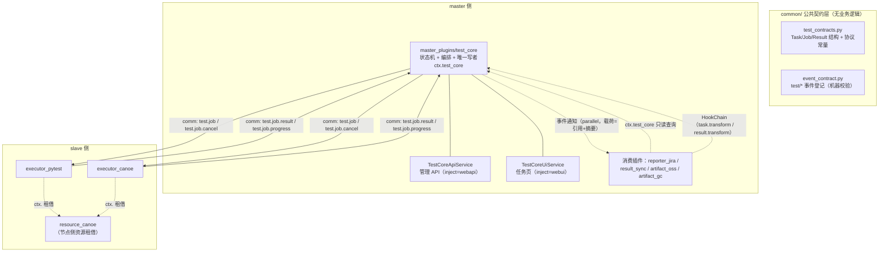
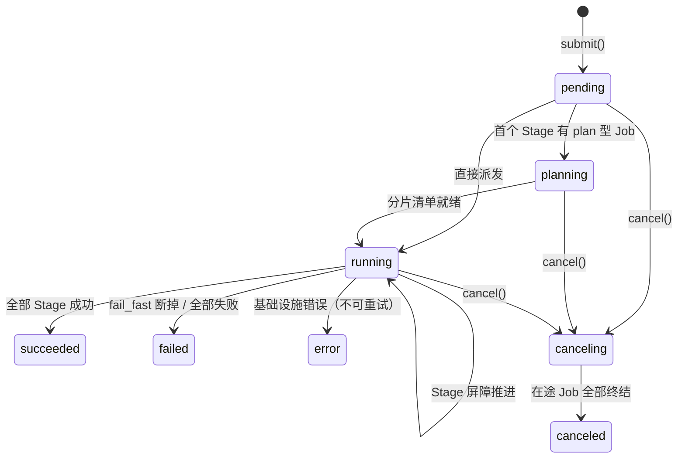
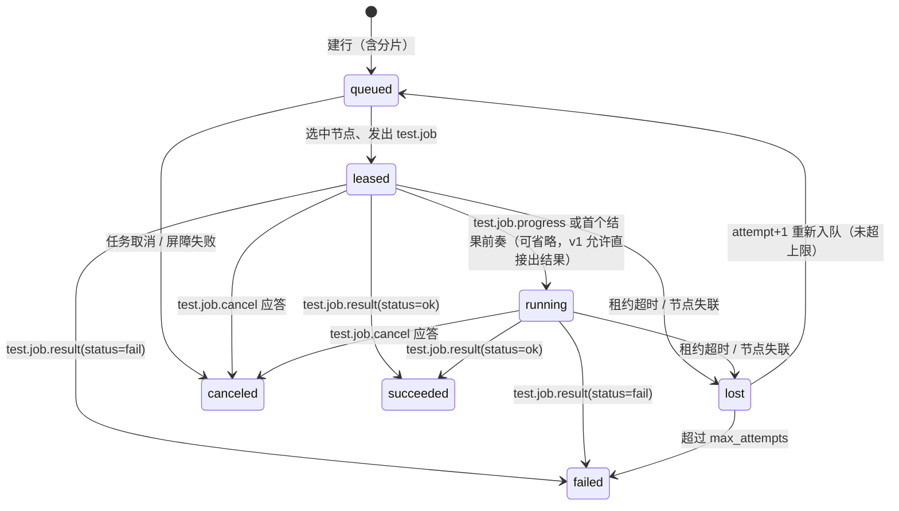
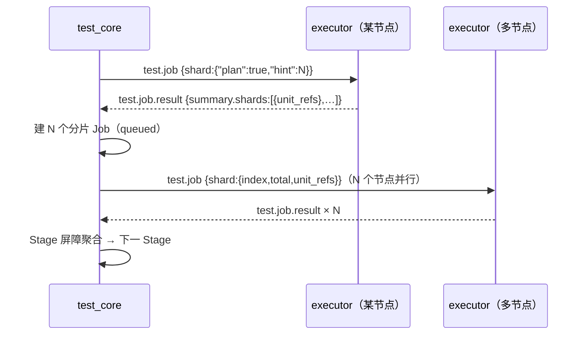

# 测试核心插件设计文档（master_plugins/test_core）

> 状态：📐 设计稿（未实现）。本文是 `test-core` 插件的实现蓝图，配套公共契约层
> `common/test_contracts.py`（待建）与执行器侧约定（`slave_plugins/executor_*`）。
> 命名与结构对齐现有约定：`master_plugins/heartbeat/DESIGN.md`（文档风格）、
> `common/plugins/comm/interface.py`（通信契约）、`common/hook_chain.py`（扩展点）、
> `common/event_contract.py`（事件登记）、`common/models.py`（Model DSL）。

## 1. 目标与非目标

### 1.1 目标

1. **任务编排**：接收测试任务（Task），拆为阶段（Stage）与子运行/分片（Job），
   调度到从节点执行，聚合结果；
2. **状态机唯一写者**：Task/Stage/Job/Result 的持久化状态只有 test_core 会写，
   其他插件一律经「事件 + HookChain + 只读服务」三条通道参与（见 §11）；
3. **多执行器组合**：一个任务的多个阶段可指定不同执行器（pytest、canoe…），
   线性阶段 + 屏障执行；
4. **分片多机器**：一个阶段可拆多个 Job 分发到多个节点并行；
5. **可靠执行**：至少一次消息投递下的幂等、租约超时、节点失联重派、取消/重跑；
6. **开放扩展**：其他插件可监听任务/结果/失败/产物事件、可经 HookChain 修正
   任务与结果数据、可挂 UI、可上报 Jira / 回填系统 / 转存 OSS，核心零耦合。

### 1.2 非目标（v1 不做）

- 阶段 DAG（v1 线性阶段 + 屏障，`depends_on` 字段预留）；
- 运行中暂停/恢复（只支持队列中暂停语义的取消）；
- 测试用例仓库管理、变更影响分析（独立插件，经 submit() 触发）；
- 内置 cron 调度（独立 scheduler 插件，经 submit() 触发）；
- 外部系统上报（Jira/回填/OSS 均为**消费插件**，不在核心内）。

## 2. 总体架构

### 2.1 角色与边界



| 角色 | 位置 | 职责 | 明确不做 |
|---|---|---|---|
| 契约层 | `common/test_contracts.py` | 数据结构、状态枚举、协议常量、版本号 | 无业务逻辑、无状态 |
| 测试核心 | `master_plugins/test_core/` | 状态机、拆分/调度、租约、聚合、落库 | 不执行测试、不对外上报、不上传 OSS |
| 管理界面 | `test_core` 附属服务 | webapi 路由、webui 页面 | 不含业务逻辑（走 `ctx.test_core` 门面） |
| 执行器 | `slave_plugins/executor_*` | 跑测试、产出结果与产物、声明能力 | 不关心谁消费结果、不直连 master API |
| 资源仲裁 | `slave_plugins/resource_*` | 节点内 license/实例租借 | 不做全局调度 |
| 消费插件 | `master_plugins/reporter_*` 等 | 监听事件 → 拉数据 → 干自己的事 | 不写核心的数据 |

### 2.2 铁律映射（不可违反）

- **插件不能 import 插件**：`common/test_contracts.py` 是唯一共享类型来源；
  执行器、消费插件、核心都只 import `common/` 与 `ctx.<service>`；
- **跨节点只走 comm**：master↔slave 一切交互是 comm topic 消息（§7），
  不直接调对方 webapi；
- **核心不依赖 webapi/webui**：管理 API / 页面拆附属服务（`service_of = "test-core"`，
  `inject = ["test_core", "webapi"]`），缺席不阻塞核心（同 heartbeat 模式）。

## 3. 公共契约层：common/test_contracts.py

> 与插件无关的纯数据结构与常量，供核心、执行器、消费插件三方共用。
> 只用 stdlib（dataclass / TypedDict / Literal），不依赖 cordis、不依赖 db。

### 3.1 数据结构

```python
# 提交面（API/服务入参）
type TaskState = Literal[
    "pending", "planning", "running", "canceling",
    "succeeded", "failed", "canceled", "error",
]
type JobState = Literal[
    "queued", "leased", "running",
    "succeeded", "failed", "canceled", "lost",
]   # 上行 JobResult.status 另含 "timeout"，落库归 failed
type StageKind = Literal["run", "approval"]        # 执行阶段 / 人工确认门（预留）

@dataclass(frozen=True)
class ExecutorSelector:
    """执行器选择器：按能力信封匹配（common/capabilities.py 的 kind/id/labels）。"""
    id: str                                         # 能力 id，如 "pytest"
    kind: str = "executor"                          # 固定大类
    labels: Mapping[str, str] = ...                 # 可选筛选轴，如 {"lang": "python"}

@dataclass(frozen=True)
class ShardSpec:
    mode: Literal["none", "plan"] = "none"          # 不分片 / 执行器规划分片
    hint: int = 0                                   # 期望分片数提示（0=执行器自定）

@dataclass(frozen=True)
class StageSpec:
    name: str
    executor: ExecutorSelector
    params: Mapping[str, Any]                       # 执行器自有参数（不解析）
    shard: ShardSpec = ShardSpec()
    requires: Mapping[str, int] = ...               # 资源需求，如 {"canoe": 1}
    timeout_s: float = 0.0                          # 0 = 取配置默认

@dataclass(frozen=True)
class TaskSpec:
    name: str
    stages: Sequence[StageSpec]                     # v1 线性顺序执行 + 屏障
    priority: int = 0                               # 大者先出队
    labels: Mapping[str, str] = ...                 # 项目/租户轴，配额与筛选
    params: Mapping[str, Any] = ...                 # 任务级参数（注入各 Stage）
    idempotency_key: str = ""                       # 提交去重（CI 重复触发）
    failure_policy: Literal["fail_fast", "continue"] = "fail_fast"
    timeout_s: float = 0.0                          # 任务总超时，0=不限

# 下行面（master → slave，topic: test.job）
@dataclass(frozen=True)
class JobDescriptor:
    proto: int                                      # 协议版本，执行器不认识即拒收（§8.3）
    job_id: str
    task_id: str
    stage_name: str
    attempt: int                                    # 从 1 起
    executor: ExecutorSelector
    params: Mapping[str, Any]
    shard: Mapping[str, Any] | None                 # {index, total, unit_refs}，null=不分片
    artifact_dir: str                               # 产物目录（节点本地路径约定见 §8.4）
    deadline_ts: float                              # 建议完成时刻（节点本地参考）

# 上行面（slave → master，topic: test.job.result）
@dataclass(frozen=True)
class ArtifactRef:
    artifact_id: str
    kind: Literal["log", "report", "attachment"]
    name: str
    uri: str                                        # local://… → oss://…（消费插件回填）
    size: int
    sha256: str

@dataclass(frozen=True)
class CaseResult:
    case_id: str                                    # 用例稳定标识（执行器定义）
    status: Literal["passed", "failed", "skipped", "error", "xfailed", "xpassed"]
    duration_s: float
    message: str = ""                               # 失败摘要（截断，详情进产物）
    detail_ref: str = ""                            # 产物/详情引用 id

@dataclass(frozen=True)
class JobResult:
    proto: int
    job_id: str
    attempt: int
    status: Literal["succeeded", "failed", "canceled", "timeout"]
    summary: Mapping[str, Any]                      # {total, passed, failed, ...} 执行器自定
    cases: Sequence[CaseResult]                     # 上限后截断，全量进报告产物
    artifacts: Sequence[ArtifactRef]
    started_ts: float
    finished_ts: float
    error: str = ""                                 # 基础设施级错误（区别于用例失败）
```

### 3.2 版本与兼容规则（后补代价最大，Phase 1 就生效）

- `JobDescriptor.proto` / `JobResult.proto` 从 **1** 起步，执行器按 §8.3 拒收不认识的版本；
- 结构演进规则沿用心跳 config 先例：**忽略未知字段、缺省给默认值**；
  破坏性变更升 `proto`，双版本并行一个过渡期；
- 事件载荷带 `schema_version: 1`，同规则演进。

## 4. 数据模型（Model DSL，owner = "test_core"）

> 声明方式同 `common/plugins/comm/outbox.py`：`class X(Model): __owner__ = "test-core"`，
> **owner = 插件 id**（db 归属校验口径：生产取插件 id 解码、开发取 fiber 名），
> 物理表名 `aetp_test_core_<logical>`（`slug()` 把 `-` 折叠为 `_`）。**只有 test_core 写这些表**；消费插件
> 各自建自己的表（owner=自己），互不 import、互不写对方的表。

| 表（logical） | 关键列 | 说明 |
|---|---|---|
| `task` | `id`, `idempotency_key`(唯一索引), `name`, `source`(api/ci/cron/…), `created_by`, `priority`, `labels`(JSON), `params`(JSON), `state`, `current_stage`, `failure_policy`, `created_ts`, `updated_ts`, `finished_ts`, `error` | 任务主表 |
| `stage` | `id`, `task_id`, `seq`, `name`, `kind`, `executor`(JSON selector), `params`(JSON), `shard_mode`, `requires`(JSON), `state`, `timeout_s` | 阶段表 |
| `job` | `id`, `stage_id`, `task_id`, `node_id`, `attempt`, `state`, `shard`(JSON), `lease_ts`, `started_ts`, `finished_ts`, `error`, `result_seq` | 子运行/分片，调度最小单位 |
| `job_result` | `job_id`, `attempt`, `status`, `summary`(JSON), `started_ts`, `finished_ts`, `error` | 单 Job 结果（一次 attempt 一行） |
| `case_result` | `id`, `job_id`, `attempt`, `case_id`, `status`, `duration_s`, `message`, `detail_ref` | 用例结果（超限时截断存） |
| `artifact` | `id`, `job_id`, `task_id`, `kind`, `name`, `uri`, `size`, `sha256`, `state`(local/uploaded/removed), `created_ts` | 产物引用表（URI 可变） |
| `task_history` | `id`, `task_id`, `from_state`, `to_state`, `reason`, `ts` | 状态迁移审计（管理页时间线） |

幂等键 `idempotency_key`：非空时 `(source, idempotency_key)` 唯一，重复提交返回
已存在的 task_id（CI 场景防重复建任务）。

## 5. 状态机

### 5.1 Task



### 5.2 Job



推进规则：

- **Stage 屏障**：Stage 内全部 Job 终结后才评估——全成功 → 下一 Stage；
  依 `failure_policy` 决定失败即断（fail_fast）或跑完再判（continue）；
- **终态不可逆**：终态行只读；`rerun_failed` 以**同一 Job 行 `attempt+1`**
  （`failed → queued`）回到**同一 Stage**，Task 聚合视图取每 Job 的最新 attempt；
- **迟到结果**：attempt 小于当前最新 attempt 的 `test.job.result` 仍落库
  （`job_result` 每 attempt 一行）但**不参与聚合**、不改 Job 状态，仅记 warning。

## 6. 核心服务：ctx.test_core

> `TestCorePlugin`（`Service[TestCoreConfig]`，`provide = "test_core"`），
> 全部方法走这一个门面；消费插件的只读需求也走这里（不许直连 db 表）。
> 签名以 `common/test_contracts.py` 的 `TestCoreInterface` 为准：触库 / 穿
> Hook 链的方法均为 `async def`，`register_hook` 同步。

```python
@runtime_checkable
class TestCoreInterface(Protocol):
    # -- 提交与生命周期（写） -------------------------------------------------
    def submit(self, spec: TaskSpec, *, source: str = "api") -> str:
        """提交任务，返回 task_id。idempotency_key 命中则返回既有任务。"""
        ...
    def cancel(self, task_id: str, reason: str = "") -> bool: ...
    def rerun_failed(self, task_id: str) -> str:
        """重建失败 Job（同 Task 内 attempt+1），返回同一 task_id。"""
        ...
    def set_priority(self, task_id: str, priority: int) -> bool: ...

    # -- 查询（只读，消费插件入口） -------------------------------------------
    def get_task(self, task_id: str) -> Mapping[str, Any] | None: ...
    def list_tasks(self, *, state: str | None = None, labels: Mapping[str, str] | None = None,
                   limit: int = 50, offset: int = 0) -> list[Mapping[str, Any]]: ...
    def list_jobs(self, task_id: str) -> list[Mapping[str, Any]]: ...
    def get_result(self, task_id: str) -> Mapping[str, Any] | None:
        """聚合结果 + 各 Job/attempt 明细引用。"""
        ...
    def list_case_results(self, *, task_id: str = "", job_id: str = "",
                          status: str = "", limit: int = 200) -> list[Mapping[str, Any]]: ...
    def list_artifacts(self, *, task_id: str = "", state: str = "local") -> list[Mapping[str, Any]]: ...
    def mark_artifact(self, artifact_id: str, *, uri: str | None = None,
                      state: str | None = None) -> bool:
        """产物状态/URI 回填（artifact_oss / artifact_gc 专用写口，仅此一个）。"""
        ...

    # -- 扩展点（HookChain 宿主） ---------------------------------------------
    def register_hook(self, chain: Literal["task.transform", "result.transform", "artifact.sink"],
                      fn: Interceptor[HookCtx, HookCtx], *, phase: str, order: int,
                      name: str, on_error: OnError = OnError.FAIL) -> Callable[[], None]:
        """登记拦截器，返回注销函数（绑调用方 fiber）。语义见 §11.2。"""
        ...
```

错误类型（`test_core.registry` 同包定义，消费插件按需捕获）：
`TestCoreError` → `TaskNotFound` / `InvalidSpec` / `InvalidTransition` / `DuplicateSubmission`。

### 6.1 内部模块划分

```
master_plugins/test_core/
├── __init__.py
├── plugin.json            # id=test-core, entrypoint=plugin:TestCorePlugin, kind=master
├── config.py              # TestCoreConfig(FieldConfig)，[test_core] 节
├── plugin.py              # TestCorePlugin：状态机 + 编排（不沾 web）
├── models.py              # Model DSL 表（§4）
├── scheduler.py           # 队列、选节点、派发窗口、租约扫描
├── hooks.py               # HookChain 宿主（三条链）+ HookCtx
├── registry.py            # 状态机转移表 + TestCoreError
├── api_service.py         # TestCoreApiService（inject=["test_core","webapi"]）
├── ui_service.py          # TestCoreUiService（inject=["test_core","webui"]）
├── README.md
└── DESIGN.md              # 本文
```

## 7. 通信协议（comm topics）

> 全部经 `ctx.comm`（[CommInterface](../../common/plugins/comm/interface.py)）。
> 约定同 comm README：单 topic 内保序、跨 topic 不保序；至少一次投递，处理器幂等。

| topic | 方向 | 投递策略 | 载荷 | 说明 |
|---|---|---|---|---|
| `test.job` | master→slave | `AT_LEAST_ONCE` | `JobDescriptor` | 派发子运行 |
| `test.job.cancel` | master→slave | `AT_LEAST_ONCE` | `{job_id, attempt, reason}` | 取消 |
| `test.job.result` | slave→master | `AT_LEAST_ONCE` | `JobResult` | 结果上报 |
| `test.job.progress` | slave→master | `FIRE_AND_FORGET` | `{job_id, attempt, pct, note}` | 进度（可选，丢了无害） |

载荷示例（`test.job`）：

```json
{
  "proto": 1,
  "job_id": "j-01H…",
  "task_id": "t-01H…",
  "stage_name": "unit",
  "attempt": 1,
  "executor": {"kind": "executor", "id": "pytest", "labels": {"lang": "python"}},
  "params": {"targets": ["tests/"], "extra": "-q"},
  "shard": {"index": 0, "total": 3, "unit_refs": ["tests/a", "tests/b"]},
  "artifact_dir": "data/plugins/test_core/artifacts/t-01H…/j-01H…/a1",
  "deadline_ts": 1760003600.0
}
```

**幂等规则（强制）**：

- 执行器处理 `test.job` 以 `(job_id, attempt)` 去重：已见过即丢弃（重投递常态）；
- 核心处理 `test.job.result` 以 `(job_id, attempt)` 幂等提交：重复上报只记日志；
- 取消后到达的 `test.job.result` 按 §5.2「迟到结果」处理。

## 8. 执行器协议（slave_plugins/executor_* 约定）

### 8.1 能力声明

启动时经 `heartbeat/collect-capabilities` 事件（[capabilities.py](../../common/capabilities.py)）追加信封：

```python
capability("executor", "pytest", "executor-pytest",
           version="1.0.0", labels={"lang": "python"},
           summary="Python 单测执行",
           detail={"shard": "plan", "resources": {}})   # shard: plan|none；resources: 容量声明
```

### 8.2 职责边界

1. `ctx.comm.on("test.job", ...)` 接活 → 校验 `proto` 与 `executor.id` 匹配；
2. 需要资源（`requires` 非空）时向**本节点资源服务**租借（如 `ctx.resource_canoe`，
   同进程调用），拿不到则回报 `failed(error="resource busy")` 或延迟重试（执行器自定，
   核心只看结果）；跑完/异常路径**必须释放**（finally）；
3. 执行测试，产物写入 `artifact_dir`（约定为节点 `data/plugins/test_core/artifacts/...`，
   由核心生成、执行器只写不删）；
4. `ctx.comm.report("test.job.result", JobResult(...))` 上报；大文件不进消息体；
5. 收到 `test.job.cancel`：尽力中止（杀子进程/停止测量），回 `status="canceled"` 的结果。

### 8.3 版本握手

执行器收到 `proto` 不认识：**拒收并回报** `{status:"failed", error:"proto mismatch: got N, support 1"}`，
不静默乱跑；核心把该类失败归为 `error`（基础设施）而非用例失败，不做无谓重试。

### 8.4 产物约定

- `artifact_dir` 由核心按 `{task_id}/{job_id}/a{attempt}` 生成（节点本地路径）；
- 执行器产出后在 `JobResult.artifacts` 里列 `ArtifactRef`（`uri` 填 `local://` 前缀）；
- 核心登记 `artifact` 表（state=local）并发 `test/artifact-ready`；
  `artifact_oss` 消费后经 `mark_artifact()` 回填 `oss://` URI 与 state=uploaded。

## 9. 调度设计（scheduler.py）

### 9.1 队列与优先级

- 单一就绪队列（内存）+ `job` 表兜底恢复（重启后 `queued/leased` 未终结行重新入队）；
- 出队顺序：`priority` 降序 → `created_ts` 升序（同级 FIFO）；
- 配额（v1 简化）：按 `labels["project"]` 的并发上限（配置项），防单项目占满。

### 9.2 节点选择

1. `ctx.nodes.list(online_only=True)`（[NodesInterface](../../common/contracts.py)，heartbeat 提供）；
2. 按能力信封匹配 Stage 的 `ExecutorSelector`（`select_capabilities`，同 id + labels 超集）；
3. 候选节点中选「在途 Job 数最少」者；节点在途数达 `max_inflight_per_node` 跳过；
4. 选中即写 `job.node_id / attempt / lease_ts`，`ctx.comm.send_to(node, "test.job", ...)`。

### 9.3 分片流程（ShardSpec.mode = "plan"）



plan 型 Job 的 `shard = {"plan": true, "hint": N}`（`hint` = `ShardSpec.hint`
期望分片数提示，0 = 执行器自定），分片接口是 `JobResult.summary.shards`；
核心不理解测试套件结构。

### 9.4 背压

- 派发窗口：全局在途 Job（leased+running）不超过 `max_inflight_jobs`；
- comm 在途超限已有保护（丢最旧并告警），核心以窗口兜住，正常不应触发；
- `max_attempts`、租约时长等见 §13 配置。

## 10. 可靠性：租约、重试、幂等

| 机制 | 设计 |
|---|---|
| 租约 | Job 发出时记 `lease_ts`；租约扫描循环（同 heartbeat `_sweep_loop` 模式）发现超时 → `lost` |
| 节点失联 | 订阅 `heartbeat/node-status`（emit，**同步监听器**，只投递内部队列）：节点 `offline/lost` → 其在途 Job 提前判 `lost` |
| 重试 | `lost` 且 `attempt < max_attempts` → `attempt+1` 重新入队（换节点优先）；超限 → `failed` |
| 幂等 | 结果按 `(job_id, attempt)` 幂等提交；重复 `test.job` 由执行器去重 |
| 时钟基准 | 一律以**核心接收时刻**记账（`sent_at`/`deadline_ts` 仅参考），沿用心跳先例 |
| 重启恢复 | 启动时扫 `job` 表：`leased/running` 超租约按超时处理，`queued` 回内存队列 |

## 11. 扩展点

### 11.1 事件（只监听；载荷 = 引用 + 摘要，禁止大对象）

在 [event_contract.py](../../common/event_contract.py) 登记（模式全部 `parallel`，
经 `common.cordis_utils.parallel_event` 派发，异常隔离；`tests/test_event_contract.py` 机器校验）：

| 事件 | 时机 | 载荷（含 `schema_version: 1`） |
|---|---|---|
| `test/task-created` | submit 落库后 | `{task_id, name, labels, source, priority}` |
| `test/task-state` | 每次状态迁移 | `{task_id, from, to, reason}` |
| `test/job-finished` | Job 终结 | `{task_id, job_id, attempt, status, node_id, summary}` |
| `test/case-finished` | 用例失败批（聚合后） | `{task_id, job_id, attempt, failed:[{case_id, message, detail_ref}], truncated}` |
| `test/task-finished` | Task 终结 | `{task_id, state, counts:{passed,failed,…}, duration_s}` |
| `test/artifact-ready` | 产物登记后 | `{artifact_id, task_id, job_id, kind, uri, size, sha256}` |

消费模式（Jira/回填/OSS 全部如此）：

```python
class ReporterJiraPlugin(Service[...]):
    async def init(self) -> object:
        self.ctx.on("test/case-finished", self._on_failed)   # 同步监听器或 parallel
        ...
    def _on_failed(self, payload: dict) -> None:
        detail = self.ctx.test_core.list_case_results(task_id=payload["task_id"], status="failed")
        ...  # 自己的 outbox 去重 + 重试 + 调 Jira，绝不阻塞核心
```

### 11.2 HookChain（要修改数据；宿主 = test_core）

复用 [hook_chain.py](../../common/hook_chain.py)（phase+order 排序、FAIL/SKIP 策略、
洋葱结构、快照执行）。数据经 `HookCtx`（可变 dataclass）传递：

| 链 | 触发点 | HookCtx 可改 | 典型用途 | 建议 on_error |
|---|---|---|---|---|
| `task.transform` | submit 落库前 | `spec`（Stage 参数/labels） | 按环境注入变量、加标签 | `FAIL` |
| `result.transform` | `test.job.result` 落库前 | `result`（summary/cases） | 归一化 case_id、补标签 | `FAIL` |
| `artifact.sink` | `test/artifact-ready` 发出后 | 只读 `ref`（旁路复制） | 审计旁路写 | `SKIP` |

**纪律**：修改数据只能走 HookChain；同一扩展点的拦截器用 `phase/order` 表达顺序，
禁止拦截器之间直接互调（防隐式插件依赖）。

### 11.3 UI 贡献

- 核心 UI（任务列表 / 任务详情时间线）由 `TestCoreUiService` 提供；
- 消费插件经 [UiCatalogInterface](../../common/contracts.py) 挂自己的 tab/面板
  （Jira 关联缺陷、OSS 产物下载、回填状态），核心页面不为任何消费方改代码；
- 任务详情 API 带 `extensions` 收集槽（同 heartbeat `collect-node` 模式）：
  `test/collect-task` 事件，监听器写 `response["extensions"]["<插件名>"]`。

## 12. 管理 API（api_service.py，inject=["test_core","webapi"]）

路由注册同 [HeartbeatApiService](../heartbeat/api_service.py)：`api.get/post(path, handler, kind="api", name="test-core.…")`。

| 方法 | 路径 | 说明 |
|---|---|---|
| POST | `/api/test/tasks` | 提交任务（body=TaskSpec JSON；`Idempotency-Key` 头可选） |
| GET | `/api/test/tasks` | 列表（state/labels 过滤、分页） |
| GET | `/api/test/tasks/{task_id}` | 详情（含 extensions 收集槽） |
| GET | `/api/test/tasks/{task_id}/jobs` | Job 列表（含 attempt 历史） |
| GET | `/api/test/tasks/{task_id}/result` | 聚合结果 |
| POST | `/api/test/tasks/{task_id}/cancel` | 取消 |
| POST | `/api/test/tasks/{task_id}/rerun` | 重跑失败 Job |
| PATCH | `/api/test/tasks/{task_id}` | 改优先级/标签 |
| GET | `/api/test/cases` | 用例结果查询（status/keyword 过滤） |
| GET | `/api/test/artifacts` | 产物列表 |
| GET | `/api/test/artifacts/{artifact_id}/download` | 本地产物下载（uploaded 后 302 到外部 URI） |
| POST | `/api/test/materials` | 材料上传（二进制 body；`X-Material-Name`/`X-Material-Recipe`/`X-Material-Executor` 头；超限 413） |
| GET | `/api/test/materials[/{id}[/cases]]` | 材料列表（state/labels/**executor** 过滤，`executor_id==X OR =''`）/ 详情 / 用例清单 |
| DELETE | `/api/test/materials/{id}` | 删除（被任务/计划/选择集引用 → 409） |
| GET | `/api/test/materials/{id}/download` | 材料 zip 下载 |
| GET | `/api/test/selections/{sid}` | 选择集详情 |
| GET/POST | `/api/test/plans` | 计划列表（keyword/labels/分页）/ 创建 |
| GET/PUT/DELETE | `/api/test/plans/{plan_id}` | 详情 / 更新 / 删除（缺失 404/False 语义见 §6） |
| POST | `/api/test/plans/{plan_id}/clone` | 另存为 |
| POST | `/api/test/plans/{plan_id}/dispatch` | 下发（overrides；`Idempotency-Key` 头优先；返回 `{task_id, deduplicated}`） |
| GET | `/api/test/jobs/{job_id}/logs` | 测试输出流 tail（`since_id`/`limit`；log 插件缺席降级 `log_available=false`） |

鉴权走 webapi 既有 auth 链（`webapi/auth-denied` 事件已可审计）；写操作记审计日志。

## 13. 配置模型（config.py，`config.ini` 的 `[test_core]` 节）

`TestCoreConfig(FieldConfig)`，类属性即默认值，校验沿用 `_positive_seconds` 风格：

| 字段 | 默认 | 说明 |
|---|---|---|
| `lease_timeout` | `300.0` | Job 租约秒数（发出 → 结果/续期） |
| `job_timeout` | `3600.0` | Job 默认超时（StageSpec.timeout_s=0 时生效） |
| `task_timeout` | `0.0` | 任务默认总超时（0=不限） |
| `max_attempts` | `3` | 单 Job 最大执行次数（含首次） |
| `max_inflight_jobs` | `32` | 全局派发窗口 |
| `max_inflight_per_node` | `4` | 单节点在途上限 |
| `default_priority` | `0` | 未指定时的优先级 |
| `project_quota` | `0` | 按 labels.project 的并发配额（0=不限） |
| `case_results_limit` | `2000` | 单 Job 用例结果截断上限 |
| `retention_days` | `30` | 产物本地保留天数（GC 插件消费） |
| `history_size` | `200` | task_history 单任务保留条数 |

## 14. 日志、审计与可观测性

- 运行日志走 `ctx.logger`（log 插件），敏感字段经 [log_op](../../common/log_op.py) 脱敏；
- 状态迁移全部进 `task_history` 并记审计（提交/取消/重跑/改优先级）；
- `health_metrics()` 挂 `api.add_health_provider("test_core", ...)`：
  队列深度、在途 Job 数、租约超时累计、重试累计、各 HookChain 自带计数
  （[hook_chain.py](../../common/hook_chain.py) 的调用/出错/自身耗时）；
- 事件全部 `parallel` 派发（异常隔离），**禁止把核心路径搭在消费插件的健康上**。

## 15. 数据保留与 GC

- 核心只**登记引用、不删文件**；`artifact_gc` 消费插件订阅 `test/artifact-ready`，
  按 `retention_days` 异步清理（删本地文件 + `mark_artifact(state="removed")`）；
- `job_result`/`case_result` 保留期独立配置（v1 随 task 保留，不做精细分级）；
- 转存 OSS（`artifact_oss`）与 GC 互斥由 `artifact.state` 状态机保证
  （local → uploaded → removed，单向）。

## 16. 安全

- 提交/取消/重跑需经 webapi 鉴权（服务层 `submit/cancel` 面向**同进程插件**，不做二次鉴权）；
- `JobDescriptor.params` 与 `StageSpec.params` 均为**不透明 JSON**，核心不拼 shell、
  执行器自行安全处理（参数注入风险归执行器）；
- 产物目录严格在 `data/plugins/test_core/artifacts/` 下，执行器不得路径穿越
  （核心生成路径、执行器只写）；
- 凭据（Jira token / OSS AK）归消费插件经 appconfig/环境变量获取，
  **不进 db、不进事件、不进日志**。

## 17. 实施切片与测试策略

| Phase | 内容 | 验收 |
|---|---|---|
| P1 | `common/test_contracts.py` + `test_core`（单节点单 Job，pytest 执行器直连）：状态机、落库、`ctx.test_core`、管理 API | `tests/test_test_core.py`：状态机全转移、幂等提交、聚合正确 |
| P2 | comm 派发 + 租约/重试/取消 + 分片 plan 流 | 假 transport 驱动的 E2E：丢包重投、节点失联重派、迟到结果不污染 |
| P3 | Stage 组合多执行器 + 资源租借接入 | 双执行器任务、resource busy 路径 |
| P4 | 事件/HookChain 铺开 + 样板消费插件（Jira/OSS 任选其一做样板） | `tests/test_event_contract.py` 扫描通过；消费插件独立测试 |

测试约定（沿用 `tests/` 现状）：

- 状态机转移表做**穷举表驱动测试**（合法/非法转移）；
- comm 用测试替身（fake transport / 内存 outbox），不打真网；
- 事件契约由 `tests/test_event_contract.py` 全仓扫描（新事件必须先登记）；
- HookChain 顺序/失败策略语义已有 `tests/test_hook_chain.py` 覆盖，测试核心只测接线。

## 18. 决策记录

| # | 决策 | 理由 |
|---|---|---|
| D1 | 结果消息只带摘要，详情/日志走 `ArtifactRef` | comm 应答 256KiB 理念：消息体恒小 |
| D2 | 任务数据唯一写者是核心，修改只能走 HookChain | 消灭多插件并发写冲突，热装卸顺序可控 |
| D3 | 事件载荷 = 引用 + 摘要，详情靠只读服务拉 | 消费插件互不影响，核心不感知消费方数量 |
| D4 | 分片规划交给执行器（plan 型 Job） | 核心不懂测试套件结构，执行器才是专家 |
| D5 | 资源仲裁在节点侧（租借），核心只管容量提示 | license 语义归资源插件，泄漏由节点服务收口 |
| D6 | 时间以核心接收时刻为准 | 多机时钟不可信（沿用心跳先例） |
| D7 | `proto` 版本 + 忽略未知字段 | 执行器独立演进，向后兼容可机器验证 |
| D8 | v1 阶段线性 + 屏障，`depends_on` 预留 | 先解决 80% 场景，DAG 升级不改表 |

## 19. 开放问题

1. `case-finished` 批量粒度：每 Job 终结发一条 vs Task 终结汇总发——倾向前者
   （Jira 及早建单），Task 终结再发 `task-finished` 供回填收口；
2. 执行器 progress 的续租语义（长任务是否以 progress 续 lease）——v1 用
   `lease_timeout` 覆盖最长 Job 时长即可，P2 再评估续租；
3. 跨任务的用例级历史（flaky 趋势）存储位置——倾向独立 `reporter_stats` 消费插件
   自建表，不进核心；
4. `approval` Stage 的交互协议（谁放行、超时策略）——等有真实需求再定契约。
