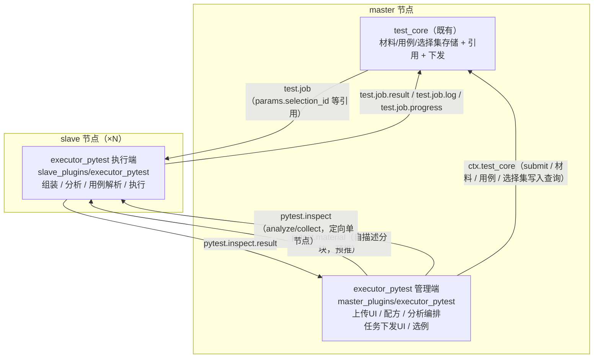
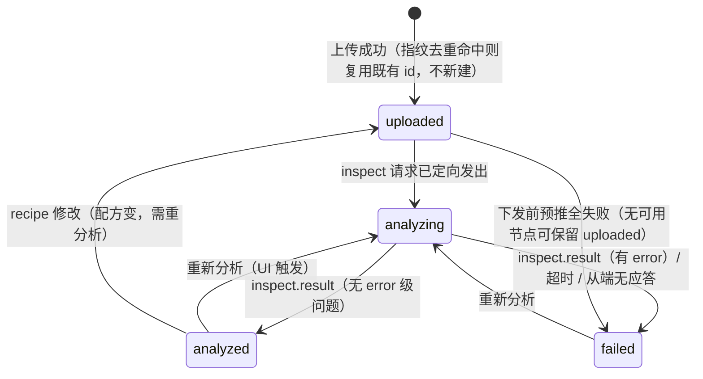

# pytest 执行器（主从双插件）设计文档

> 状态：📐 设计稿 **v2**（**待评审，未实现**）。本文替代 v1（执行端单插件稿），
> 因新增「脚本上传 / 组装 / 分析 / 用例解析 / 任务下发 UI」需求整体重设计，
> 并已吸收 v2 初稿的全部审查修复（协议乱序、去重语义、派发竞态、请求路由、
> 选例载荷、状态机、GC/引用约束等）。与
> [master_plugins/test_core/DESIGN.md](../../master_plugins/test_core/DESIGN.md)
> （下称「核心设计」）配套；契约以
> [common/test_contracts.py](../../common/test_contracts.py) 为准。
> 评审通过后按 §17 批次实施，§18 列出核心 / 契约层配合改动。

## 1. 背景与目标

### 1.1 需求

1. **测试核心提供脚本上传接口**：脚本不一定"直接下发就能跑"——可能是一组
   文件 + 参数，需执行器**组装生成测试工程**后才能执行；
2. **执行器提供脚本上传 UI**：材料（脚本包）上传 + 组装配方编辑；
3. **执行器提供任务下发 UI**：编辑测试任务时可传入指定参数 / 环境变量；
4. **脚本分析**：检查当前脚本是否存在问题（语法 / 依赖 / 可收集性 / 配方）；
5. **用例解析**：解析脚本中的用例数据，**测试核心可获取**（选例、统计）；
6. 因此执行器拆为**主从两个插件**：管理端（主，master 侧）+ 执行端（从，
   slave 侧）。

### 1.2 目标

1. **材料全生命周期**：上传 → 分析 → 用例解析 → 预推 → 随任务下发 → 组装 →
   执行 → 产物归档 → 过期清理；
2. **管理端**：上传 UI、配方编辑、分析 / 解析触发与结果展示、任务下发 UI
   （参数 / 环境变量 / 选例）；
3. **执行端**：材料组装、脚本分析、用例解析、测试执行（沿 v1 执行内核）；
4. **核心**：材料与用例数据的**存储与引用**（内容不透明）、上传接口、
   用例/选择集查询接口；
5. 保持既定分工：核心管「分给谁 / 干砸了怎么办 / 分数怎么记」，执行器管
   「活怎么干」；主从同族经 comm 协作（心跳主从先例）。

### 1.3 非目标

- 在线脚本 IDE（编辑器只做配方与参数编辑，脚本内容由上传决定）；
- 用例级分布式调度（分片仍为文件级）；
- 材料历史版本管理（v1 单版本 + 指纹去重，见 §20）；
- 非 pytest 执行器的材料语义（材料对核心不透明，语义归本插件族）。

## 2. 总体架构



### 2.1 三方职责边界

| 职责 | test_core（核心） | 管理端（主） | 执行端（从） |
|---|---|---|---|
| 材料上传接口 / 存储 | ✅（内容不透明） | UI + 调接口 | — |
| recipe（不透明字符串） | 存原样字符串（core 不解析） | pytest 不使用；未来执行器面板表单生成 | 自定义解析 |
| 脚本分析 | 存问题结果 | 触发 + 展示 + **选节点** | ✅ 真实环境执行 |
| 用例数据 / 选择集 | ✅ 存储 / 查询接口 | 展示 / 选例 | ✅ 解析 |
| 任务下发 | ✅ `submit()` / 状态机 | ✅ 任务编辑 UI | — |
| 材料分发 | —（引用随 Job 透传） | ✅ **预推** + 补推 | 接收 / 校验 / 落盘 |
| 测试执行 | 调度 / 重试 / 聚合 | — | ✅ 组装 + 执行 |
| 日志 / 结果 / 产物 | ✅ 收集 / 追踪 | 查看 | ✅ 上报 |
| 能力声明 | 按能力选节点 | — | ✅（`executor/pytest`） |

### 2.2 插件结构

```
master_plugins/executor_pytest/          # 管理端（主）
├── __init__.py
├── plugin.json                          # id=executor-pytest-master, kind=master
├── config.py                            # [executor_pytest_master] 节
├── plugin.py                            # ExecPytestMasterPlugin：预推 / inspect 编排
├── material.py                          # 打包 / 自描述分块推送 / 就绪跟踪 / 补推
├── api_service.py                       # 管理端 API（inject=[..., webapi]）
├── ui_service.py                        # 页面注册（inject=[..., webui]）
├── ui/MaterialsPage.vue                 # 上传 / 配方编辑 / 分析结果 / 用例清单
├── ui/SubmitPage.vue                    # 任务下发（参数 / 环境变量 / 选例）
├── README.md
└── DESIGN.md                            # 本文

slave_plugins/executor_pytest/           # 执行端（从）
├── __init__.py
├── plugin.json                          # id=executor-pytest, kind=slave
├── config.py                            # [executor_pytest] 节
├── plugin.py                            # PytestExecutorPlugin：协议接线 / 幂等 / 取消
├── executor.py                          # 执行内核：子进程 / 输出捕获 / junit 解析
├── assemble.py                          # 工程组装（配方解释）
├── inspect.py                           # 脚本分析 + 用例解析
├── stream.py                            # 日志流批量器 / case 归属
├── marker_plugin/aetp_marker.py         # pytest 小插件：case 标记 + 结构化收集清单
└── README.md
```

### 2.3 铁律映射

- 双方是独立插件包，**互不 import**；一切经 comm 消息（心跳主从先例）；
- 管理端 ↔ 核心经 `ctx.test_core` 服务；只 import stdlib、`cordis_port`、
  `common.*` 公共层、同包 `.xxx`；
- 能力声明经 `common.capabilities`；DeliveryPolicy 字面量 dict。

## 3. 数据模型（核心侧新增，owner = "test-core"）

> 材料与用例数据归**核心存储**（数据唯一写者原则延伸：核心存引用与清单，
> 内容不透明）；管理端经 `ctx.test_core` 材料服务面读写。列风格对齐
> `task` 表（审计列齐全、JSON 文本列）。

| 表 | 列 | 说明 |
|---|---|---|
| `material` | `id`(pk), `name`, `kind`(zip), `size`, `sha256`, `recipe_fingerprint`, `recipe`(JSON), `state`, `problems`(JSON), `source`, `created_by`, `labels`(JSON), `created_ts`, `updated_ts` | 材料主表；唯一键 `(sha256, recipe_fingerprint)`（§4.3） |
| `material_case` | `id`(pk = `material_id + "::" + case_id`), `material_id`, `case_id`(nodeid), `name`, `path`, `markers`(JSON), `params`(JSON), `status`(ok/error) | 用例清单（解析结果） |
| `material_selection` | `id`(pk), `material_id`, `name`, `case_ids`(JSON), `created_by`, `created_ts` | 选择集（任务下发 UI 的勾选结果，Job 只带引用） |

材料文件本体：核心节点 `data/plugins/test_core/materials/{material_id}/bundle.zip`
（上传落盘；运行时列 zip 目录取文件清单，**不建 material_file 表**——决策 D13）。

### 3.1 材料状态机



- **状态归属**：`analyzing` 是**管理端编排态**（经 `inspect_status` 暴露，
  核心服务面不写）；核心持久态仅 `uploaded / analyzed / failed`（`put_problems`
  与 `update_recipe` 写入），UI 徽标由「核心状态 + 在途 inspect」合成；
- **并发互斥**：同 `material_id` 已有 `analyzing` 在途时，新的分析请求合并
  （复用在途 `request_id` 应答广播给新等待者），不并发双跑；
- **迟到应答**：超时置 `failed` 后 `inspect.result` 才到 → 收下刷新状态并记
  warning（同 Job 迟到结果口径）；
- `problems` 永远存**最近一次**分析结果；状态迁移记审计日志。

### 3.2 引用约束与 GC（决策 D14）

- **被任务引用的材料禁止删除**：`delete_material` 校验无 `task.params` /
  `material_selection` 在用（含历史任务与 rerun 引用），有引用 → 409；
- 主端保留策略：`material_retain_days`（默认 90 天）仅清理**无引用**且
  超期的材料（GC 动作归管理端定时任务，核心提供 `list_unreferenced` 辅助）；
- 从端缓存：`material_retain_days`（默认 30 天）+ `material_cache_max_bytes`
  （默认 2 GiB）双限，超限按 LRU 清**未被在跑 Job 使用**的缓存；
- 组装工程目录：Job result 上报后删除；启动时扫尾（崩溃残留）。

## 4. 材料与 recipe（执行器自定义不透明字符串）

> **v2.1 语义修订**（用户裁决）：recipe 是**执行器自定义的不透明字符串**——
> core 只存取不解析、不知含义；生成方式是各执行器面板的表单选择/配置拼串。
> **pytest 不使用 recipe**（面板无配方输入、执行端不解释，材料即传即跑）；
> 未来 canoe 等在**自己的面板**做表单 → 生成自己的格式字符串。
> 本文 §4.2 原 JSON 结构（layout/entry/args/env/requirements/setup）作废。

### 4.1 材料（脚本包）

- 格式：**zip**（沿用插件包上传的二进制 body 先例
  `webapi._read_body_capped`）；上限 `material_max_bytes`（默认 16 MiB）；
- zip-slip 防护（解包路径校验）；`sha256` 落档。

### 4.2 recipe（不透明字符串）

- 类型 `str`（可空串）：core 存原样字符串、上传 API 原样透传
  （`X-Material-Recipe` 头 / query 降级）；
- **解析格式由执行器自定义**，core 与上传 API 不关心含义；
- pytest 执行器：**不解析 recipe**（任何内容均忽略）——工程 = zip 原样解压，
  执行目标 = 分片 unit_refs → params.targets → selection 展开 → 兜底 `["."]`；
- 未来执行器（canoe）：自己的面板表单 → 拼自己的字符串 → 自己解释。

### 4.3 指纹与去重

- `recipe_fingerprint` = `sha256(recipe.encode("utf-8"))`（16 位 hex；空串
  合法、恒定指纹）；
- 上传去重键 **`(sha256, recipe_fingerprint)`**：同内容同字符串 = 同一材料
  （幂等复用），同内容不同字符串 = **不同测试工程**（如 canoe 同素材不同
  工程配置）；命中 → 返回既有 `material_id`。

## 5. 材料分发协议（管理端 → 执行端）

> comm 消息体恒小（SQLite outbox），材料走**自描述分块**；单 topic 内保序、
> 跨 topic 不保序——因此**元信息冗余进每条 chunk，不依赖元包先行**（修复）。

### 5.1 消息（族内私有 topic，全部带 `proto` 字段）

| topic | 方向 | 策略 | 载荷 |
|---|---|---|---|
| `pytest.material` | 主→从 | `AT_LEAST_ONCE` | `{proto, material_id, sha256, recipe_fingerprint, total, chunk_size, recipe}`（元包；**chunk 不等它**） |
| `pytest.material.chunk` | 主→从 | `AT_LEAST_ONCE` | `{proto, material_id, sha256, total, index, data_b64}`（**自描述**：每条含 total/sha256） |
| `pytest.material.missing` | 从→主 | `AT_LEAST_ONCE` | `{proto, material_id, node_id, missing: [index…]}`（兜底补发请求） |

- `chunk_size` 64 KiB（原文；base64 后约 87 KiB/消息，1.33x）；
- 从端按 `(material_id, index)` 幂等落盘（已收跳过），齐 `total` 块后校验
  `sha256`；一致置 ready；不一致回 `missing`（列出坏/缺块）重拉一轮，
  再失败放弃并告警；
- **元包的 `recipe`** 是组装依据；元包乱序晚到不影响落盘（chunk 自描述），
  组装前确保元包已到即可。

### 5.2 预推与就绪（修复：下发前置预推，missing 仅兜底）

1. **预推**（主路径）：`submit()` **之前**，管理端把材料推给**全部能力匹配
   候选节点**（`ctx.nodes.select` 过滤 `executor/pytest`），`push_concurrency`
   控流；预推完成（各节点齐块校验通过 / 明确失败）才允许提交任务；
2. **兜底**：执行端收 `test.job` 时材料未就绪 → 发 `test.job.progress
   {event: "material-missing"}` + `pytest.material.missing`，**宽限等待
   `material_wait_s`（默认 60s）**，其间材料到即执行；超时回
   `failed: material missing`（属基础设施错误，核心重试新 attempt 给补推
   留窗口）；
3. 补推幂等：`missing` 带块清单，主端只发缺块；**无就绪跟踪记录**（主端重启 /
   未预推即触发）时自愈——候选节点整包补推（元包优先复用同材料既有
   selections），非候选节点忽略告警。

## 6. 脚本分析（inspect / analyze）

### 6.1 请求路由（修复：定向单节点，首个应答胜出）

- 合并分析/解析为**一个通道** `pytest.inspect`（`mode: "analyze" | "collect"`），
  减一组 topic；
- **定向单节点**：管理端用 `ctx.nodes.select(kinds=["slave"])` 匹配
  `executor/pytest` 能力选一台（优先 Job 候选节点，最少在途优先），
  `send_to(node)`；应答带 `node_id`；
- 幂等键 `request_id`：同 `request_id` 只认**首个**应答（含迟到应答处理，
  §3.1）；无应答超时 `inspect_timeout_s`（默认 300s）→ `failed` 可重试；
- 请求携带 `material_id`（从端未就绪走 §5.2 兜底同款宽限）。

### 6.2 检查项（从端 inspect.py，在真实执行环境、临时目录组装后进行）

| # | 检查 | 实现 | 问题码 | 级别 |
|---|---|---|---|---|
| 1 | 包完整性 | 解压 + sha256 | `material.corrupt` | error |
| 2 | 配方校验 | layout src 存在、entry 可达、env 合法 | `recipe.invalid` | error |
| 3 | 语法 | `py_compile` 逐 .py | `syntax.error` | error |
| 4 | 依赖声明 | `requirements` 与环境探测（pip show / import） | `deps.missing` | warning |
| 5 | 可收集性 | 组装后 `pytest --collect-only`（经 marker 插件） | `collect.error` | error |

问题模型：`{code, path, line?, message, severity}`；`problems` 入
`material.problems`（JSON），同时回 UI。

## 7. 用例解析（inspect / collect）

- `mode="collect"`：组装后经 **`aetp_marker` 插件输出结构化清单**（修复：
  不解析 `-q` 文本）——hook `pytest_collection_modifyitems` 导出 JSON：

```json
{"cases": [
  {"case_id": "tests/test_a.py::TestX::test_y[p1]", "name": "test_y[p1]",
   "path": "tests/test_a.py", "markers": ["smoke"], "params": {"id": "p1"}}
]}
```

- **`params` 的口径**：parametrize 原始参数值只存在于对象内部，nodeid 里是
  字符串化 id——`params` 为**从 nodeid 解析的近似值**（文档口径如实声明，
  以 nodeid（`case_id`）为准）；
- 结果经管理端写入核心 `material_case`（**核心可查询**，需求 5）；
- `status=error` 标记解析异常的用例，不阻塞其余入库；
- **选例（selection）**：任务下发 UI 勾选 → 写 `material_selection`
  （`case_ids` 列表）→ Job 只带 `params.selection_id`（修复：载荷恒小，
  §11）。

## 8. API 面（材料 CRUD 归核心，族内操作归管理端）

**核心既有端点**（`test_core` 的 api_service，`/api/test/*`——材料存储在核心，
上传/列表/详情/删除/用例/下载/选择集查询由它承担）：

| 方法 | 路径 | 说明 |
|---|---|---|
| POST | `/api/test/materials` | 上传 zip（二进制 body + `X-Material-Name`/`X-Material-Recipe` 头；超限 413、指纹命中 200 返回既有 id） |
| GET | `/api/test/materials[/{id}[/cases]]` | 列表 / 详情 / 用例清单 |
| DELETE | `/api/test/materials/{id}` | 删除（有引用 409，§3.2） |
| GET | `/api/test/materials/{id}/download` | zip 下载 |
| GET | `/api/test/selections/{sid}` | 选择集详情 |

**族内端点**（管理端 api_service，`inject = ["executor_pytest_master", "webapi"]`）：

| 方法 | 路径 | 说明 |
|---|---|---|
| PUT | `/api/pytest/materials/{id}/recipe` | 更新配方（→ 状态回 `uploaded` 需重分析；指纹变化即新指纹） |
| POST | `/api/pytest/materials/{id}/selections` | 保存选择集（`{"name", "case_ids"}`）→ 返回 `selection_id` |
| POST | `/api/pytest/materials/{id}/push` | 预推（`{"selection_ids": […]}` 可选）→ 各节点 pushed/failed |
| POST | `/api/pytest/materials/{id}/inspect` | 触发分析/解析（`{"mode": "analyze"\|"collect"}`，返回 `request_id`） |
| GET | `/api/pytest/inspects/{request_id}` | inspect 请求状态 / 结果 |
| GET | `/api/pytest/stats` | 管理端运行统计 |

错误映射同核心 API 惯例（400/404/409/500 + `{"ok", "error", "code"}`）。

## 9. 管理端 UI

### 9.1 材料与工程页（MaterialsPage.vue）

- 上传（拖拽 zip）→ 文件清单浏览 → **配方表单编辑**（layout/entry/args/env/
  requirements，raw JSON 兜底）→ 「分析」「解析」按钮（结果面板：问题列表
  按 severity 着色；用例清单表格 + 过滤 + 勾选）；
- 材料状态徽标（uploaded/analyzing/analyzed/failed）+ 重新分析。

### 9.2 任务下发页（SubmitPage.vue）

| 区块 | 内容 | 落到 TaskSpec |
|---|---|---|
| 基本信息 | 名称、优先级、标签、失败策略、超时 | `name/priority/labels/failure_policy/timeout_s` |
| 材料与选例 | 选材料 → 用例清单勾选（全选/按 marker 过滤） | 保存 selection → Stage `params.selection_id` + `params.material_id` |
| 参数 | **动态表单**（按能力信封 `detail.schema` 生成，§11）+ raw JSON 兜底 | Stage `params` |
| 环境变量 | 键值编辑（UI 即拒 `AETP_*` 前缀） | `params.env` |
| 分片 | plan 开关 + hint | Stage `shard` |

提交流程：**保存 selection → 预推材料（§5.2）→ `ctx.test_core.submit()`**
（幂等键 UI 生成）；预推失败的节点在 UI 上明示（可选择仍提交——失败节点
会走 §5.2 兜底）。

## 10. 执行端（slave）执行内核

> 沿 v1 执行内核（已并入），本节为摘要；不变决策：文件级分片（D1）、
> case_id=nodeid（D2）、杀进程树（D3）、日志双写（D4）、幂等表只防重复
> 消息（D5）、argv 化拒 shell（D7）、proto 拒收（D8）。

### 10.1 接活与幂等

`test.job` → proto 校验（不匹配回 `failed: proto mismatch` 不执行）→
`(job_id, attempt)` 本地 JSON 去重表（登记先于执行）→ 材料就绪检查
（§5.2 宽限）→ `max_concurrent` FIFO → 执行。

### 10.2 组装（assemble.py）

材料 zip 解到 `{节点目录}/workdir/{job_id}/a{attempt}/`（zip-slip / 越界安全
校验）→ **原样即工程**（v2.1：pytest 不解释 recipe，无铺排/覆盖）→
工程目录即 pytest `cwd`；解压失败 → `failed: assemble error`（不重试）。

### 10.3 执行与结果

- argv：`[python, "-m", "pytest", *targets, *extra_args, "--junitxml", …,
  "-p", "aetp_marker"]`，`shell=False`；targets 优先级：分片 `unit_refs`
  → `params.targets` → `params.selection_id` 展开（从端本地材料用例清单
  或收到的 case_ids）→ recipe.entry 兜底；
- 超时 = `min(deadline_ts 余量, config.timeout_s)`；取消优先于超时；杀
  **进程树**；canceled/timeout 仍上报已产生产物；
- junit → `CaseResult`（case_id=nodeid；summary 计数；`succeeded` ⟺
  `failed+errors==0` 且非取消/超时）；基础设施错误与用例失败**区分**
  （`error` 字段，cases 为空）；
- 产物：`junit.xml`(report) + `pytest.log`(log)，sha256/size 自算，
  `uri="local:///D:/…"` 盘符形态；组装目录随 result 上报清理（§3.2）。

### 10.4 日志流

`LogChunk {proto, job_id, attempt, seq, stream, case_id, lines[]}`；
`level` 口径：stdout 行=20(INFO)、stderr 行=30(WARNING)（marker 控制行
不入流）；每 50 行 / 2 秒批量、每秒 ≤20 包、单行 8 KiB 截断、seq 断层可
检测；追踪元组 `op=task_id / name=test.{job_id}.{attempt} / source=case_id`。

## 11. 参数契约（params schema）

### 11.1 schema 动态发现（决策 D17，替代 v2 初稿"双端静态常量"）

执行端能力信封的 `detail` 携带 **JSON Schema 子集**：

```python
capability("executor", "pytest", "executor-pytest", ..., detail={
    "shard": "plan",
    "schema": {"type": "object", "properties": {
        "material_id": {"type": "string"},
        "targets": {"type": "array", "items": {"type": "string"}},
        "extra_args": {"type": "array", "items": {"type": "string"}},
        "keyword": {"type": "string"},
        "env": {"type": "object"},
        "selection_id": {"type": "string"},
        "workdir": {"type": "string"}, "python": {"type": "string"}}
    }})
```

管理端任务下发 UI **从能力信封读 schema 生成动态表单**——换执行器
（canoe 等）UI 自动跟随，无双端常量漂移问题。

### 11.2 params 语义（执行端解释）

| 键 | 说明 |
|---|---|
| `material_id` | 材料引用（组装用；与 `targets/selection_id` 构成执行目标） |
| `selection_id` | 选择集引用（**载荷恒小**：展开动作在执行端，case_ids 随材料/补发清单同步或经核心查询——见 §20-Q1 备注） |
| `targets` | nodeid/文件/目录列表（选例聚合或手填） |
| `extra_args` / `keyword` | 追加参数 / `-k`（并存时 extra_args 优先） |
| `env` | 环境变量增量（拒 `AETP_*`；argv 化不进 shell） |
| `workdir` / `python` | 覆盖执行端配置 |

未知键忽略；核心注入保留键（`__timeout_s__`）忽略；`material_id` 与
`targets/selection_id` 至少其一。

## 12. 配置模型

### 12.1 核心 `[test_core]`（新增）

| 字段 | 默认 | 说明 |
|---|---|---|
| `material_max_bytes` | `16777216` | 上传上限 |
| `materials_dir` | `""`（= `data/plugins/test_core/materials`） | 存储目录 |

### 12.2 管理端 `[executor_pytest_master]`

| 字段 | 默认 | 说明 |
|---|---|---|
| `push_chunk_bytes` | `65536` | 分块原文大小 |
| `push_concurrency` | `2` | 并行预推节点数 |
| `inspect_timeout_s` | `300.0` | 分析/解析应答超时 |
| `material_retain_days` | `90.0` | 主端无引用材料保留（GC） |

### 12.3 执行端 `[executor_pytest]`

| 字段 | 默认 | 说明 |
|---|---|---|
| `python` | `""`（= sys.executable） | 解释器 |
| `pytest_args` | `"-p no:cacheprovider"` | 默认参数 |
| `timeout_s` | `3600.0` | 单 Job 超时 |
| `max_concurrent` | `1` | 节点内并发 |
| `shard_files` | `4` | plan 分片每片文件数上限 |
| `workdir` | `""`（= 节点目录） | 默认工作目录 |
| `material_wait_s` | `60.0` | 材料宽限等待（§5.2） |
| `material_retain_days` | `30.0` | 从端材料缓存保留 |
| `material_cache_max_bytes` | `2147483648` | 从端缓存上限（LRU） |
| `log_batch_lines` / `log_batch_interval` / `log_rate_limit` | `50 / 2.0 / 20` | 日志流 |
| `line_max_bytes` | `8192` | 行截断 |

## 13. 通信协议总表

| topic | 方向 | 策略 | 用途 |
|---|---|---|---|
| `test.job` / `test.job.cancel` | 核→从 | at-least-once | 派发 / 取消（既有） |
| `test.job.result` | 从→核 | at-least-once | 结果（既有） |
| `test.job.progress` | 从→核 | fire-and-forget | 进度 / material-missing 信号 |
| `test.job.log` | 从→核 | fire-and-forget | 日志流 |
| `pytest.material` / `.chunk` / `.missing` | 主↔从 | at-least-once | 材料分发（§5，自描述分块） |
| `pytest.inspect` / `.result` | 主↔从 | at-least-once | 分析 / 解析（§6/§7，定向单节点） |

- `pytest.*` 族内私有 topic，**统一带 `proto` 字段**（演进规则同契约：
  忽略未知字段、不认识版本拒收）；`test.*` 是契约面；
- inspect 幂等键 `request_id`、材料幂等键 `(material_id, index)`、
  Job 幂等键 `(job_id, attempt)`。

## 14. 可观测性

- 双端 `ctx.logger` 运行日志 + `stats()` 挂 /healthz（有 webapi 时）；
  执行端统计另经 **`heartbeat/collect-status` 扩展收集槽**并入节点 status
  （心跳既有机制）；
- 执行端 stats：`queued/running/executed/canceled/timeout/deduped/
  proto_rejected/logs_sent/logs_dropped/results_reported/material_wait_total`；
- 管理端 stats：`materials_total/pushing/push_failed/inspecting/
  inspect_failed/chunks_resent/late_results_total`；
- 材料状态迁移、inspect 生命周期记审计（`log_op` 关联 id）。

## 15. 安全

- 上传：zip-slip 校验、大小上限、指纹落档；材料内容视为**不可信输入**；
- 路径：组装目录 / workdir / artifact_dir resolve 后必须在节点目录内；
- 命令：argv 化、`shell=False`；`setup` **v1 不执行**（D15）；
- `env` 拒 `AETP_*`（UI + 执行端纵深双校验）；
- collect 的 `--collect-only` 会 import conftest（顶层代码执行）——v1 按
  **内部可信**材料处理（决策 D16）；面向不可信上传时需容器/低权限账号
  隔离（§20-Q2）。

## 16. 测试计划

> 对齐 `tests/` 现行风格（IsolatedAsyncioTestCase、临时 ini 起栈、消息捕获、
> `unload_all`；参考 `tests/test_test_core.py`、双节点写法）。

### 16.1 单元

| 组 | 覆盖 |
|---|---|
| 上传 | zip 解析、zip-slip 拒绝、超限 413、`(sha256, recipe_fingerprint)` 去重 |
| 状态机 | §3.1 全转移、并发分析合并、迟到应答刷新 |
| 配方 | 校验、浅合并（数组整体替换）override |
| 分块 | 自描述乱序到达（chunk 先于元包）、缺块补发、幂等、sha 复核 |
| 预推/兜底 | 候选节点筛选、宽限等待、超时 failed、missing 补缺块 |
| inspect | 五类问题码、超时、迟到、request_id 去重、定向单节点路由 |
| 用例解析 | marker 结构化清单、nodeid 近似 params、status 标记 |
| 选择集 | 保存/展开（selection_id → case_ids） |
| 参数翻译 / junit / 流批器 / 幂等 / 路径校验 | 沿 v1 清单 |

### 16.2 集成

夹具重建 `tests/fixtures/pytest_project/`：`case_basic.py`（pass/fail/skip）、
`case_params.py`（parametrize）、`case_slow.py`（sleep）、`conftest.py`、
`requirements.txt`（含一个缺失依赖测 deps.missing）、**非平铺包结构**
（`src/cases/` + `conf/` 分离，验证组装）。

| 组 | 覆盖 |
|---|---|
| 上传→分析→解析→预推→下发→组装→执行 全链路 | 核心+管理端+执行端三件套同进程 comm 自环 |
| 组装执行 | 非平铺包（layout 铺排后才可跑）——需求 1 核心场景 |
| 跨机 inspect / 材料补块 | 主从双 Context 真实 HTTP comm |
| 取消/超时/proto/重复消息/日志流 | 沿 v1 清单 |
| 用例数据可查 | 核心 cases 查询 + selection 载荷恒小断言（需求 5） |
| 任务下发 API 面 | submit 带 material_id/selection_id/env 端到端 |

## 17. 实施批次

| 批 | 内容 | 验收 |
|---|---|---|
| **A** ∥ **B** | A：核心材料/用例/选择集存储 + 上传 API（§18.3-5）；B：执行端全量（组装/inspect/执行） | 各自单测绿 |
| **C** | 管理端（material.py 预推/补推 + plugin + api_service） | 分块/预推/inspect 集成绿 |
| **D** | 两个 UI 页面 + README | 手工走查 + API 面测试 |
| **E** | 全链路 + 双节点跨机 + CI 门禁（pyright 0/0、ruff、全量回归） | §16.2 全绿 |

提交沿用会话纪律（分批、`type(scope): 中文`、无 AI 尾注、不推云端）。

## 18. 核心 / 契约层配合改动

| # | 位置 | 改动 | 量级 |
|---|---|---|---|
| 1 | `common/test_contracts.py` | `TOPIC_JOB_LOG` + `LogChunk`；`pytest.*` 族 topic 常量归执行器族自管（不进契约） | 小 |
| 2 | `common/event_contract.py` | `test/job-log`、`test/material-state`（材料状态变化通知） | 小 |
| 3 | core `models.py` | `material` / `material_case` / `material_selection` 三表 | 中 |
| 4 | core `plugin.py` | 材料服务面（upload/list/get/put_recipe/put_problems/put_cases/selection CRUD/list_unreferenced）+ `test.job.log` 接收（沿 v1：幂等排序、`ctx.log` 入库、转发事件、丢包计数） | 中 |
| 5 | core `api_service.py` | `POST /api/test/materials`（二进制 body）、`GET /api/test/materials[/{id}[/cases]]`、材料下载、selection 查询 | 中 |
| 6 | core `config.py` | §12.1 两字段 + `logs_lost_total` 入 health_metrics | 小 |

注：**Job 派发本身零改动**（`params.material_id/selection_id` 是透明 JSON
透传）；可选增强：`submit()` 校验 `material_id` 存在（防止悬空引用，建议做）。

## 19. 决策记录

| # | 决策 | 理由 |
|---|---|---|
| D1 | 分片粒度 = 文件级 | conftest/fixture 作用域安全 |
| D2 | case_id = pytest nodeid | 稳定、生态对齐、flaky 主键 |
| D3 | 取消/超时杀进程树 | 防 xdist/子进程僵尸 |
| D4 | 日志双写（完整件 + 实时流） | 可观测 + 兜底 |
| D5 | 幂等表只防重复消息；崩溃重跑交核心 attempt | 职责分层 |
| D6 | `summary.shards` 是唯一分片接口 | 核心不懂套件结构 |
| D7 | argv 化、拒 shell | 防命令注入 |
| D8 | proto 不匹配拒收 | 宁拒绝不乱跑 |
| D9 | 执行器拆主从双插件 | 管理面住 master、执行面住 slave，同族经 comm |
| D10 | 材料/用例/选择集归核心存储 | 需求 1/5 + 数据唯一写者；内容不透明 |
| D11 | 材料分块走 comm 且 **chunk 自描述** | 消息体恒小 + 跨 topic 不保序的正确应对 |
| D12 | 分析/解析在从端真实环境、**定向单节点** | 环境相关性；避免广播重复应答 |
| D13 | 不建 `material_file` 表 | zip 清单运行时读，减一张表 |
| D14 | 引用约束 + 双端 GC | rerun 可重放、防误删；缓存有界 |
| D15 | `setup` 命令 v1 不执行 | 防任意命令执行 |
| D16 | 材料按**内部可信**处理 | collect 需 import conftest；不可信场景留隔离方案 |
| D17 | 参数 schema 走能力信封 `detail.schema` 动态发现 | UI 与执行端天然同源，无常量漂移 |
| D18 | 下发前置**预推**，missing 宽限兜底 | 消除材料就绪与租约竞态 |
| D19 | 选例存 `material_selection`，Job 带 `selection_id` | 载荷恒小（大选例不进消息） |

## 20. 开放问题（已定案，实施时裁决）

1. **`selection_id` 的展开位置** → **定案 (a)**：selection 清单随预推元包
   `selections` 字段同步给候选节点，执行端落
   `{cache}/{material_id}/selections/{selection_id}.json` 就地展开——载荷恒小
   且无额外来回；主端 missing 自愈时优先复用同材料既有 selections 元数据。
2. **不可信材料边界（D16）与 `setup` 执行（D15）** → **定案维持 v1 边界**：
   材料按内部可信处理（collect 会 import conftest）、`setup` 只记录不执行。
   面向不可信上传时另行立项容器/低权限隔离，或按「仅执行材料内声明的
   python 模块 + 白名单」定制。
